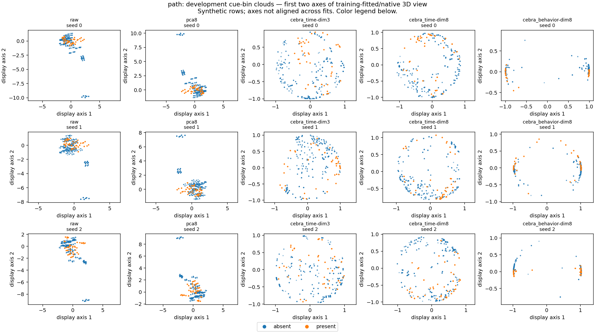
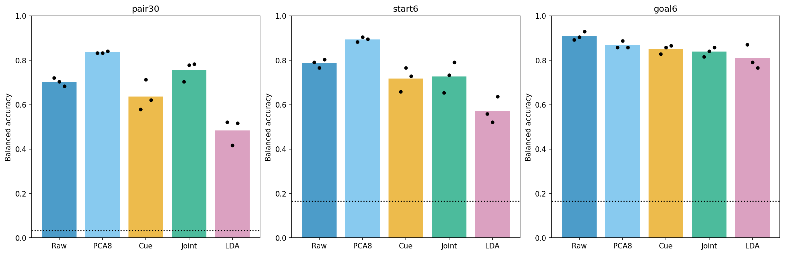
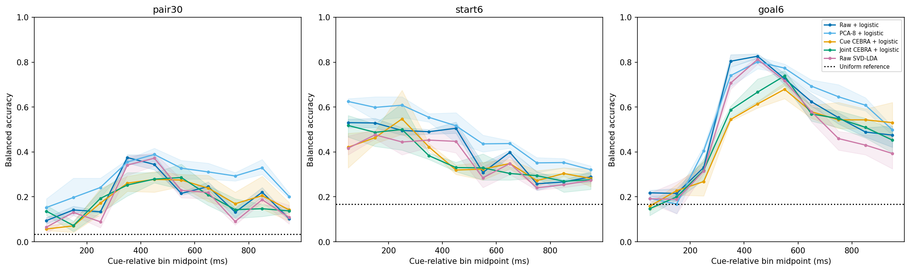

# Neuroscience: CEBRA, readouts and their limits

A report-led research workspace for hippocampal navigation recordings: **what can
we recover from cue activity, and what does a learned representation actually show?**
CEBRA is a central tool, not a required winner. The repository brings together
[fresh-input notebooks](notebooks/README.md), a preserved
[historical saved-model review](report/endpoint_walkthrough.ipynb),
[editable retrospective](report/README.md), accepted exploratory evidence and an
[installable Python package](src/neuro/README.md).

## Start here: fresh source-to-result computation

Three independently runnable notebooks cover [pseudopopulation construction](notebooks/01_pseudopopulation.ipynb),
[PCA/LDA](notebooks/02_pca_lda.ipynb) and [CEBRA](notebooks/03_cebra.ipynb).
They expose input/target and split construction, fresh fitting, matched refitted source
ablations and diagnostics; they do not load old research results. Current notebook
outputs are cleared. Notebook A passed fresh non-fitting execution; B/C were not rerun.
[Installation and execution](notebooks/README.md).

**Actual lab source is included in ordinary Git:** [compact unbinned cue-source v1](data/README.md#compact-unbinned-cue-source--october26-2026)
contains all195 selected units' spikes and all58 sessions' event/timing records plus
cleaned historical assignments (about54.7MB). No Release or LFS is used. Dense gaze and
behavior are deliberately omitted; originals remain local. The shared compact notebook
route reconstructs fresh native-precision bins without old private imports/results.
[Non-fitting validation and historical reconciliation](docs/compact-cue-source-20261026.md).

The separately authorized real run has a new27-unit/10-session contributor-disjoint
panel, not the historical195-unit cohort. Its [protocol](docs/shareable-notebooks-protocol-20261023.md)
and [execution ledger](docs/shareable-notebooks-execution-20261023.md) own status and limits.
No biological independence, pristine test set or matched historical score comparison
follows from this change. Historical notebooks/results remain intact.

## A look at the completed historical work

These are existing **exploratory results**, not new analyses or independent biological
confirmation. The gallery deliberately keeps two different cohorts and targets separate.

### CEBRA geometry: a picture is not a decoding result



**September saved-model atlas · binary interior path component at fixed 4→3.**
29 selected units/seven session blocks; 82 training and 22 historically exposed
development real sources, assembled into 128/128 label-conditioned pseudorows per
seed. Points are 100-ms cue bins, not independent trials. The first two axes of a
training-fitted/native 3D view are shown for all three computational seeds; axes
are not aligned across fits. This is a descriptive projection, with no decoder or
uncertainty interval in the image. The reported historical whole-cue Time-8/Behavior-8
readouts had mean balanced accuracy 44.27%/41.41%, below the 50% reference: visible
structure did not establish path coding, manifold topology or neural dynamics.
[Atlas results and original readout metrics](docs/reports/cebra-latent-atlas-results-20260924.md)
· [Exact image origin and hashes](docs/assets/showcase/README.md).

### Endpoint readouts: compare CEBRA with simple references



**October endpoint study · pair30, start6 and goal6, not path beyond endpoints.**
195 units/58 sessions; 12,288 inner-training and 3,265 exposed-development real
sources, all within original outer train. Each seed assembles 480/240 pair-balanced,
known-label-conditioned train/development pseudorows. Readouts use concatenated
0–1 s cue activity: train-only scaling/PCA and logistic `C=0.01`, plus raw SVD-LDA;
CEBRA-Time cue-only/joint cue-navigation encoders have 1,000 updates. Bars show
mean balanced accuracy (mean class recall), dots the three computational seeds,
dotted lines uniform references—not biological confidence intervals. Joint training
helps some endpoint scores but is not uniformly better than raw/PCA; the whole-cue
arm-gain null family does not establish robust joint superiority.
[Accepted October7 report, all metrics and controls](docs/reports/cebra-endpoint-time-readout-20261006/README.md)
· [Figure provenance](docs/assets/showcase/README.md).

### Cue-time decoding is not temporal generalization



**Same October endpoint cohort, split, encoders and readout families as above.**
Each 100-ms window has a separately fitted readout; the horizontal axis is bin
midpoint in milliseconds from cue onset. Lines are three-seed mean balanced accuracy,
shading min–max computational variation, not confidence intervals. Inspected peaks
are not validated windows. This is **same-window decoding**, not a frozen-decoder
train-time × test-time transfer matrix, navigation decoding or same-trial dynamics.
Source: the accepted `run-reviewed-20261007` report; see
[complete curves, confusions, nulls and limitations](docs/reports/cebra-endpoint-time-readout-20261006/README.md#full-visual-evidence).

**Claim ceiling:** source-disjoint pseudopopulations support condition-level assays,
not simultaneous population states or unknown-label natural-trial prediction.
Endpoint recovery, binary path-component prediction and full ordered-route prediction
are different tasks. Ordered routes were not evaluated; H1 remains unresolved and
H2/artificial-agent comparison is removed. No new fit is queued.

## Choose a reading path

| Reader / goal | Start here | Then |
| --- | --- | --- |
| Scientist/programmer: compute from fresh inputs | [Three fresh-input notebooks](notebooks/README.md) — invented default; explicit compact source route; current outputs cleared | [Public APIs](src/neuro/README.md#independent-public-workflow); [real-run ledger](docs/shareable-notebooks-execution-20261023.md) |
| Professor/reviewer: inspect the historical fitted computation | [Executed endpoint notebook](report/endpoint_walkthrough.ipynb) — equations, intermediate shapes, diagrams, six encoders and495 readouts replayed without fitting | [Execution boundaries](report/README.md#saved-artifact-notebook-execution-and-boundaries); public aggregates, private inputs required only to rerun |
| Scientist: understand the evidence and claims | [Current report](report/README.md) — working draft, not a finished paper | [Evidence catalog](docs/reports/README.md), [analysis contract](docs/analysis-contract.md) |
| Scientist: follow how the question evolved | [Weekly research history](history/README.md) | Original study protocols/results; old next steps are not a run queue |
| Programmer: use or change the maintained package | [Package reference and safe examples](src/neuro/README.md) | [As-built software design](docs/software-design.md), [script map](scripts/README.md) |
| Returning contributor: recover current state | [Workspace and recovery](docs/workspace.md) | [Agent instructions](./AGENTS.md), [documentation map](docs/README.md) |
| Discuss the next research question | [Reusable latent-model agenda](docs/cebra-observability-agenda-20261011.md) | Narrow hypotheses and admissible data first; this is a proposal, not execution approval |

**Which architecture document?** [Software design](docs/software-design.md) is the
maintained engineering reference: module dependencies, scientific objects, lifecycle
diagrams and current gaps. [Package README](src/neuro/README.md) is the usage/reference
guide. The preserved [HTML design overview](docs/codebase-design.html) is an earlier
visual preview that may lag current source; download/open locally rather than expecting
GitHub to render it. [Reorganization](docs/reorganization.md) records migration status,
not a second API or a target architecture already implemented.

## What lives in the package?

`src/neuro/` supports the **latest maintained experiment family end to end**:
input validation and assembly, training/readout logic, scientific controls, provenance
and verification. Reusable helpers are part of that scope, not its entirety.

| Layer | Modules | Responsibility |
| --- | --- | --- |
| Independent supplied-input APIs | `source_data`, `pseudopopulation`, `pca_lda`, `cebra`, `evaluation` | Validated source contracts, assembly, train-only transformations/fitting and metrics; no study/Git/private-root dependency |
| Observable notebook support | `place195`, `notebook_inputs`, `notebook_support`, `notebook_artifacts` | Explicit dataset semantics, fresh input routes, small readout/plot operations, provenance and authenticated replay |
| Whole experiment workflows | `neuro.studies.full_trial_transfer` | Fixed-endpoint binary path-component assay: cue-only versus broader encoder training, baselines, nulls and source sensitivity |
| Whole experiment workflows | `neuro.studies.endpoint_time_readout` | Ordered pair/start/goal cue readouts, navigation preparation, approval/resource gates and saved-run replay |
| Whole experiment workflows | `neuro.studies.cue_time_readout` | Frozen full-trial features, single-bin decoder fits, whole-cue replay and descriptive saved-checkpoint geometry; no encoder training |
| Reusable scientific helpers | `raw_io`, `neural_inputs`, `cebra_solver`, `geometry` | Ripple/spike IO, count/exposure bins, fixed solver construction and geometry diagnostics actually needed by those workflows |
| Shared safeguards/bookkeeping | `place195_split_access`, `execution`, `provenance` | Source-split access gate, hashing/deadlines/nested snapshots and audited current source closure |

**Legacy study coupling remains.** The new public APIs do not import studies; shared
CEBRA datasets/samplers now live in `_cebra_sampling`. Endpoint still imports full-trial
training/embedding machinery; cue-time imports its cohort, assembly, decoder-state
and comparison machinery. `full_trial_transfer` is both a concrete
experiment and a provider of shared objects. These are not three independent helper
modules. Binary labels, endpoint labels and their lineage objects remain distinct;
similar shapes do not make them interchangeable. No architecture migration is implied
by documenting this coupling, and there is **no universal runner** or common result schema.

## Try the package safely from a checkout

No installation is needed for this **stdlib-only helper example**. Run from the
repository root; it hashes this README, opens no lab artifacts and performs no fitting:

```sh
PYTHONPATH="$PWD/src" PYTHONDONTWRITEBYTECODE=1 /usr/bin/python3 -B - <<'PY'
from pathlib import Path
from neuro.execution import sha256_file

digest = sha256_file(Path("README.md"))
assert len(digest) == 64
print(digest)
PY
```

To discover a workflow's CLI, use an **already provisioned scientific environment**.
On this checkout the retained runtime is used below; do not install/recreate it merely
to read the docs. `--help` lists commands, it does not run a study:

```sh
PY=scratch/v6-v9-runtime/bin/python
PYTHONPATH="$PWD/src" PYTHONDONTWRITEBYTECODE=1 PYTHONNOUSERSITE=1 \
  "$PY" -B -m neuro.studies.endpoint_time_readout --help
```

Full-trial and cue-time use the same `python -m neuro.studies.<module> --help` form;
see [the package guide](src/neuro/README.md#inspect-workflow-commands) for all three.
Study imports need CEBRA/torch/NumPy/sklearn and other existing dependencies. Help may
probe CUDA availability; it is not a GPU/runtime certification. Helpers can be imported
directly without importing a study. From another directory, use the absolute checkout
`src` path for `PYTHONPATH`.

The new supplied-input APIs are **installable and wheel-tested outside the checkout**,
with optional `cebra` and `notebooks` extras; they are an initial API, not a backwards-
compatibility promise. Concrete historical studies remain checkout/private-input workflows.
`pyproject.toml`/`uv.lock` and the historical replay runtime have different roles; do not
infer that one reproduces the other. Historical study defaults still name private roots. **These examples do not authorize raw access, fitting,
checkpoint loading, private replay or downloads.** Even `audit`, `verify`, `geometry`
and `report` can access protected artifacts or write files; “no fit” is not “data-free.”

## Principles and repository boundaries

- **Support current experiments, not every historical caller.** Keep required scientific
  validation/controls; keep obsolete experiment bodies and historical-only compatibility
  outside the package. October15's reviewed cleanup extracted 21 unchanged definitions
  into the four purpose-specific helper modules and removed `legacy_adapters`.
- **Split independent sources before learned preprocessing or assembly.** Keep derivatives
  of a real source together; fit transforms/readouts on train only. Seeds, bins and reused
  pseudorows are not biological replication. State target, baseline, null and claim limits.
- **Separate results, proposals and execution authority.** Frozen historical approvals and
  hashes do not approve relocated/current source. Use the owning executed snapshot/runtime
  for separately authorized historical replay; do not rewrite old hashes to make it pass.
- **Reuse by scientific meaning, not by visual similarity.** Preserve distinct labels,
  cohorts and lineage; keep launch aliases thin. No speculative framework or notebook API.
- **Separate current notebooks from historical evidence.** The fresh-input notebooks
  expose source construction and computation; the historical endpoint notebook replays
  accepted fitted artifacts. Neither authorizes another biological fit.

```text
report/                 current manuscript, feedback and presentation-only tools
history/week-.../       chronological overviews and preserved historical reading files
src/neuro/              whole maintained workflows + required reusable helpers
scripts/                thin current launch aliases + historical experiment bodies
docs/                   maintained methods, evidence catalog, engineering and recovery
```

Package checkpoint `8c98b52` and engineering documentation at `ce31248` are published in
[PR20](https://github.com/Hong-yiii/neuro_science/pull/20), extended by the reviewed
helper cleanup and README showcase. The owner authorized publication and merge to
conclude this session; the linked PR records the authoritative merge status.
Other evidence migrations remain open. The frozen report retains a **known pre-existing
checksum mismatch**, not silently repaired; see [report integrity status](report/README.md#frozen-whole-file-reading-milestone--october-12).

Private `data/`, `outputs/`, `scratch/`, `work/`, local PDFs, sessions and retained
worktrees are protected; Git cannot recover ignored inputs/models. `Hippocampus.jl/`
and `PyHipp/` are external code submodules, not package dependencies to migrate here.
Use [workspace/recovery](docs/workspace.md) for operations rather than historical logs.
