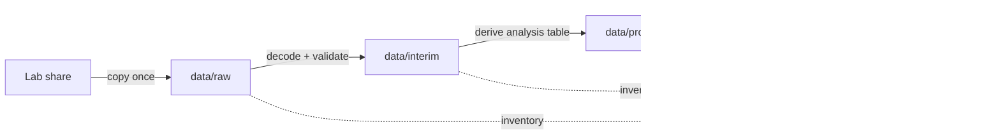
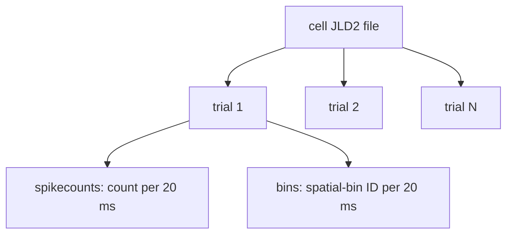

# Local Data Workspace

This directory is the single local home for research data used by this workspace.
The **directory rules are version-controlled; data is ignored by default**. Lab data
can contain sensitive information and is usually too large for Git. The explicit
owner-approved public-copy exception below does not expose other local data.

## Compact unbinned cue source — October26, 2026

Hongyi confirmed lab permission and chose **ordinary Git only** for a compact source
view without incidental metadata. [cue-source-v1/](cue-source-v1/) is part of the
checkout: no download service, GitHub Release or Git LFS. No Release was ever created
or uploaded. The earlier full sanitized archive remains local, not a deliverable.
No new data/software license is assigned; public access does not invent reuse rights.

The compact payload is **54,684,694 bytes** plus its709-byte notebook configuration
(**54,685,403 bytes total**, about52.2MiB); largest blob `spikes.npz` is about21MiB, below100MiB. It contains:

| File | Meaning |
| --- | --- |
| `spikes.npz` | All5,576,459 timestamps for195 selected units, native dtype/shape/order/full precision; unsorted or repeated timestamps are not changed. Also native reference/components. No cue clipping or split filtering. |
| `2018????_session01.npz` (58) | Ripple trial matrices, raw Args/Data markers/timestamps, trialIndices/sample rate/session-clock metadata where present; Eye trial codes/times, timeouts, missingness and clock metadata; every Unity marker/delta row as exact ASCII tokens. |
| `outer_splits.csv.gz`, `inner_splits.csv.gz` | Cleaned frozen IDs, predecessor/group assignments, labels and policy provenance from the two authenticated historical tables. No fitted results or private paths. |
| `manifest.json`, `manifest.sha256` | Schema, clocks, selection order/IDs, original370-input hashes, processing commit (including `-dirty` where supplied), compact file hashes/sizes and explicit omissions. |
| `notebook-config.json` | Explicit opt-in compact route; biological execution disabled by default. |

**Intentionally omitted:** dense Unity position/heading, continuous gaze/analog/full
sample timestamps, fixations/saccades, machine paths, object-reference scaffolding,
MAT headers, embedded source patches, ancillary notes/spreadsheets/logs, all fitted
models/predictions/private executed figures. Full native sources remain unchanged locally.
This is not an archival replacement for the full recordings or their MATLAB objects.

### Timing, records and historical exposure

Spikes remain native milliseconds; conversion to seconds occurs only for consumption.
Ripple timestamps are native seconds; outer and optional raw-stream sample rates and
session origin remain available. Per-array `attributes` retain MATLAB class, empty
encoding and integer-decoding metadata where present. In five Eye `timeouts` arrays,
`MATLAB_empty=1` means the backing `[0,0]` describes an empty shape, not two timeouts;
backing dtype/shape/bytes remain untouched.
Eye timestamps are milliseconds per the Julia reader; raw `missing_idx` is one-based
trial/event indexing (stored HDF5 as2×N). A separate observation mask distinguishes
missing placeholders from genuine observed zeros. The historical importer's Eye-unit
heuristic is disclosed only for policy reconciliation, not used to overwrite native data.
All7,761,853 Unity marker/delta rows contribute to cumulative seconds, including startup,
zero-marker and orphan rows; ordered task headers are retained. No dense x/y/heading
is needed to reproduce parsed navigation-row-bound QC. Event matrices explicitly use
event axis0 in HDF5, including singleton/3×3 cases; no `squeeze` inference.

The ordinal Ripple/Unity/Eye trial join and previous/current marker-digit start/goal
semantics remain provisional assumptions, not verified behavioral truth. All23,901
records (23,200success/701timeout) remain available, including mismatches and failed
records. Metadata availability does not make every record analysis-eligible.
Consumption preserves original outer train and frozen exposed development assignments,
the global predecessor-contributor embargo and complete pair support:27units/10blocks,
1,415train/551development sources. Native missing Eye events affect no selected
contributors; full-source missingness remains explicit. No fresh all-trials split.

Binning uses native-precision absolute Ripple-clock half-open edges, ten100ms bins,
without the historical helper's epsilon. Timestamps are not rounded to force equality
with nine-significant-digit historical CSVs. This reconstructs fresh inputs, **not old
scores/models/results**. Source trials are provenance units; balanced synthetic rows
resample with replacement and are not new measurements or independent replications.

### Authenticate, inspect and reproduce the export

```sh
(cd data/cue-source-v1 && sha256sum -c manifest.sha256)
PYTHONPATH=src python - <<'PY'
import json
from pathlib import Path
from neuro.notebook_inputs import inspect_inputs
p = Path('data/cue-source-v1/notebook-config.json').resolve()
c = json.loads(p.read_text()); c['manifest_directory'] = str(p.parent)
print(inspect_inputs(c).audit)  # metadata only; no model fitting
PY
```

The reader pins the manifest hash from the configuration, retains an immutable
inspection-time configuration fingerprint, and verifies every compact file again
before reconstruction. It rejects duplicate IDs/NPZ members, path traversal,
symlinks, wrong hashes/schema and oversized or malformed NPY headers/payloads before
array allocation. Selected units' complete timestamp vectors are scanned to choose
cue windows; this is not a promise of held-out timestamp non-reading. Arrays use
`allow_pickle=False`. Keep the reviewed manifest hash separately when accepting an
untrusted copy; a checksum stored alongside mutable bytes is not a signature.

The thin exporter `scripts/export_cue_source.py` takes explicit `--root`, `--inventory`,
`--outer`, `--inner`, `--output` and `--revision`; there are no private path defaults.
Use a new output directory. It authenticates all370 allowlisted native files before
and after, requires the two exact frozen-assignment hashes, preserves numeric arrays,
compares written arrays, and writes deterministic NPZ/gzip bytes. It reads no models.
Export source is `neuro.cue_source_export`; reconstruction is `neuro.cue_source`.
See the [dated execution/reconciliation ledger](../docs/compact-cue-source-20261026.md)
for actual commands, sizes, tests and limits. No originals, runtime or old results are
required by compact-mode notebooks after cloning. B/C fitting remains a separate
explicitly reviewed execution, not a consequence of including source data.

Dates, session/array/channel/cell IDs, native task headers and scientific metadata
are intentionally public. Removed paths/patches do **not** guarantee anonymity.
All other local data and private execution artifacts remain outside this exception.

`Hippocampus.jl/data/` belongs to the upstream Julia package. Do not place our
working datasets there: changing it mixes lab data with a submodule that has its
own Git history. Our copies belong here, under the repository-level `data/`.

## Directory layout

```text
data/
├── README.md          # tracked policy (this file)
├── raw/               # immutable copies received from the lab
│   └── lab_exports/
├── interim/           # reversible intermediate conversions
├── processed/         # analysis-ready tables produced by scripts
└── manifests/         # local inventories: provenance, sizes, checksums
```

| Stage | Meaning | May scripts overwrite it? | Example |
| --- | --- | ---: | --- |
| `raw` | Bytes as received from the lab | **No** | `.jld2`, cell lists |
| `interim` | Decoded or reshaped data that is not analysis-ready | Yes | flattened trial records |
| `processed` | Stable inputs consumed by analyses | Yes, reproducibly | rate-map table |
| `outputs` | Figures, statistics, reports—not input data | Yes | place-field plot |

The distinction is like an ML pipeline: `raw` is the downloaded dataset,
`interim` is tokenized/cache data, `processed` is the model-ready tensor, and
`outputs` contains evaluation artifacts.



## One entry point

Use `scripts/data.py` for local data operations:

```sh
# Create the Python environment and standard data directories
uv sync
uv run python scripts/data.py init

# Record what exists, including SHA-256 checksums
uv run python scripts/data.py manifest

# Inspect one professor-provided spatial-bin JLD2 file
uv run python scripts/data.py inspect \
  data/raw/lab_exports/place_spatial_bins_f1526be5/examples/CELL/file.jld2

# Create a four-panel overview under ignored outputs/
uv run python scripts/data.py visualize \
  data/raw/lab_exports/place_spatial_bins_f1526be5/examples/CELL/file.jld2
```

The manifest is a **local receipt**, not a backup. A checksum proves that two
files contain identical bytes; it does not explain the scientific meaning of
the file. Scientific schema and interpretation belong in `notes/data_inspection/`
or `context/`.

## Rules for a neuroscience beginner

1. **Never edit `raw/`.** If a correction is necessary, keep the original and
   generate a corrected file under `interim/`.
2. **Record provenance.** Note who supplied the dataset, when, its original lab
   path, and any message describing preprocessing.
3. **Separate measured from derived values.** A spike count is derived from
   detected and sorted electrical events; a firing-rate map is derived again by
   dividing counts by occupancy. Neither is a direct image of a memory or idea.
4. **Keep trial and time alignment.** Neural activity only becomes interpretable
   relative to behavior when timestamps and trial boundaries match.
5. **Do not treat a curated list as an unbiased sample.** The current list is
   explicitly place-selective; it cannot estimate how common place cells are in
   the full recorded population.
6. **Do not commit data or manifests by default.** They may expose participant,
   session, workstation, or lab path information even when the neural arrays are
   not personally identifying.

## Current biological export

The current files contain one cell per file and ragged trials:



Aligned entries `spikecounts[t][k]` and `bins[t][k]` mean: during trial `t`, in
time window `k`, the sorted cell produced that many detected spikes while the
subject occupied that spatial bin. See
`notes/data_inspection/place_spatial_bins_f1526be5.md` for verified details.

## Native lab-server snapshots

Two related 2026-08-30 native-data receipts are documented:

- `data/raw/lab_server/cortex_picasso_misc_20260830/` — earlier bounded
  `20181105/session01` six-unit dependency bundle described in
  `notes/data_inspection/lab_server_20181105_session01.md`. That exact directory
  is not present in the current checkout.
- `data/raw/lab_server/cortex_picasso_misc_place195_20260830/` — current local
  all-session place-selected snapshot used for the first importer/QC run. It
  contains 58 `session01` directories, 195 selected `spiketrain.mat` files, one
  Ripple `rplparallel.mat`, one Eyelink `eyelink.mat`, and one native Unity
  `RawData_T1-400/session_*.txt` file per session. It contains no
  `unity_raytrace.jld2` files.

The all-session importer/QC entry point is:

```sh
uv run python scripts/import_place195_sessions.py \
  --output-dir outputs/prospective_path_first_run/<new-run-dir>
```

It writes ignored outputs only: source-file hashes, session/unit/trial QC, native
Unity path samples, cue spike events, cue counts, a summary, and logged
decisions. It is a **data-feasibility audit**, not H1 evidence.

Next-step split and behavior-QC commands are:

```sh
uv run python -m scripts.place195_split_and_behavior_audit freeze-splits \
  --import-dir outputs/prospective_path_first_run/place195-all-sessions-20260830-v4 \
  --output-dir outputs/prospective_path_first_run/<new-split-run>

uv run python -m scripts.place195_split_and_behavior_audit behavior-audit \
  --import-dir outputs/prospective_path_first_run/place195-all-sessions-20260830-v4 \
  --split-dir outputs/prospective_path_first_run/<split-run> \
  --output-dir outputs/prospective_path_first_run/<new-behavior-audit-run>
```

The current split hash is recorded in
`notes/data_inspection/place195_split_behavior_audit_20260830.md`.

Do not treat the 195 selected cells as an unbiased sample or a verified
simultaneous population. Do not silently drop clock-discrepant trials such as
20181105 trial 178; retain them with explicit QC flags.
