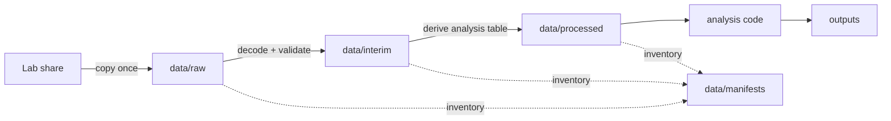
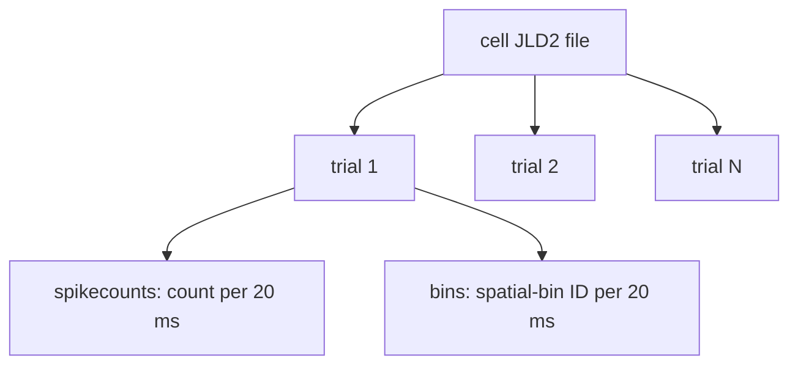

# Local Data Workspace

This directory is the single local home for research data used by this workspace.
The **directory rules are version-controlled; the data files are not**. Lab data
can contain sensitive information and is usually too large for Git.

`Hippocampus.jl/data/` belongs to the upstream Julia package. Do not place our
working datasets there: changing it mixes lab data with a submodule that has its
own Git history. Our copies belong here, under the repository-level `data/`.

## Directory layout

```text
data/
├── README.md          # tracked policy (this file)
├── raw/               # immutable copies received from the lab
│   └── lab_exports/
├── interim/           # reversible intermediate conversions
├── processed/         # analysis-ready tables produced by scripts
└── manifests/         # local inventories: provenance, sizes, checksums
```

| Stage | Meaning | May scripts overwrite it? | Example |
| --- | --- | ---: | --- |
| `raw` | Bytes as received from the lab | **No** | `.jld2`, cell lists |
| `interim` | Decoded or reshaped data that is not analysis-ready | Yes | flattened trial records |
| `processed` | Stable inputs consumed by analyses | Yes, reproducibly | rate-map table |
| `outputs` | Figures, statistics, reports—not input data | Yes | place-field plot |

The distinction is like an ML pipeline: `raw` is the downloaded dataset,
`interim` is tokenized/cache data, `processed` is the model-ready tensor, and
`outputs` contains evaluation artifacts.



## One entry point

Use `scripts/data.py` for local data operations:

```sh
# Create the Python environment and standard data directories
uv sync
uv run python scripts/data.py init

# Record what exists, including SHA-256 checksums
uv run python scripts/data.py manifest

# Inspect one professor-provided spatial-bin JLD2 file
uv run python scripts/data.py inspect \
  data/raw/lab_exports/place_spatial_bins_f1526be5/examples/CELL/file.jld2

# Create a four-panel overview under ignored outputs/
uv run python scripts/data.py visualize \
  data/raw/lab_exports/place_spatial_bins_f1526be5/examples/CELL/file.jld2
```

The manifest is a **local receipt**, not a backup. A checksum proves that two
files contain identical bytes; it does not explain the scientific meaning of
the file. Scientific schema and interpretation belong in `notes/data_inspection/`
or `context/`.

## Rules for a neuroscience beginner

1. **Never edit `raw/`.** If a correction is necessary, keep the original and
   generate a corrected file under `interim/`.
2. **Record provenance.** Note who supplied the dataset, when, its original lab
   path, and any message describing preprocessing.
3. **Separate measured from derived values.** A spike count is derived from
   detected and sorted electrical events; a firing-rate map is derived again by
   dividing counts by occupancy. Neither is a direct image of a memory or idea.
4. **Keep trial and time alignment.** Neural activity only becomes interpretable
   relative to behavior when timestamps and trial boundaries match.
5. **Do not treat a curated list as an unbiased sample.** The current list is
   explicitly place-selective; it cannot estimate how common place cells are in
   the full recorded population.
6. **Do not commit data or manifests by default.** They may expose participant,
   session, workstation, or lab path information even when the neural arrays are
   not personally identifying.

## Current biological export

The current files contain one cell per file and ragged trials:



Aligned entries `spikecounts[t][k]` and `bins[t][k]` mean: during trial `t`, in
time window `k`, the sorted cell produced that many detected spikes while the
subject occupied that spatial bin. See
`notes/data_inspection/place_spatial_bins_f1526be5.md` for verified details.
