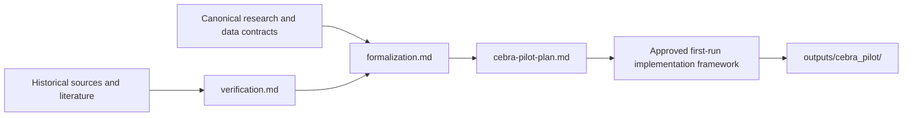
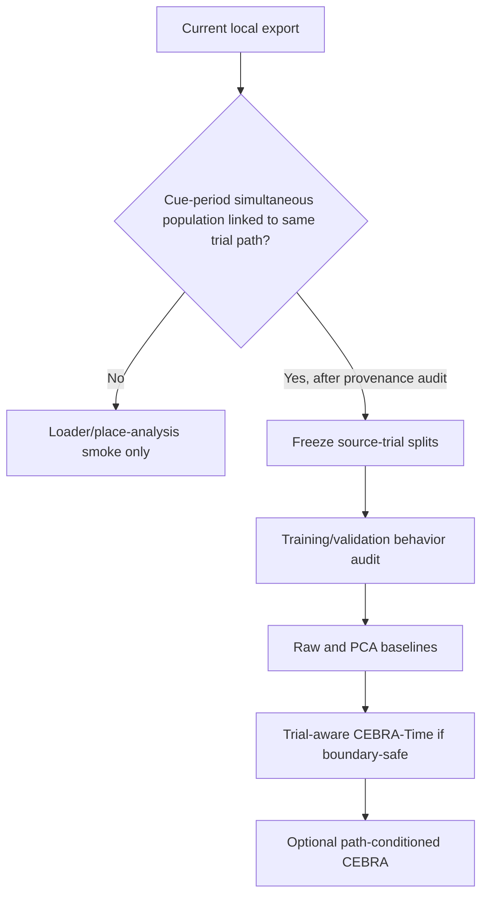

# First CEBRA Pilot

Status: **approved software framework and software-only preflights present**

Scientific status: **blocked on cue-aligned, trial-linked simultaneous population data**

This directory is the definitive home for artifacts unique to the first CEBRA
pilot. The approved first-run software framework now lives under
[`implementation/`](implementation/), while scientific analysis remains blocked.

## Read Order

1. [`AGENTS.md`](AGENTS.md) — local rules and authority order.
2. [`formalization.md`](formalization.md) — mathematical objects, estimands,
   nulls, and fixed/deferred decisions.
3. [`cebra-pilot-plan.md`](cebra-pilot-plan.md) — gated execution order.
4. [`verification.md`](verification.md) — independent findings, corrections,
   and unresolved blockers.
5. [`sources/`](sources/) — historical source material; noncanonical.

Canonical workspace documents remain:

- [`../research-questions.md`](../research-questions.md) for H1/H2;
- [`../analysis-contract.md`](../analysis-contract.md) for required data; and
- [`../dataset-card.md`](../dataset-card.md) for verified dataset facts.

## Artifact Flow



Sources can motivate or challenge the formalization. They do not directly issue
implementation instructions.

## Current Contents

| Path | Role | Authority |
| --- | --- | --- |
| `AGENTS.md` | Local agent and filing rules | Binding within this directory |
| `formalization.md` | Pilot-specific mathematical specification | Derived from canonical docs; normative for this pilot |
| `cebra-pilot-plan.md` | Execution phases and stop/go gates | Operational |
| `verification.md` | Independent review evidence and dispositions | Audit record |
| `implementation/` | Approved first-run software framework and docs | Software smoke only; no scientific analysis |
| `sources/cebra-graph-navigation-handoff.original.txt` | Byte-exact ChatGPT-session handoff | Historical, noncanonical |
| `sources/cebra-graph-navigation-handoff.md` | Formatting-normalized Markdown mirror | Historical, noncanonical |

First-run pilot code now lives in `implementation/`. Generated models, arrays,
figures, logs, and manifests remain outside this directory under ignored
`outputs/cebra_pilot/`.

## Filed Source Provenance

`docs/cebra_pilot/sources/cebra-graph-navigation-handoff.original.txt` is the
byte-for-byte copy of:

```text
/Users/hongyilin/Downloads/cebra_graph_navigation_handoff.md
```

Recorded SHA-256:

```text
a35fe6473a0abee25f34344123b3a9acfb9c1b7991e283e8fbc651e905f7862c  cebra-graph-navigation-handoff.original.txt
6e1c6cac3dce2e577270f3541fe8b2f70e92edbc736643fb79d37f24188e4171  cebra-graph-navigation-handoff.md
```

The Markdown mirror differs only by automatic whitespace/table formatting. The
source is dated 2026-08-24 and records a debate/proposal. Its graph-distance
ideas remain candidates. Its old “suggested first implementation” and
cross-sampler loss-comparison instructions are superseded by the gated pilot
plan and formalization.

## Current Stop/Go State



Current state: **No** at the data gate. The local `f1526be5` export is one
selected cell's navigation-period data and cannot test H1 or the shared-path
screen.

## Build Boundary

The approved framework pins CEBRA `0.6.1` in an isolated dependency group and
has run a synthetic fit/transform/save/load preflight. It does not process raw
cue data, fit a biological model, or interpret an embedding. See
`implementation/README.md`, `implementation/API_AND_MATH.md`, and
`implementation/REVIEW.md`.
