# 27-unit cue-only comparison — October23,2026

**Exploratory, historically exposed, label-conditioned pseudopopulation assay.**
Real fitting completed **October23**; this report was assembled **November2,2026**
from authenticated saved notebook outputs. It is not a new run, independent
confirmation, simultaneous-population experiment or trial-specific path/H1 test.

[Self-contained HTML](report.html) · [All seed-level metrics](tables/metrics_by_seed.csv)
· [Aggregate source accounting](tables/source_accounting.json) · [Provenance](provenance.json)
· [Frozen protocol](../../shareable-notebooks-protocol-20261023.md)
· [Execution and independent review](../../shareable-notebooks-execution-20261023.md)

Download `report.html` and open it locally for offline reading with all figures
embedded. Markdown and adjacent images are the Git-readable version. Linked CSV,
JSON and protocol documents remain separate files.

## Bottom line

- **Fresh construction, fitting and evaluation were completed.** The three notebooks
  reconstructed selected cue inputs independently, fitted 6 CEBRA encoders, 10 PCAs,
  78 logistic readouts and 12 LDAs, and recorded 180 fit-blocked saved-model/readout
  split checks. This report only extracts their saved aggregates and images.
- **No general CEBRA advantage.** With full source pools, mean pair30 balanced accuracy
  was 17.1% for CEBRA versus 16.9% raw and 13.3% PCA; the CEBRA/raw difference is only
  0.21 percentage points and varies by computational seed. For goal6, raw was 64.6%,
  PCA 59.6% and CEBRA 51.9%. These are endpoint assays, not path-beyond-endpoints evidence.
- **Training performance substantially exceeds development performance.** Raw logistic
  training BA is 100% for all three targets, while development BA is 16.9–64.6%.
  Strong training fit is not reliable out-of-source performance. These gaps alone
  do not isolate their causes or establish an independent generalization estimate.
- **Reduced source pools usually hurt these descriptive scores.** All 12 observed
  target/representation means have lower BA after reduction; the change ranges
  from −0.83 to −24.38 percentage points. This is one nested pool intervention at
  fixed synthetic-row count, not a biological sample-efficiency law.
- **The single permutation is a diagnostic, not a significance test.** Its scores
  are near the uniform references. No null distribution, p-value or robust
  superiority claim follows from one shuffle on historically exposed sources.

## What was measured and assembled?

The source measurements are cue-relative spike events/counts inherited from the
reviewed six-file import route. The run freshly binned accepted events into ten
100-ms half-open bins over **[0,1) seconds from cue onset**. This was not a new
read of acquisition files and did not use the later compact native-precision input
route introduced October26.

Endpoint labels are **derived/provisional**: previous/current successful trial
marker digits supply start/goal; unequal IDs 1–6 define 30 ordered pairs. A pair
label is not an observed navigation path. Marker semantics and within-session
simultaneity remain unverified.

| Quantity | This completed run |
| --- | ---: |
| Selected units / session blocks | 27 / 10 |
| Real current-trial sources, training / exposed development | 1,415 / 551 |
| Full eligible historical pool before embargo/selection | 195 units / 58 sessions; 12,288 train / 3,265 development |
| Training sources removed by global direct-contributor embargo | 4,427; 7,861 survive globally |
| Training/development direct-contributor intersection | 0 |
| Synthetic rows per ordered pair, train / development | 16 / 8 |
| Synthetic rows per assembly, train / development | 480 / 240 |
| Cue bins / bin width | 10 / 100 ms |
| Observed computational seeds | 0, 1; one exposed split, not two folds |
| Permutation world | seed50000; computational seed0 only |

The embargo uses the union of current and predecessor IDs of **all 3,265 original
exposed-development examples**, not merely the selected panel. A session survives
only if every pair retains at least two training and one development source; all
selected units in those sessions are retained. Selection used metadata/support,
not neural values or model scores. This changes the cohort and estimand.

Each synthetic row draws one intact units×all-bins block per session, matching a
**known pair label**, and concatenates ten blocks. It is not a simultaneous 27-unit
trial. Missing off-block measurements stay masked, not zero. Sampling is with
replacement: synthetic rows and adjacent bins are dependent derivatives of real
sources. Same-session membership and contributor separation do not establish
biological independence or unknown-label natural-trial prediction.

Accepted-event conservation was **27,598 binned + 518 omitted-tail = 28,116 events**.
Selected source×unit×bin shape was 1,966×27×10, with off-block masking; assembled
train/development shapes were 480×27×10 and 240×27×10. These are spike counts, not
firing rates. All selected sources cover the nominal first cue second.

### Source support, construction and reuse

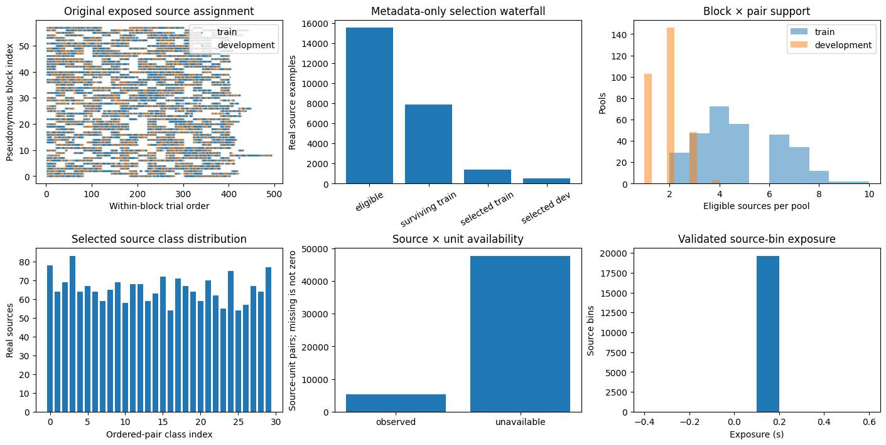
**Saved Notebook A, cell8.** Top-left: original 58-block exposed assignments, with
within-block trial order and pseudonymous block index. Top-middle: metadata-selection
counts; “eligible” includes train and development, so these bars are not a single
monotone train-only funnel. Top-right: selected block×pair training/development pool
sizes. Bottom-left: selected real source counts **combined across train and development**,
indexed by pair class (no published index-to-pair map). Bottom-middle: source×unit
availability; missing is not zero. Bottom-right: source-bin exposure in seconds.
No decoder or uncertainty interval; these are not 480/240 synthetic-row class counts.
The saved figure does not supply a split-specific class-count table or a support heatmap.

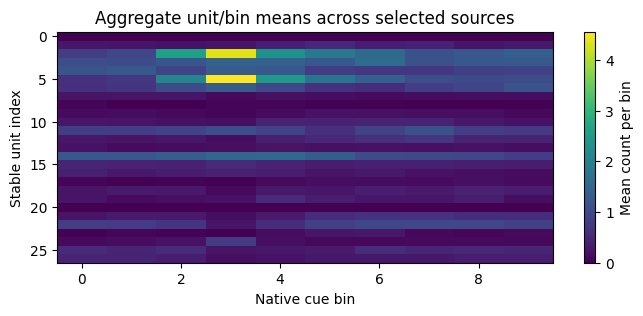
**Saved Notebook A, cell10.** Mean counts per unit/bin across the selected real
sources (training and development combined, unavailable entries excluded with
`nanmean`). This is **not an average of the 480 assembled training rows**. Unit
index and cue-bin index describe the derived 27-unit, ten-bin representation;
color is mean spike count per 100-ms bin. Not a real simultaneous trial, decoder
result or biological trajectory; no uncertainty interval.

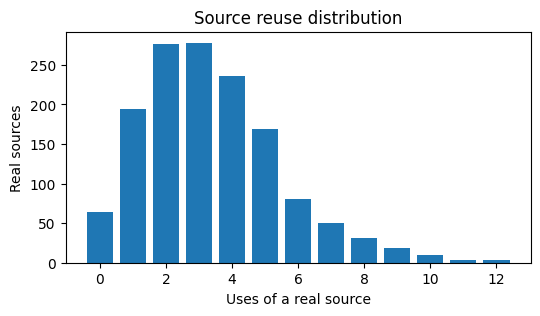
**Saved Notebook A, cell12; observed seed0/full.** Histogram of training-source reuse
in 480 synthetic rows × ten blocks = 4,800 block draws. Each source contributes its
whole recorded block, not independent unit draws. This is finite-pool accounting,
not biological sample size or an uncertainty estimate.

| Observed seed / pool | Eligible training sources | Used | Unused | Used more than once |
| --- | ---: | ---: | ---: | ---: |
| 0 / full | 1,415 | 1,351 | 64 | 1,157 |
| 1 / full | 1,415 | 1,344 | 71 | 1,154 |
| 0 / reduced | 638 | 638 | 0 | 632 |
| 1 / reduced | 638 | 637 | 1 | 628 |

“Used more than once” counts distinct reused sources, not excess draws. Reduced
pools are nested `floor(n/2)` selections per session×effective-pair with fixed
subset seed20261023: **638/1,415 = 45.1% retained**, not exactly 50%. Both budgets
still create 480 training rows and reuse the same fixed 240 development rows within
each world. Observed and permuted worlds have different label-conditioned assemblies.

## Models and evaluation

All learned scaling, PCA, CEBRA and readouts were fitted on training assemblies only.
Development assembly seed0 is fixed across observed seeds, budgets and models.
Every budget reassembles training inputs and refits each learned stage.

| Representation | Whole-cue features and readout |
| --- | --- |
| Raw | Training pooled-bin standardization; 27×10 = 270 features, unit-major flattening; separately scaled logistic per target |
| PCA | Training pooled-bin standardization and full-SVD PCA8 per bin; 8×10 = 80 features, time-major flattening; separately scaled logistic |
| CEBRA | Cue-only CEBRA-Time, offset1 model, hidden32, output8, temperature1, Adam lr0.0003, batch256, 1,000 updates; 80 whole-cue features; separately scaled logistic |
| LDA | Raw supervised SVD-LDA classifier with training-only readout scaling; not an unsupervised or dimension-matched embedding baseline |

Logistic uses `C=0.01`, `max_iter=2000`, `lbfgs`; observed convergence was 9–33
iterations. CEBRA sampling is row-uniform with adjacent native cue-bin positives;
reference/positive/negative exposure is shown below. Decoder targets are pair30,
start6 and goal6. All evaluation here concatenates the first cue second: **no
separate single-bin decoder grid was fitted**.

Balanced accuracy (BA) is mean class recall. Accuracy equals BA for these balanced
development assemblies. Macro-F1 is in [0,1]; log loss is mean negative log
probability (natural-log units), lower is better. Uniform references are 1/30
(3.33%) and 1/6 (16.67%) for BA, and log(30)=3.401 / log(6)=1.792 for loss—not
significance thresholds. No biological confidence intervals are estimated.

## Whole-cue development scores — full pools

Means across **two computational seeds**, with their min–max BA range, not biological
uncertainty. Raw/PCA are independently refitted in B and C; their saved scalar
summaries match exactly and are counted only once here. LDA comes from B; CEBRA from C.
The CSV preserves source-notebook attribution, each seed, both budgets/worlds,
training BA, development accuracy/BA/F1/loss and the BA gap. Brier scores and separate
training F1/loss were not printed in the saved aggregate stream and are not invented here.

| Target | Representation | Mean BA | Seed BA range | Macro-F1 | Log loss | Train BA |
| --- | --- | ---: | ---: | ---: | ---: | ---: |
| pair30 | Raw + logistic | 16.88% | 15.83–17.92% | 0.1459 | 2.8979 | 100.00% |
| pair30 | PCA-8 + logistic | 13.33% | 12.08–14.58% | 0.1246 | 2.9503 | 99.38% |
| pair30 | CEBRA-8 + logistic | 17.08% | 15.00–19.17% | 0.1483 | 2.7987 | 94.79% |
| pair30 | Raw SVD-LDA | 9.58% | 8.75–10.42% | 0.0682 | 30.4961 | 100.00% |
| start6 | Raw + logistic | 28.96% | 27.08–30.83% | 0.2959 | 1.6006 | 100.00% |
| start6 | PCA-8 + logistic | 25.00% | 22.50–27.50% | 0.2460 | 1.7044 | 91.04% |
| start6 | CEBRA-8 + logistic | 25.42% | 20.83–30.00% | 0.2512 | 1.7430 | 74.58% |
| start6 | Raw SVD-LDA | 22.29% | 21.25–23.33% | 0.2244 | 21.4840 | 100.00% |
| goal6 | Raw + logistic | 64.58% | 62.50–66.67% | 0.6380 | 1.0378 | 100.00% |
| goal6 | PCA-8 + logistic | 59.58% | 57.92–61.25% | 0.5889 | 1.0797 | 97.71% |
| goal6 | CEBRA-8 + logistic | 51.88% | 47.92–55.83% | 0.5168 | 1.0682 | 91.88% |
| goal6 | Raw SVD-LDA | 49.58% | 49.17–50.00% | 0.4858 | 12.1219 | 100.00% |

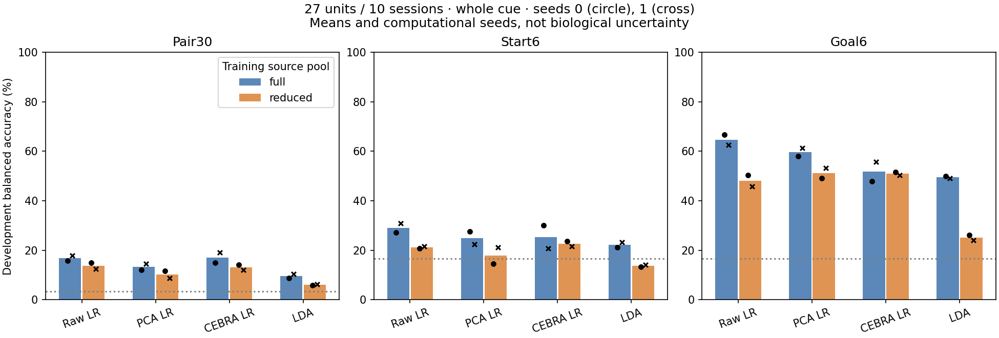
27-unit/10-session panel, 240 development pseudorows per fixed world assembly, first
0–1s cue concatenation, target-specific logistic/LDA as above. Bars are means;
circles=seed0, crosses=seed1. Blue/orange distinguish full/reduced training-source
pools, not different test sizes. Dotted lines are uniform BA references. Seed
variation is computational, not biological uncertainty. Source: saved B/C scalar
outputs, authenticated by `provenance.json`; no new fits or prediction replay.

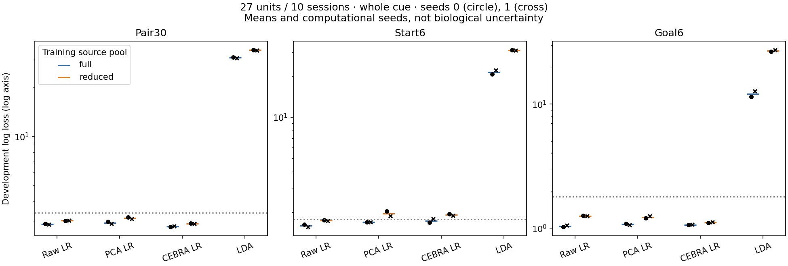
Same cohort, assemblies, whole-cue targets and readouts. Colored ticks=two-seed
means; circles/crosses=seeds0/1; dotted lines=uniform log loss. **Logarithmic y-axis**
keeps LDA's very large losses visible without hiding logistic differences. LDA's
large probability losses despite nonzero accuracy warrant calibration caution;
this report neither recalibrates predictions nor diagnoses the cause. Not biological
uncertainty. Source: saved B/C scalar outputs; no new evaluation or fitting.

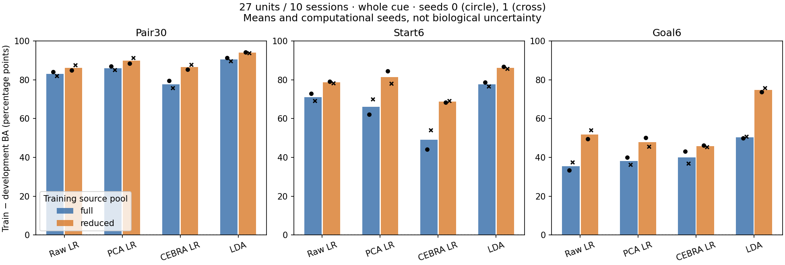
Same 27-unit whole-cue assay: 480 training/240 development synthetic rows, not
independent biological trials. Bars=mean train-minus-development BA in percentage
points; circles/crosses=computational seeds0/1; full/reduced pools shown separately.
No confidence intervals. Raw training BA is 100%; large gaps limit interpretation,
but do not identify a specific causal failure. Source: saved B/C scalar summaries.

## Full versus reduced training-source pools

Paired by computational seed and identical development assembly. Positive
`reduced − full` would favor reduction. Changes below are differences of two-seed
means; seed-specific values remain in the CSV. Neither synthetic row counts nor
the unit panel changed. This does not isolate the effects of recording fewer cells.

| Target | Representation | Full BA | Reduced BA | Reduced − full (pp) | Full loss | Reduced loss |
| --- | --- | ---: | ---: | ---: | ---: | ---: |
| pair30 | Raw + logistic | 16.88% | 13.75% | −3.13 | 2.8979 | 3.0441 |
| pair30 | PCA-8 + logistic | 13.33% | 10.21% | −3.13 | 2.9503 | 3.1595 |
| pair30 | CEBRA-8 + logistic | 17.08% | 13.13% | −3.96 | 2.7987 | 2.9186 |
| pair30 | Raw SVD-LDA | 9.58% | 6.04% | −3.54 | 30.4961 | 33.8660 |
| start6 | Raw + logistic | 28.96% | 21.25% | −7.71 | 1.6006 | 1.7496 |
| start6 | PCA-8 + logistic | 25.00% | 17.92% | −7.08 | 1.7044 | 1.9706 |
| start6 | CEBRA-8 + logistic | 25.42% | 22.71% | −2.71 | 1.7430 | 1.9242 |
| start6 | Raw SVD-LDA | 22.29% | 13.75% | −8.54 | 21.4840 | 31.0469 |
| goal6 | Raw + logistic | 64.58% | 48.13% | −16.46 | 1.0378 | 1.2588 |
| goal6 | PCA-8 + logistic | 59.58% | 51.25% | −8.33 | 1.0797 | 1.2307 |
| goal6 | CEBRA-8 + logistic | 51.88% | 51.04% | −0.83 | 1.0682 | 1.1111 |
| goal6 | Raw SVD-LDA | 49.58% | 25.21% | −24.38 | 12.1219 | 26.9576 |

Goal CEBRA's small mean reduction is not proof of robustness: seed variation,
one fixed development pool and a single nested subset choice limit the comparison.
No source-deletion sensitivity, new split or tuned sample-size curve was run.

## Label-permutation diagnostic

Joint pair labels were shuffled at source level within retained session×split
(seed50000), **before reassembly and refitting**. Start/goal derive from the shuffled
pair rather than separate inconsistent shuffles. Permuted reduced pools are nested
under those effective labels. Its development assembly is fixed **within that world**,
not identical to the observed assembly. Only computational seed0 was used here.

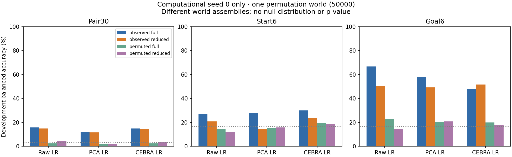
27-unit whole-cue assay, 480/240 label-conditioned rows per configuration. Bars are
single-seed BA, not means/error bars; dotted lines=uniform references. Raw/PCA/CEBRA
logistic readouts use the same settings as above; LDA was not run in this diagnostic.
Different worlds have different assembled inputs. Source: saved C scalar outputs.
One shuffle breaks alignment but is not an exchangeable biological null distribution,
confidence interval, family-wise test or p-value.

| Target | Representation | Permuted full BA | Permuted reduced BA | Full loss | Reduced loss |
| --- | --- | ---: | ---: | ---: | ---: |
| pair30 | Raw + logistic | 2.50% | 4.17% | 3.5295 | 3.4978 |
| pair30 | PCA-8 + logistic | 2.08% | 2.08% | 3.4769 | 3.5094 |
| pair30 | CEBRA-8 + logistic | 2.50% | 3.33% | 3.5370 | 3.6082 |
| start6 | Raw + logistic | 14.58% | 12.08% | 2.2048 | 2.0452 |
| start6 | PCA-8 + logistic | 15.42% | 15.83% | 2.0547 | 2.0635 |
| start6 | CEBRA-8 + logistic | 19.58% | 18.33% | 1.8819 | 2.1088 |
| goal6 | Raw + logistic | 22.50% | 14.58% | 1.9086 | 1.9846 |
| goal6 | PCA-8 + logistic | 20.42% | 20.83% | 1.9661 | 1.8736 |
| goal6 | CEBRA-8 + logistic | 20.00% | 17.92% | 1.9290 | 2.1825 |

## Saved CEBRA learning curves

All six fits completed 1,000 finite updates. Left panel: training InfoNCE loss
versus optimizer update (not development predictive loss). Right: realized
reference/positive/negative uses of native vectors, not biological effective sample
size. These are the **exact saved PNGs**, not curves recomputed from models. The
same cue-only 27-unit/ten-bin architecture and sampling settings apply throughout;
there are no confidence intervals or decoder scores in these figures. Lower
contrastive loss does not by itself establish useful endpoint information.

### Observed, seed0

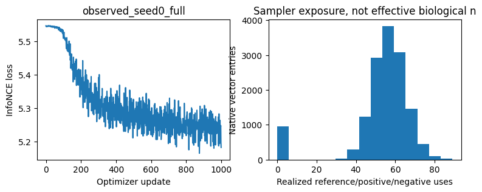
Full training pool; observed labels; 480 training pseudorows. Saved C cell8/output2.

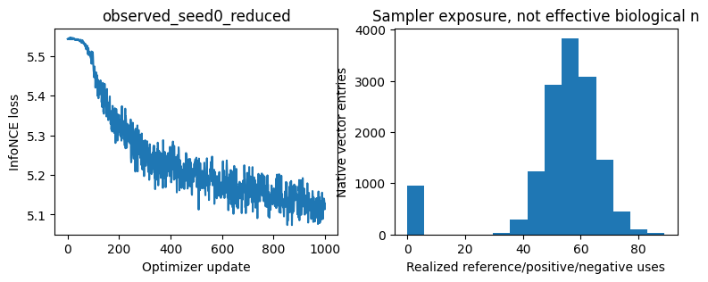
Reduced training pool; observed labels; 480 training pseudorows. Saved C cell8/output6.

### Observed, seed1

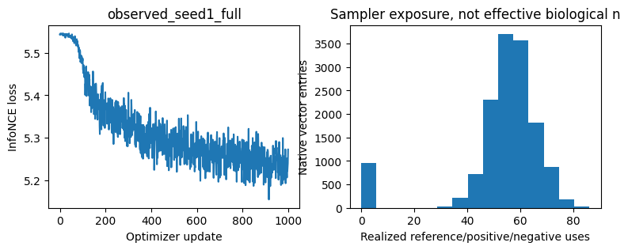
Full training pool; observed labels; 480 training pseudorows. Saved C cell8/output10.

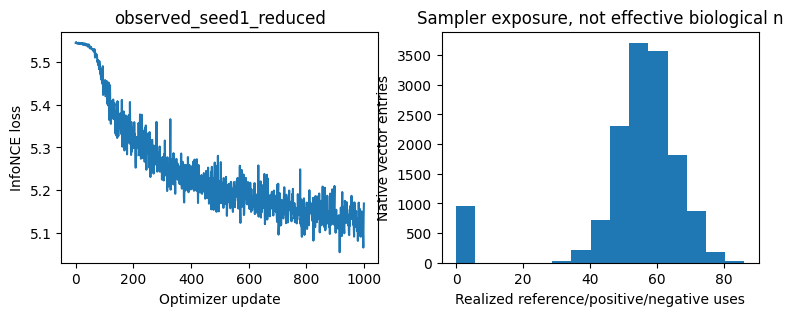
Reduced training pool; observed labels; 480 training pseudorows. Saved C cell8/output14.

### Permuted, seed0 — separate diagnostic world

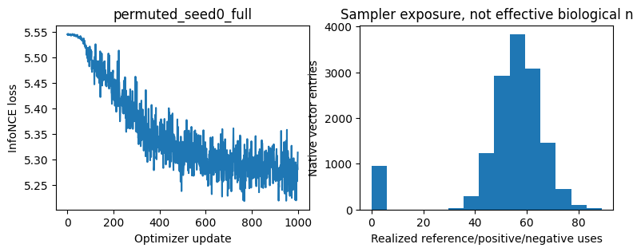
Full training pool; effective permuted labels; 480 training pseudorows. Saved C cell8/output18.

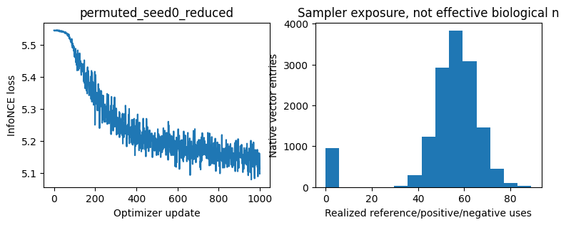
Reduced training pool; effective permuted labels; 480 training pseudorows. Saved C cell8/output22.

## Saved count and normalized confusions

Each grid has **nine readout rows** (three representations × pair/start/goal), with
**count matrices on the left and row-normalized recall on the right**. Rows of each
matrix=true effective class; columns=predicted class; ticks are class indices, not
a published index-to-endpoint map. Each grid uses 240 development pseudorows, giving
8 examples per pair or 40 per start/goal. Counts and recall are descriptive; no
biological uncertainty is estimated. All use concatenated0–1s cue inputs and the
same 27-unit/10-session panel. B includes raw/PCA logistic and raw LDA; C includes
raw/PCA/CEBRA logistic. No seed or world is pooled in a matrix.

These ten original PNGs preserve the accepted **overlapping confusion-title layout
limitation**. Matrices and axes remain intact; open an image separately to zoom.
The report did not load numeric prediction artifacts to redraw or relabel them.
Raw/PCA images recur across B/C as independent pipeline checks, not additional
independent experimental evidence. Exact notebook cell/output and image hashes
are in `provenance.json`.

Notebook B: raw/PCA logistic and LDA, both observed seeds and budgets

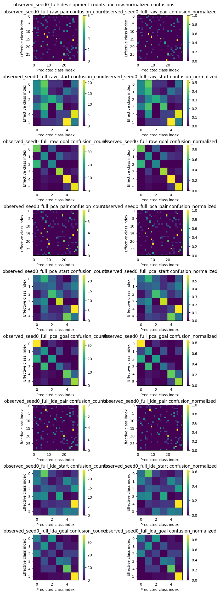
Observed seed0, full pools; saved B cell8/output2.

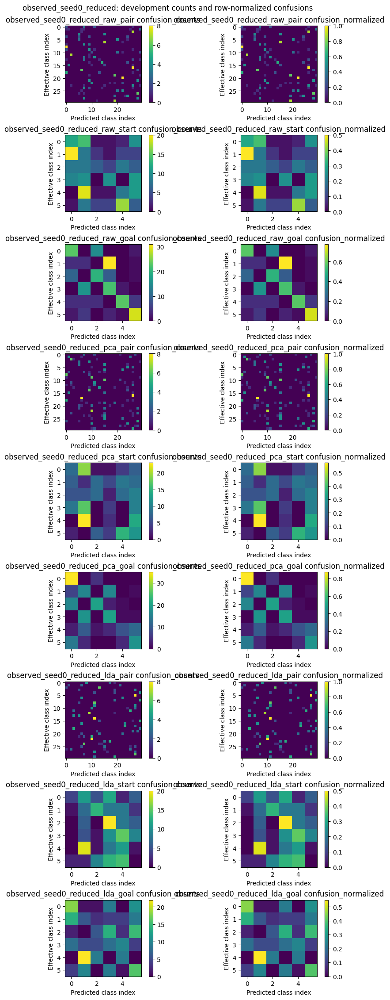
Observed seed0, reduced pools; saved B cell8/output5.

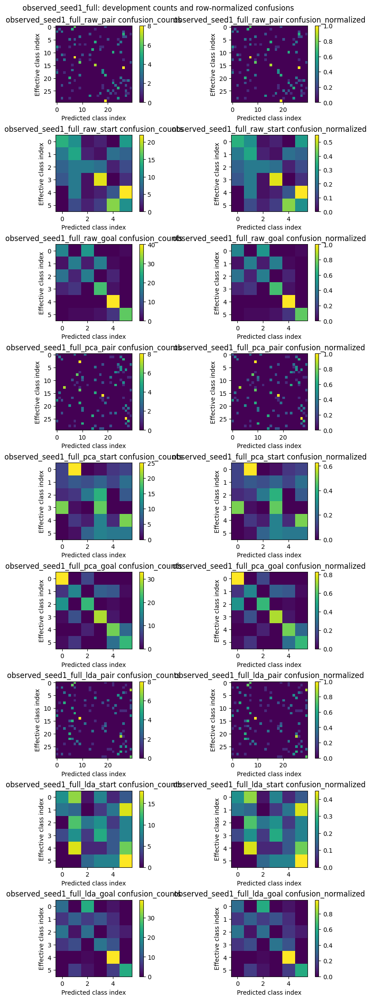
Observed seed1, full pools; saved B cell8/output8.

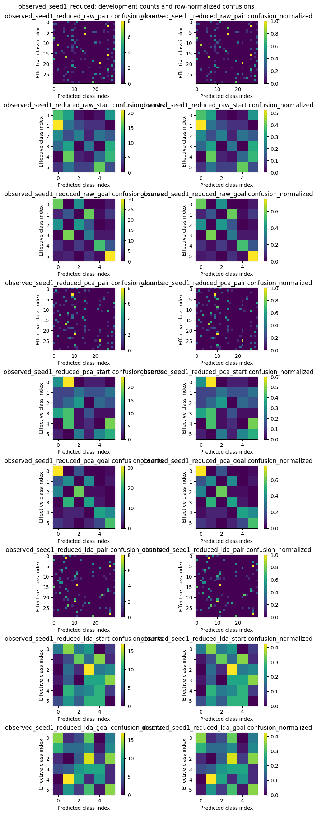
Observed seed1, reduced pools; saved B cell8/output11.

Notebook C: raw/PCA/CEBRA logistic, observed and permuted worlds

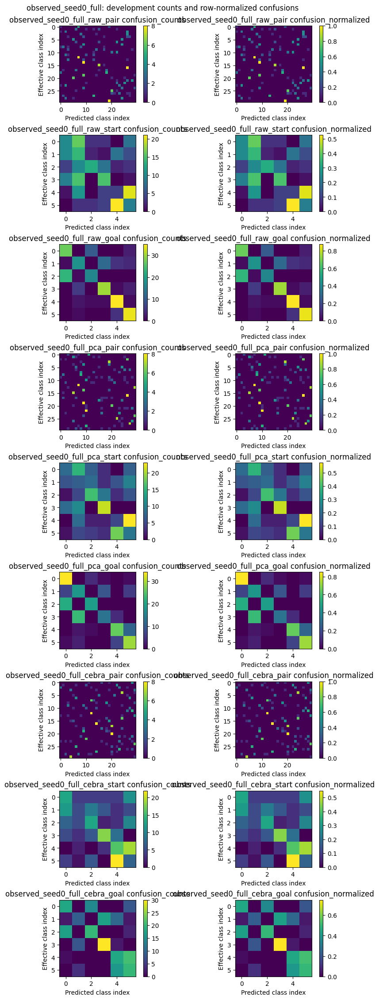
Observed seed0, full pools; saved C cell8/output3.

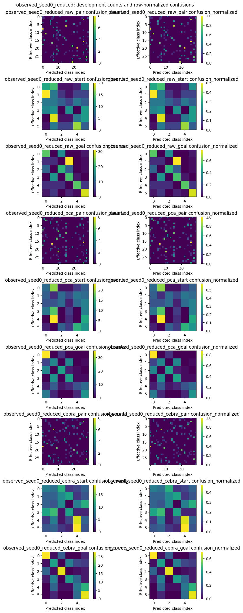
Observed seed0, reduced pools; saved C cell8/output7.

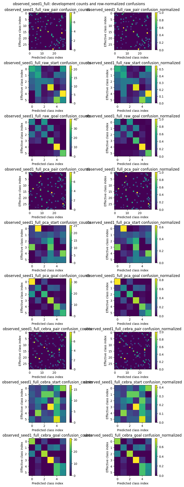
Observed seed1, full pools; saved C cell8/output11.

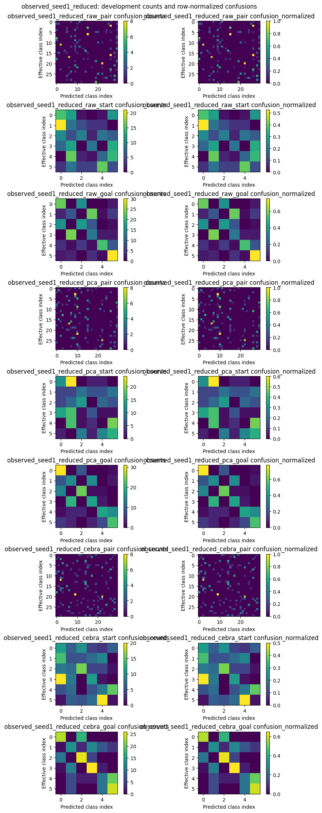
Observed seed1, reduced pools; saved C cell8/output15.

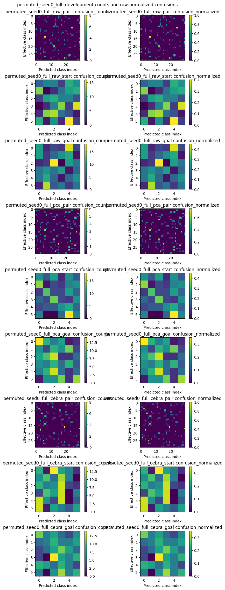
Permuted seed0, full pools; saved C cell8/output19. Different effective labels/assembly
from the observed world; not a matched per-row error comparison.

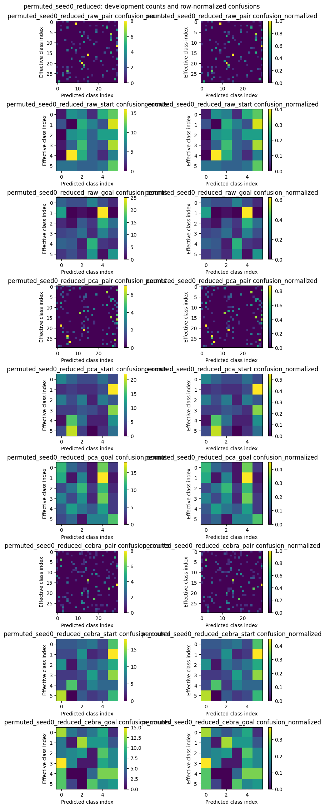
Permuted seed0, reduced pools; saved C cell8/output23. Diagnostic only, not a null distribution.

## Saved two-coordinate illustrations — not a new geometry analysis

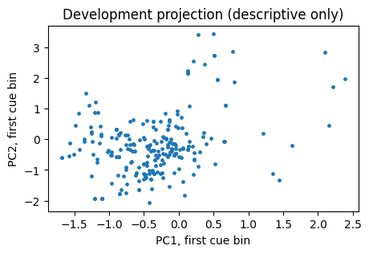
Saved B cell10/output1: **observed seed1/reduced**, PC1 versus PC2 of the first cue
bin for 240 development pseudorows. Training-fitted PCA8; no decoder, class colors
or uncertainty interval. This is not an all-seed geometry result or a 3D manifold.

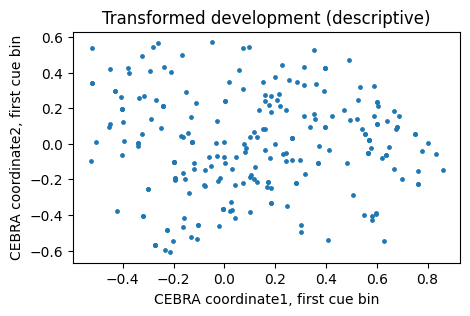
Saved C cell10/output0: **permuted seed0/reduced**, first two CEBRA coordinates of
the first cue bin for 240 development pseudorows. This is the final loop case,
**not an observed-label embedding**. No decoder, uncertainty interval or biological
trajectory interpretation. Coordinates are not aligned across independent fits.

## What differs from the 195-unit report?

The [October7 endpoint report](../cebra-endpoint-time-readout-20261006/README.md)
is a useful presentation template, **not a matched control experiment**.

| Dimension | Historical195-unit endpoint study | This27-unit notebook run |
| --- | --- | --- |
| Cohort | 195 units / 58 sessions | 27 units / 10 selected sessions after contributor embargo and support selection |
| Real sources, train/development | 12,288 / 3,265 | 1,415 / 551; inherited exposed assignments |
| Observed seeds | 0,1,2 | 0,1 |
| Encoder comparison | Cue-only vs joint cue/navigation | Cue-only; full/reduced source pools |
| Evaluation windows | Ten single bins plus whole cue | Whole cue only |
| Permutations | 20 diagnostic null worlds/families | One alignment-breaking diagnostic world |
| Source-deletion sensitivity | Included | Not run |
| 3D/temporal-transfer evidence | Not supplied by that endpoint decoder comparison | No new3D or frozen temporal-transfer analysis |

Do not subtract the two studies' scores and attribute the difference to neuron
count, embargo, joint training or software quality. Cohort, source support,
construction/selection and experiment grids differ. Both use exposed,
label-conditioned pseudopopulations; neither is pristine unknown-trial prediction.
The October26–27 teaching/compact-source revisions were **not biological B/C reruns**;
this report does not certify their current cells or compact-input numerical results.

## Verification, access boundary and remaining limits

**Historical execution:** task `b0497792d` finished October23 at19:50:49SGT, exit0,
115.275s including the wrapper (receipt's internal notebook duration110.870s).
6 CEBRA /10 PCA /78 logistic /12 LDA;6,000 optimizer updates, excluding scaler fits.
The actual cgroup peaked at1.09GiB under4GiB/no-swap/two-core limits, with no OOM;
all three transient units ended. No further fit or worker is queued by this report.
Independent reviewer `cf4ffdf8` accepted the run and repeated180 fit-blocked
readout/split replays; the original ledger records the exact scope and limitations.

**This report's verification is narrower:** it authenticates the saved receipt
and all three executed notebook JSON files, extracts36 B +54 C scalar summaries,
checks24 repeated raw/PCA summaries agree, and exports66 unique rows. It extracts
all21 saved PNGs byte-for-byte, creates four scalar-summary charts, and embeds all25
in HTML. No notebook execution, model/pickle loading, original data access, neural
reconstruction or new biological replay is performed. The original execution
artifacts are unchanged. Numeric confusion matrices and finer support tables are
not re-exported; their saved figures remain the visual evidence.

Biological interpretation remains bounded by inherited source selection and exposure,
serial/session dependence, provisional endpoint labels, and label-conditioned
assembly. Direct current/predecessor contributor separation does not remove all
confounds or prove simultaneous recording, mechanism, intention, formal observability,
path information beyond endpoints, or superiority on future recordings. Synthetic
row counts and computational seeds are not independent biological replications.

### Provenance and reproduction of this presentation

- Original local run: `outputs/fresh-notebooks-20261023/real/` (private).
- Accepted receipt SHA256: `bbc59a6899cb2c42b20a985baaaf7b55cec4f7d37c3e92f076d73c8325dafebe`.
- `provenance.json` binds notebook/renderer/output hashes and exact image cell indices.
- Renderer: `scripts/render_fresh_notebook_report.py`. It reads only the authenticated
  receipt and three executed notebook JSON files; imports no scientific pipeline.
- Existing host plotting runtime: `scratch/v6-v9-runtime/bin/python`. With the
  recorded artifacts available, run `scratch/v6-v9-runtime/bin/python scripts/render_fresh_notebook_report.py`.
- Data-free parser/grid check: `python scripts/render_fresh_notebook_report.py --self-test`.

The owner subsequently requested a PR to `main` for this report and its reviewed
aggregate presentation artifacts. That publication request does not authorize a
merge, deployment or new scientific run. Original private inputs/models/predictions,
historical results and unrelated working-tree changes remain outside this change.
