# When is path-component information readable from the cue?

**Completed exploratory frozen-model study · October5,2026.** [Offline illustrated report](report.html) · [Frozen protocol](protocol.md) · [Source construction](source-support.md) · [Execution/review](execution.md)

## Scope and how to read this

We tested all ten100-ms cue bins separately and compared them with the existing concatenated whole cue, using frozen cue-only/joint CEBRA-Time plus matched raw/PCA references. Logistic and RBF-SVM settings were fixed. **5,040 completed new single-bin readouts;504 saved whole-cue replays;zero encoder/PCA refits.** This includes20 source-coherent null worlds and three computational seeds. Every result was forward-replayed with fitting blocked.

This predicts a **binary interior path component within fixed4→3**, not goal or a complete ordered route. Goal never varies here. The previously observed400–500ms goal peak came from a different195-unit LDA experiment and did not define this study's window. Historical evaluation sources are exposed; this study diagnoses these frozen representations, not independent biological confirmation.

## Main finding and advice

**Whole-cue concatenation was not automatically better in this historical benchmark.** Joint CEBRA + logistic reached88.89% mean balanced accuracy at100–200ms versus61.81% for the whole cue; raw-neural logistic reached94.44% at200–300ms versus46.53% whole-cue. Those are descriptive peaks found while inspecting all bins—not validated windows. A more complex decoder is not necessary to produce a high historical score.

**The controls prevent treating those peaks as established prospective path coding.** Sixteen of20 source-label null worlds had an80-view maximum at least as large as the observed94.44%; the inclusive plus-one tail is17/21. The predeclared maximum joint-training logistic gain likewise was not exceptional (9/21). This does not prove that hippocampal path information is absent, but these exposed source pools do not validate a best bin. The next scientific priority is a source-support/fold and nuisance-control design, not a GRU or a larger tuning grid. No new-source study is automatically authorized by this result.

Separately, whole-cue effective dimension in the historical evaluation combinations changed from3.50→3.99 for cue-only and2.92→2.79 for joint across250→1000updates. Training values followed different trends (cue7.73→5.20; joint10.05→9.71). Those train/evaluation differences and source reuse rule out interpreting a lower number as a verified biological manifold dimension. No checkpoint was selected from this diagnostic.

### Whole cue versus descriptive single-bin peaks

The maxima below describe the complete curves; **they are not validated best windows or model selections**. Checking many bins makes isolated peaks optimistic. Consult the family-wide nulls and all-seed plots before interpretation.

|Representation|Readout|Whole BA|Highest observed mean bin BA|Window|Whole AUROC|
|---|---|---:|---:|---|---:|
|Raw neural|Logistic|46.53%|94.44%|200–300ms|0.549|
|Raw neural|RBF-SVM|30.56%|77.78%|200–300ms|0.000|
|PCA|Logistic|22.22%|66.67%|700–800ms|0.072|
|PCA|RBF-SVM|55.56%|77.08%|0–100ms|0.525|
|Cue-only CEBRA-Time|Logistic|32.64%|63.89%|0–100ms|0.146|
|Cue-only CEBRA-Time|RBF-SVM|40.28%|57.64%|400–500ms|0.002|
|Joint CEBRA-Time|Logistic|61.81%|88.89%|100–200ms|0.574|
|Joint CEBRA-Time|RBF-SVM|50.69%|81.94%|0–100ms|0.634|

### Controls constrain the claim

- Primary maximum paired joint-training logistic gain across10bins: **0.294929nats**; matched no-association tail **0.428571**.
- Maximum absolute BA across80bin/representation/readout views: **94.44%**; family tail **0.809524**.
- Maximum constant-baseline logistic loss improvement across40views: **0.306613nats**; family tail **0.380952**.
- These20-world references cannot establish equal-risk superiority or undo historical adaptivity/serial dependence. A relative gain over a poor representation is not itself evidence of absolute path information.
- Eight of22 leave-one-source deletions lose class support. Reweighting bands describe the fixed historical source pool, not uncertainty about new animals/sessions.

## Figures and interpretation boundaries

### Source support

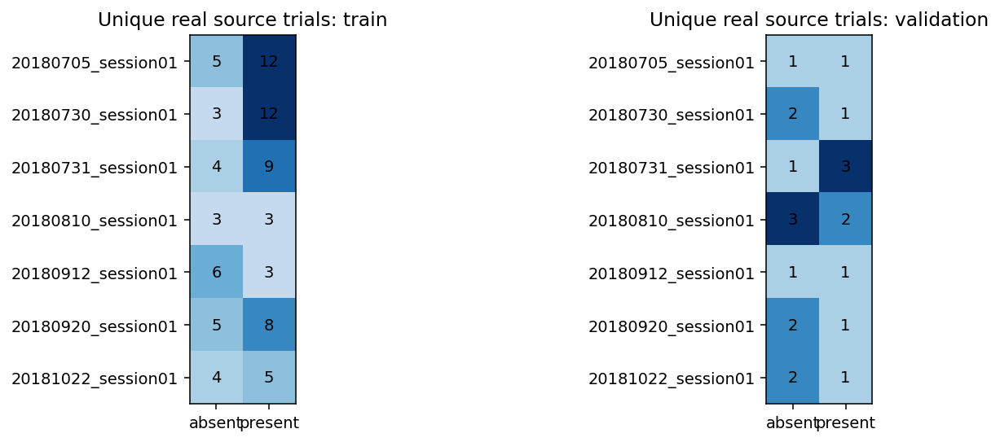

Real-source support by session and class. Eight validation session×class pools are singletons; synthetic replication does not repair their support. No decoder or uncertainty estimate applies to these counts. Fixed4→3 interior component D_N_R_T__N_R_M;29 selected units/7 session blocks. 82 training sources (30 absent/52 present),22 historical-validation sources (12/10); 128 training pseudorows (64/64),30 evaluation combinations (24/6), half evaluation mass/class. Sources split before assembly; rows share sources; seeds0/1/2 are computational repeats, not biological replication. Cue time is milliseconds from cue onset; last bin retains measured clipping. All readouts use frozen final1000 features; raw29 or latent8 features/bin, raw290 or latent80 whole-cue. No window/decoder/checkpoint selected for future prediction. Provenance: outputs/cebra-cue-time-readout-20261005/run-reviewed-20261005; verified numeric exports linked below.

### Balanced accuracy

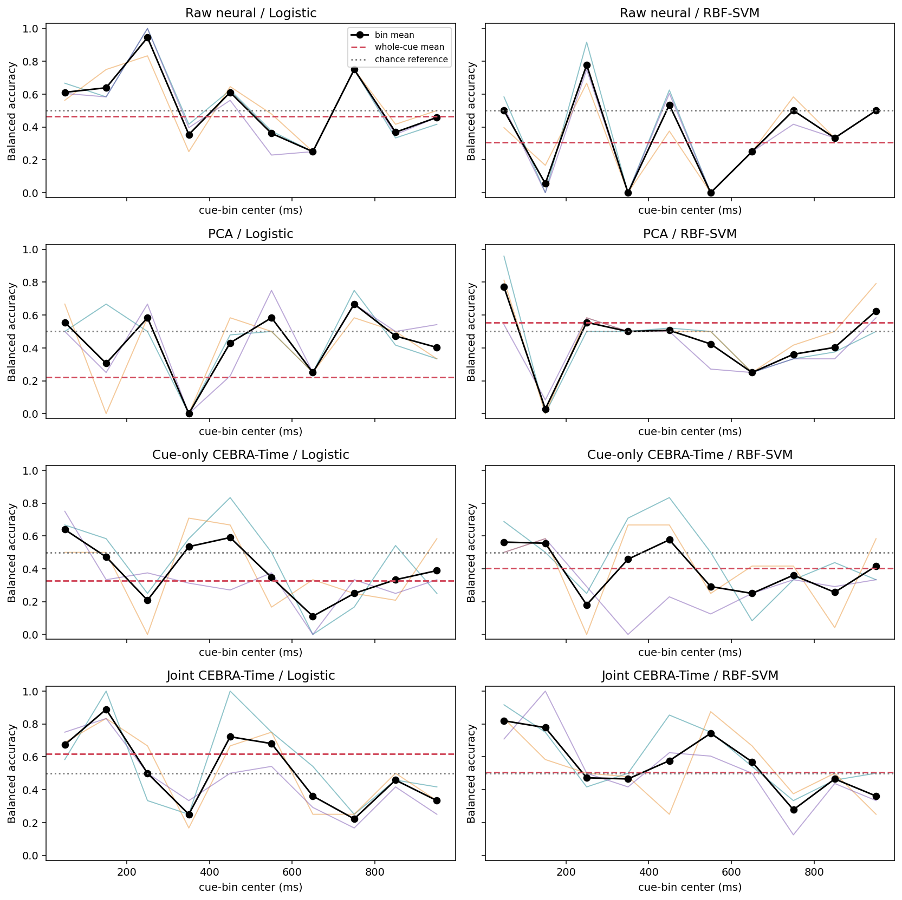

Balanced accuracy: thin colored lines show the three paired seeds, black shows their mean; red dashed is the separately trained whole-cue readout. No SEM/confidence interval is inferred from seeds. BA is mean class recall; AUROC uses logistic probabilities or uncalibrated SVM margins. Null reference=.5, not a significance threshold. Fixed4→3 interior component D_N_R_T__N_R_M;29 selected units/7 session blocks. 82 training sources (30 absent/52 present),22 historical-validation sources (12/10); 128 training pseudorows (64/64),30 evaluation combinations (24/6), half evaluation mass/class. Sources split before assembly; rows share sources; seeds0/1/2 are computational repeats, not biological replication. Cue time is milliseconds from cue onset; last bin retains measured clipping. All readouts use frozen final1000 features; raw29 or latent8 features/bin, raw290 or latent80 whole-cue. No window/decoder/checkpoint selected for future prediction. Provenance: outputs/cebra-cue-time-readout-20261005/run-reviewed-20261005; verified numeric exports linked below.

### Auroc

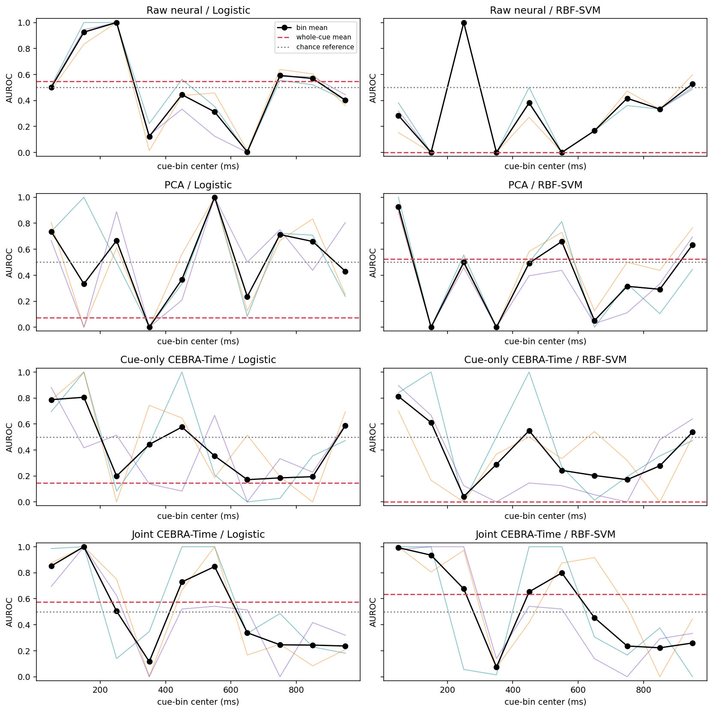

AUROC: thin colored lines show the three paired seeds, black shows their mean; red dashed is the separately trained whole-cue readout. No SEM/confidence interval is inferred from seeds. BA is mean class recall; AUROC uses logistic probabilities or uncalibrated SVM margins. Null reference=.5, not a significance threshold. Fixed4→3 interior component D_N_R_T__N_R_M;29 selected units/7 session blocks. 82 training sources (30 absent/52 present),22 historical-validation sources (12/10); 128 training pseudorows (64/64),30 evaluation combinations (24/6), half evaluation mass/class. Sources split before assembly; rows share sources; seeds0/1/2 are computational repeats, not biological replication. Cue time is milliseconds from cue onset; last bin retains measured clipping. All readouts use frozen final1000 features; raw29 or latent8 features/bin, raw290 or latent80 whole-cue. No window/decoder/checkpoint selected for future prediction. Provenance: outputs/cebra-cue-time-readout-20261005/run-reviewed-20261005; verified numeric exports linked below.

### Logistic loss

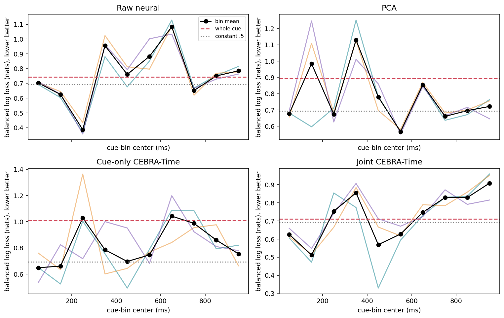

Logistic-only probability loss, including all seeds and whole-cue references. Constant-.5 loss=log(2)=.693147. Lower loss can reflect calibration rather than better discrimination. No SVM probability loss is fabricated. Fixed4→3 interior component D_N_R_T__N_R_M;29 selected units/7 session blocks. 82 training sources (30 absent/52 present),22 historical-validation sources (12/10); 128 training pseudorows (64/64),30 evaluation combinations (24/6), half evaluation mass/class. Sources split before assembly; rows share sources; seeds0/1/2 are computational repeats, not biological replication. Cue time is milliseconds from cue onset; last bin retains measured clipping. All readouts use frozen final1000 features; raw29 or latent8 features/bin, raw290 or latent80 whole-cue. No window/decoder/checkpoint selected for future prediction. Provenance: outputs/cebra-cue-time-readout-20261005/run-reviewed-20261005; verified numeric exports linked below.

### Window effects and gaps

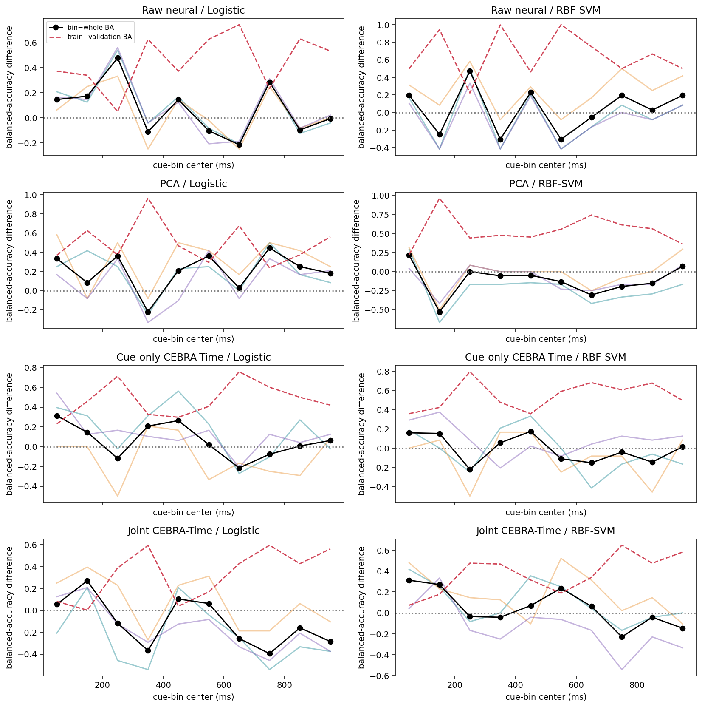

Paired bin-minus-whole BA (black, positive favors the bin) and train-minus-validation gap (red). Thin traces are per-seed bin-minus-whole effects. Different feature counts and fixed regularization mean this is predictive utility, not a capacity-matched proof of temporal information. Fixed4→3 interior component D_N_R_T__N_R_M;29 selected units/7 session blocks. 82 training sources (30 absent/52 present),22 historical-validation sources (12/10); 128 training pseudorows (64/64),30 evaluation combinations (24/6), half evaluation mass/class. Sources split before assembly; rows share sources; seeds0/1/2 are computational repeats, not biological replication. Cue time is milliseconds from cue onset; last bin retains measured clipping. All readouts use frozen final1000 features; raw29 or latent8 features/bin, raw290 or latent80 whole-cue. No window/decoder/checkpoint selected for future prediction. Provenance: outputs/cebra-cue-time-readout-20261005/run-reviewed-20261005; verified numeric exports linked below.

### Joint training effects

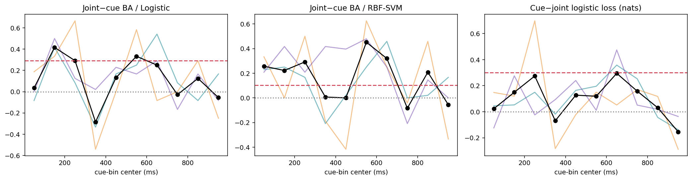

Paired joint-training effects. Positive favors joint training in all panels. Black=three-seed mean; thin=individual seeds; red dashed=whole cue. The predeclared primary new statistic is the maximum mean logistic gain across ten bins, with matched null maxima—not a selected-bin superiority test. Fixed4→3 interior component D_N_R_T__N_R_M;29 selected units/7 session blocks. 82 training sources (30 absent/52 present),22 historical-validation sources (12/10); 128 training pseudorows (64/64),30 evaluation combinations (24/6), half evaluation mass/class. Sources split before assembly; rows share sources; seeds0/1/2 are computational repeats, not biological replication. Cue time is milliseconds from cue onset; last bin retains measured clipping. All readouts use frozen final1000 features; raw29 or latent8 features/bin, raw290 or latent80 whole-cue. No window/decoder/checkpoint selected for future prediction. Provenance: outputs/cebra-cue-time-readout-20261005/run-reviewed-20261005; verified numeric exports linked below.

### Null families

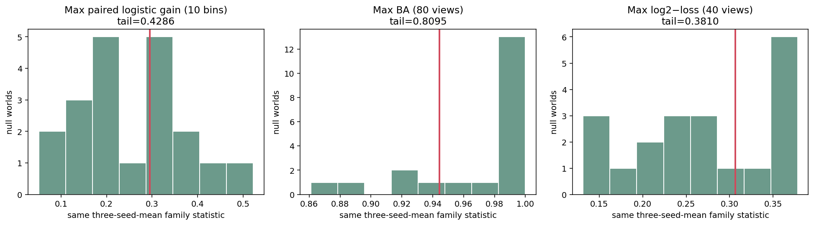

Twenty accepted source-coherent label-null worlds (bars), observed statistic (red). Inclusive plus-one tails have minimum resolution1/21. Every world uses the same seed average and maximum family; whole cue is excluded. These are no-association references, not equal-risk/superiority p-values or correction for the project's adaptive history. Fixed4→3 interior component D_N_R_T__N_R_M;29 selected units/7 session blocks. 82 training sources (30 absent/52 present),22 historical-validation sources (12/10); 128 training pseudorows (64/64),30 evaluation combinations (24/6), half evaluation mass/class. Sources split before assembly; rows share sources; seeds0/1/2 are computational repeats, not biological replication. Cue time is milliseconds from cue onset; last bin retains measured clipping. All readouts use frozen final1000 features; raw29 or latent8 features/bin, raw290 or latent80 whole-cue. No window/decoder/checkpoint selected for future prediction. Provenance: outputs/cebra-cue-time-readout-20261005/run-reviewed-20261005; verified numeric exports linked below.

### Source sensitivity

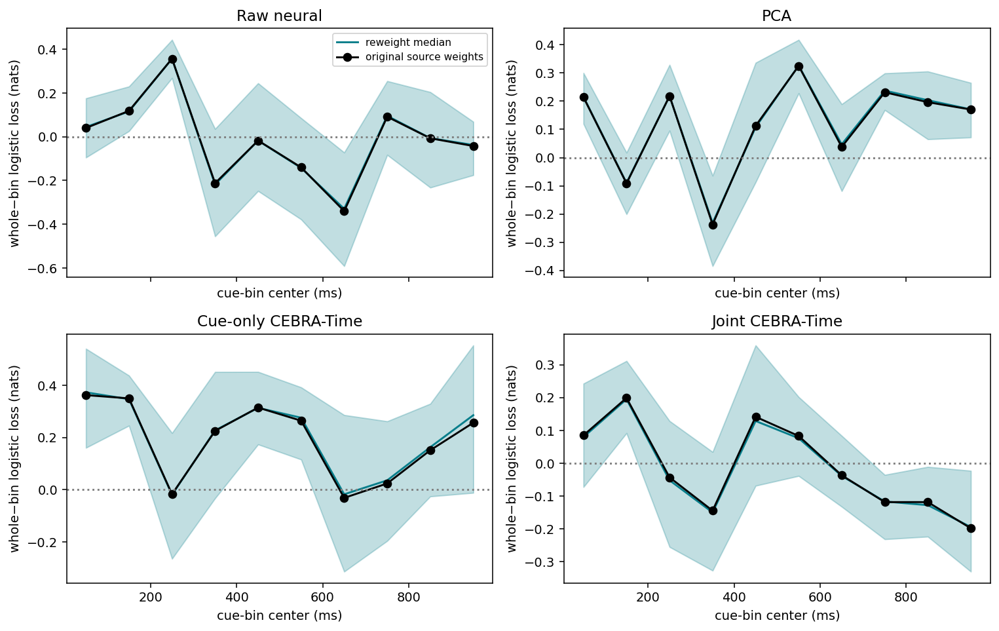

Fixed-model source-pool sensitivity of whole-minus-bin logistic loss. Positive favors the bin. Bands are2.5–97.5% quantiles over200 within-session×class source reweights, NOT biological confidence intervals. Predictions/seeds remain fixed. Eight of22 source deletions lose class support and are inestimable; singleton variability cannot be learned. Fixed4→3 interior component D_N_R_T__N_R_M;29 selected units/7 session blocks. 82 training sources (30 absent/52 present),22 historical-validation sources (12/10); 128 training pseudorows (64/64),30 evaluation combinations (24/6), half evaluation mass/class. Sources split before assembly; rows share sources; seeds0/1/2 are computational repeats, not biological replication. Cue time is milliseconds from cue onset; last bin retains measured clipping. All readouts use frozen final1000 features; raw29 or latent8 features/bin, raw290 or latent80 whole-cue. No window/decoder/checkpoint selected for future prediction. Provenance: outputs/cebra-cue-time-readout-20261005/run-reviewed-20261005; verified numeric exports linked below.

Confusions logistic seed0: counts and normalized recalls

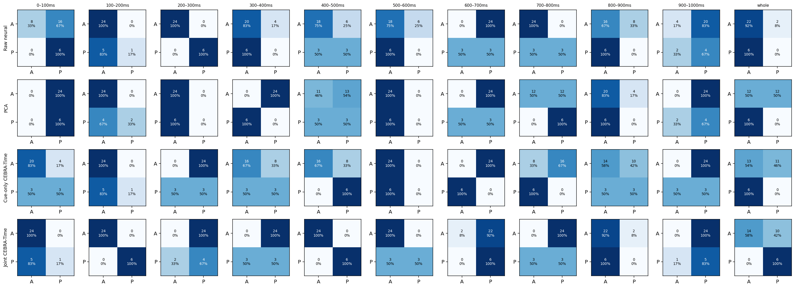

Logistic, seed0. Rows=true class; columns=predicted class, A=absent/P=present. Each cell prints the actual synthetic count and true-class-normalized recall; color is normalized0–1. Denominators are24 absent/6 present; do not sum seeds as independent trials. Every window and reference representation is shown. Fixed4→3 interior component D_N_R_T__N_R_M;29 selected units/7 session blocks. 82 training sources (30 absent/52 present),22 historical-validation sources (12/10); 128 training pseudorows (64/64),30 evaluation combinations (24/6), half evaluation mass/class. Sources split before assembly; rows share sources; seeds0/1/2 are computational repeats, not biological replication. Cue time is milliseconds from cue onset; last bin retains measured clipping. All readouts use frozen final1000 features; raw29 or latent8 features/bin, raw290 or latent80 whole-cue. No window/decoder/checkpoint selected for future prediction. Provenance: outputs/cebra-cue-time-readout-20261005/run-reviewed-20261005; verified numeric exports linked below.

Confusions logistic seed1: counts and normalized recalls

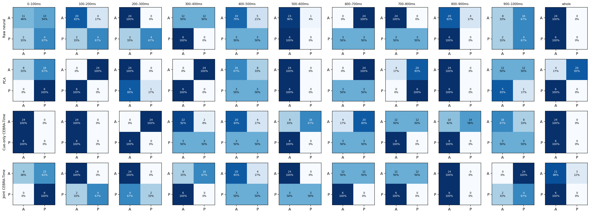

Logistic, seed1. Rows=true class; columns=predicted class, A=absent/P=present. Each cell prints the actual synthetic count and true-class-normalized recall; color is normalized0–1. Denominators are24 absent/6 present; do not sum seeds as independent trials. Every window and reference representation is shown. Fixed4→3 interior component D_N_R_T__N_R_M;29 selected units/7 session blocks. 82 training sources (30 absent/52 present),22 historical-validation sources (12/10); 128 training pseudorows (64/64),30 evaluation combinations (24/6), half evaluation mass/class. Sources split before assembly; rows share sources; seeds0/1/2 are computational repeats, not biological replication. Cue time is milliseconds from cue onset; last bin retains measured clipping. All readouts use frozen final1000 features; raw29 or latent8 features/bin, raw290 or latent80 whole-cue. No window/decoder/checkpoint selected for future prediction. Provenance: outputs/cebra-cue-time-readout-20261005/run-reviewed-20261005; verified numeric exports linked below.

Confusions logistic seed2: counts and normalized recalls

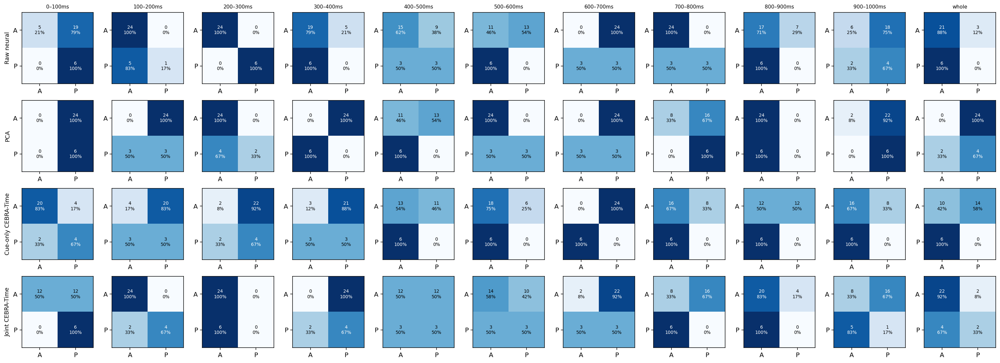

Logistic, seed2. Rows=true class; columns=predicted class, A=absent/P=present. Each cell prints the actual synthetic count and true-class-normalized recall; color is normalized0–1. Denominators are24 absent/6 present; do not sum seeds as independent trials. Every window and reference representation is shown. Fixed4→3 interior component D_N_R_T__N_R_M;29 selected units/7 session blocks. 82 training sources (30 absent/52 present),22 historical-validation sources (12/10); 128 training pseudorows (64/64),30 evaluation combinations (24/6), half evaluation mass/class. Sources split before assembly; rows share sources; seeds0/1/2 are computational repeats, not biological replication. Cue time is milliseconds from cue onset; last bin retains measured clipping. All readouts use frozen final1000 features; raw29 or latent8 features/bin, raw290 or latent80 whole-cue. No window/decoder/checkpoint selected for future prediction. Provenance: outputs/cebra-cue-time-readout-20261005/run-reviewed-20261005; verified numeric exports linked below.

Confusions svc seed0: counts and normalized recalls

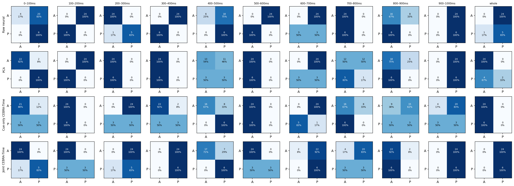

RBF-SVM, seed0. Rows=true class; columns=predicted class, A=absent/P=present. Each cell prints the actual synthetic count and true-class-normalized recall; color is normalized0–1. Denominators are24 absent/6 present; do not sum seeds as independent trials. Every window and reference representation is shown. Fixed4→3 interior component D_N_R_T__N_R_M;29 selected units/7 session blocks. 82 training sources (30 absent/52 present),22 historical-validation sources (12/10); 128 training pseudorows (64/64),30 evaluation combinations (24/6), half evaluation mass/class. Sources split before assembly; rows share sources; seeds0/1/2 are computational repeats, not biological replication. Cue time is milliseconds from cue onset; last bin retains measured clipping. All readouts use frozen final1000 features; raw29 or latent8 features/bin, raw290 or latent80 whole-cue. No window/decoder/checkpoint selected for future prediction. Provenance: outputs/cebra-cue-time-readout-20261005/run-reviewed-20261005; verified numeric exports linked below.

Confusions svc seed1: counts and normalized recalls

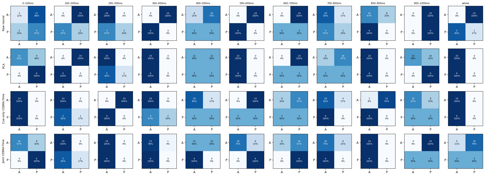

RBF-SVM, seed1. Rows=true class; columns=predicted class, A=absent/P=present. Each cell prints the actual synthetic count and true-class-normalized recall; color is normalized0–1. Denominators are24 absent/6 present; do not sum seeds as independent trials. Every window and reference representation is shown. Fixed4→3 interior component D_N_R_T__N_R_M;29 selected units/7 session blocks. 82 training sources (30 absent/52 present),22 historical-validation sources (12/10); 128 training pseudorows (64/64),30 evaluation combinations (24/6), half evaluation mass/class. Sources split before assembly; rows share sources; seeds0/1/2 are computational repeats, not biological replication. Cue time is milliseconds from cue onset; last bin retains measured clipping. All readouts use frozen final1000 features; raw29 or latent8 features/bin, raw290 or latent80 whole-cue. No window/decoder/checkpoint selected for future prediction. Provenance: outputs/cebra-cue-time-readout-20261005/run-reviewed-20261005; verified numeric exports linked below.

Confusions svc seed2: counts and normalized recalls

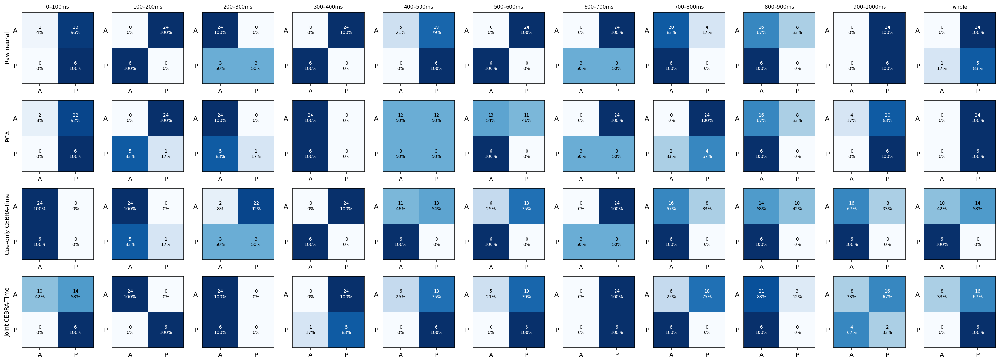

RBF-SVM, seed2. Rows=true class; columns=predicted class, A=absent/P=present. Each cell prints the actual synthetic count and true-class-normalized recall; color is normalized0–1. Denominators are24 absent/6 present; do not sum seeds as independent trials. Every window and reference representation is shown. Fixed4→3 interior component D_N_R_T__N_R_M;29 selected units/7 session blocks. 82 training sources (30 absent/52 present),22 historical-validation sources (12/10); 128 training pseudorows (64/64),30 evaluation combinations (24/6), half evaluation mass/class. Sources split before assembly; rows share sources; seeds0/1/2 are computational repeats, not biological replication. Cue time is milliseconds from cue onset; last bin retains measured clipping. All readouts use frozen final1000 features; raw29 or latent8 features/bin, raw290 or latent80 whole-cue. No window/decoder/checkpoint selected for future prediction. Provenance: outputs/cebra-cue-time-readout-20261005/run-reviewed-20261005; verified numeric exports linked below.

### Geometry evolution

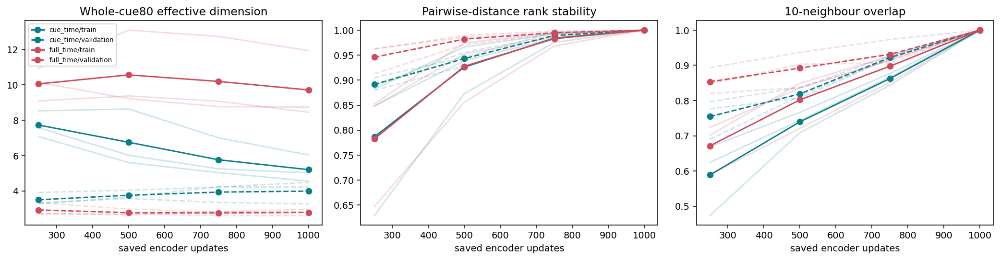

Observed-only saved-checkpoint diagnostics; no decoder/checkpoint selection. Participation ratio=(sum eigenvalues)²/sum squared eigenvalues. Stability compares identical rows to their1000-update representation using full80D Euclidean distances (rank correlation) and10-neighbour overlap. Final self-comparison is1 by construction. Train/validation are separate; thin lines=seeds. This is synthetic representation geometry, not simultaneous brain dynamics or H1b proof. Fixed4→3 interior component D_N_R_T__N_R_M;29 selected units/7 session blocks. 82 training sources (30 absent/52 present),22 historical-validation sources (12/10); 128 training pseudorows (64/64),30 evaluation combinations (24/6), half evaluation mass/class. Sources split before assembly; rows share sources; seeds0/1/2 are computational repeats, not biological replication. Cue time is milliseconds from cue onset; last bin retains measured clipping. All readouts use frozen final1000 features; raw29 or latent8 features/bin, raw290 or latent80 whole-cue. No window/decoder/checkpoint selected for future prediction. Provenance: outputs/cebra-cue-time-readout-20261005/run-reviewed-20261005; verified numeric exports linked below.

### Bin geometry

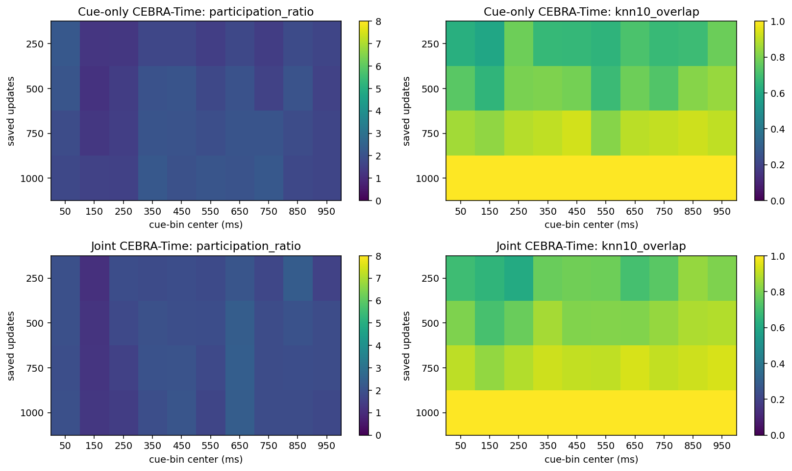

Validation single-bin8D geometry, averaged across three computational seeds. Left=participation ratio; right=neighbour overlap against the same bin at1000updates. Full spectra and each seed are exported. No label-separation or biological-axis-rotation claim is inferred from these diagnostics. Fixed4→3 interior component D_N_R_T__N_R_M;29 selected units/7 session blocks. 82 training sources (30 absent/52 present),22 historical-validation sources (12/10); 128 training pseudorows (64/64),30 evaluation combinations (24/6), half evaluation mass/class. Sources split before assembly; rows share sources; seeds0/1/2 are computational repeats, not biological replication. Cue time is milliseconds from cue onset; last bin retains measured clipping. All readouts use frozen final1000 features; raw29 or latent8 features/bin, raw290 or latent80 whole-cue. No window/decoder/checkpoint selected for future prediction. Provenance: outputs/cebra-cue-time-readout-20261005/run-reviewed-20261005; verified numeric exports linked below.

## What this does not establish

Window-specific decoders are fitted separately: their curves measure accessible information, not a persistent shared code or temporal generalization. Concatenation versus one bin also changes feature count and effective regularization. A predictive difference cannot uniquely identify temporal integration or biological dynamics. Shared encoder weights do not prove shared biological manifolds; checkpoint spectra/stability do not establish H1b. Known labels condition pseudopopulation construction, so these are not predictions of an unknown natural trial. Cue identity/history/view, acquisition simultaneity and source-selection confounds remain unresolved.

Navigation-time decoding, cross-phase/frozen-decoder temporal-transfer matrices, a matched joint-training goal experiment, new source folds and ordered-path prediction were **not run**. No GRU, new encoder, hyperparameter search, checkpoint selection or window-selection rule was introduced. A future selected-window predictor requires source-safe inner selection, including encoder fitting boundaries, and a separately reviewed run.

## Numeric evidence

Figure seed colors for the decoding/effect panels: teal=seed0, orange=seed1, purple=seed2. Thin traces show computational sensitivity, not biological uncertainty.

[All88 observed mean rows, with seed vectors](observed_means.csv) · [All528 observed train/evaluation seed metric rows](observed_seed_metrics.csv) · [Every observed confusion](observed_confusions.csv) · [Source counts](source_support.csv) · [Full geometry spectra](geometry_spectra.csv) · [Geometry stability](geometry_stability_vs_final.csv) · [Summary](summary.json) · [No-fit verification](verification.json)

Complete predictions,5040 fitted decoder states, all null-world metrics, per-source sensitivities, original-source mappings and code/runtime snapshots remain in the ignored local run directory. Only small aggregate report exports are placed here; Git does not back up private inputs/models.

All observed means (88 rows; no selected-window filtering)

|Representation|Decoder|Window|BA|AUROC|Absent recall|Present recall|Log loss|Brier|
|---|---|---|---:|---:|---:|---:|---:|---:|
|Raw neural|Logistic|bin00|0.6111|0.5000|0.3333|0.8889|0.7031|0.2542|
|Raw neural|Logistic|bin01|0.6389|0.9259|0.9444|0.3333|0.6250|0.2167|
|Raw neural|Logistic|bin02|0.9444|1.0000|1.0000|0.8889|0.3865|0.1135|
|Raw neural|Logistic|bin03|0.3542|0.1227|0.7083|0.0000|0.9554|0.3620|
|Raw neural|Logistic|bin04|0.6111|0.4444|0.7222|0.5000|0.7605|0.2799|
|Raw neural|Logistic|bin05|0.3611|0.3125|0.7222|0.0000|0.8831|0.3341|
|Raw neural|Logistic|bin06|0.2500|0.0046|0.0000|0.5000|1.0829|0.4266|
|Raw neural|Logistic|bin07|0.7500|0.5926|1.0000|0.5000|0.6517|0.2293|
|Raw neural|Logistic|bin08|0.3681|0.5694|0.7361|0.0000|0.7501|0.2772|
|Raw neural|Logistic|bin09|0.4583|0.4028|0.2500|0.6667|0.7853|0.2912|
|Raw neural|Logistic|wholecue|0.4653|0.5486|0.9306|0.0000|0.7429|0.2744|
|Raw neural|RBF-SVM|bin00|0.5000|0.2847|0.1111|0.8889|—|—|
|Raw neural|RBF-SVM|bin01|0.0556|0.0000|0.0000|0.1111|—|—|
|Raw neural|RBF-SVM|bin02|0.7778|1.0000|1.0000|0.5556|—|—|
|Raw neural|RBF-SVM|bin03|0.0000|0.0000|0.0000|0.0000|—|—|
|Raw neural|RBF-SVM|bin04|0.5347|0.3819|0.2361|0.8333|—|—|
|Raw neural|RBF-SVM|bin05|0.0000|0.0000|0.0000|0.0000|—|—|
|Raw neural|RBF-SVM|bin06|0.2500|0.1667|0.0000|0.5000|—|—|
|Raw neural|RBF-SVM|bin07|0.5000|0.4167|0.8889|0.1111|—|—|
|Raw neural|RBF-SVM|bin08|0.3333|0.3333|0.6667|0.0000|—|—|
|Raw neural|RBF-SVM|bin09|0.5000|0.5278|0.0000|1.0000|—|—|
|Raw neural|RBF-SVM|wholecue|0.3056|0.0000|0.0000|0.6111|—|—|
|PCA|Logistic|bin00|0.5556|0.7361|0.1111|1.0000|0.6784|0.2426|
|PCA|Logistic|bin01|0.3056|0.3333|0.3333|0.2778|0.9839|0.3724|
|PCA|Logistic|bin02|0.5833|0.6667|1.0000|0.1667|0.6741|0.2409|
|PCA|Logistic|bin03|0.0000|0.0000|0.0000|0.0000|1.1294|0.4541|
|PCA|Logistic|bin04|0.4306|0.3681|0.5278|0.3333|0.7798|0.2901|
|PCA|Logistic|bin05|0.5833|1.0000|1.0000|0.1667|0.5673|0.1893|
|PCA|Logistic|bin06|0.2500|0.2361|0.0000|0.5000|0.8546|0.3274|
|PCA|Logistic|bin07|0.6667|0.7130|0.3333|1.0000|0.6609|0.2339|
|PCA|Logistic|bin08|0.4722|0.6597|0.9444|0.0000|0.6960|0.2519|
|PCA|Logistic|bin09|0.4028|0.4306|0.1944|0.6111|0.7220|0.2646|
|PCA|Logistic|wholecue|0.2222|0.0718|0.2222|0.2222|0.8924|0.3439|
|PCA|RBF-SVM|bin00|0.7708|0.9259|0.5417|1.0000|—|—|
|PCA|RBF-SVM|bin01|0.0278|0.0000|0.0000|0.0556|—|—|
|PCA|RBF-SVM|bin02|0.5556|0.5000|1.0000|0.1111|—|—|
|PCA|RBF-SVM|bin03|0.5000|0.0000|1.0000|0.0000|—|—|
|PCA|RBF-SVM|bin04|0.5069|0.4931|0.5139|0.5000|—|—|
|PCA|RBF-SVM|bin05|0.4236|0.6597|0.8472|0.0000|—|—|
|PCA|RBF-SVM|bin06|0.2500|0.0509|0.0000|0.5000|—|—|
|PCA|RBF-SVM|bin07|0.3611|0.3148|0.2778|0.4444|—|—|
|PCA|RBF-SVM|bin08|0.4028|0.2917|0.8056|0.0000|—|—|
|PCA|RBF-SVM|bin09|0.6250|0.6343|0.2500|1.0000|—|—|
|PCA|RBF-SVM|wholecue|0.5556|0.5255|0.6667|0.4444|—|—|
|Cue-only CEBRA-Time|Logistic|bin00|0.6389|0.7870|0.8889|0.3889|0.6485|0.2299|
|Cue-only CEBRA-Time|Logistic|bin01|0.4722|0.8056|0.7222|0.2222|0.6610|0.2357|
|Cue-only CEBRA-Time|Logistic|bin02|0.2083|0.1991|0.0278|0.3889|1.0283|0.3979|
|Cue-only CEBRA-Time|Logistic|bin03|0.5347|0.4421|0.5694|0.5000|0.7856|0.2910|
|Cue-only CEBRA-Time|Logistic|bin04|0.5903|0.5764|0.6806|0.5000|0.6963|0.2495|
|Cue-only CEBRA-Time|Logistic|bin05|0.3472|0.3542|0.6944|0.0000|0.7466|0.2761|
|Cue-only CEBRA-Time|Logistic|bin06|0.1111|0.1713|0.0556|0.1667|1.0423|0.4110|
|Cue-only CEBRA-Time|Logistic|bin07|0.2500|0.1852|0.5000|0.0000|0.9870|0.3845|
|Cue-only CEBRA-Time|Logistic|bin08|0.3333|0.1944|0.5000|0.1667|0.8597|0.3285|
|Cue-only CEBRA-Time|Logistic|bin09|0.3889|0.5880|0.4444|0.3333|0.7543|0.2800|
|Cue-only CEBRA-Time|Logistic|wholecue|0.3264|0.1458|0.6528|0.0000|1.0105|0.3862|
|Cue-only CEBRA-Time|RBF-SVM|bin00|0.5625|0.8125|0.9583|0.1667|—|—|
|Cue-only CEBRA-Time|RBF-SVM|bin01|0.5556|0.6111|1.0000|0.1111|—|—|
|Cue-only CEBRA-Time|RBF-SVM|bin02|0.1806|0.0417|0.0278|0.3333|—|—|
|Cue-only CEBRA-Time|RBF-SVM|bin03|0.4583|0.2894|0.6389|0.2778|—|—|
|Cue-only CEBRA-Time|RBF-SVM|bin04|0.5764|0.5486|0.6528|0.5000|—|—|
|Cue-only CEBRA-Time|RBF-SVM|bin05|0.2917|0.2431|0.4167|0.1667|—|—|
|Cue-only CEBRA-Time|RBF-SVM|bin06|0.2500|0.2037|0.1111|0.3889|—|—|
|Cue-only CEBRA-Time|RBF-SVM|bin07|0.3611|0.1713|0.7222|0.0000|—|—|
|Cue-only CEBRA-Time|RBF-SVM|bin08|0.2569|0.2778|0.3472|0.1667|—|—|
|Cue-only CEBRA-Time|RBF-SVM|bin09|0.4167|0.5370|0.5000|0.3333|—|—|
|Cue-only CEBRA-Time|RBF-SVM|wholecue|0.4028|0.0023|0.8056|0.0000|—|—|
|Joint CEBRA-Time|Logistic|bin00|0.6736|0.8519|0.6250|0.7222|0.6256|0.2169|
|Joint CEBRA-Time|Logistic|bin01|0.8889|1.0000|1.0000|0.7778|0.5117|0.1618|
|Joint CEBRA-Time|Logistic|bin02|0.5000|0.5046|0.6667|0.3333|0.7538|0.2777|
|Joint CEBRA-Time|Logistic|bin03|0.2500|0.1157|0.1111|0.3889|0.8552|0.3278|
|Joint CEBRA-Time|Logistic|bin04|0.7222|0.7292|0.7778|0.6667|0.5692|0.1927|
|Joint CEBRA-Time|Logistic|bin05|0.6806|0.8472|0.8611|0.5000|0.6276|0.2182|
|Joint CEBRA-Time|Logistic|bin06|0.3611|0.3380|0.2222|0.5000|0.7474|0.2775|
|Joint CEBRA-Time|Logistic|bin07|0.2222|0.2454|0.2778|0.1667|0.8290|0.3158|
|Joint CEBRA-Time|Logistic|bin08|0.4583|0.2431|0.9167|0.0000|0.8290|0.3120|
|Joint CEBRA-Time|Logistic|bin09|0.3333|0.2361|0.1111|0.5556|0.9088|0.3447|
|Joint CEBRA-Time|Logistic|wholecue|0.6181|0.5741|0.7917|0.4444|0.7106|0.2567|
|Joint CEBRA-Time|RBF-SVM|bin00|0.8194|0.9931|0.6944|0.9444|—|—|
|Joint CEBRA-Time|RBF-SVM|bin01|0.7778|0.9352|1.0000|0.5556|—|—|
|Joint CEBRA-Time|RBF-SVM|bin02|0.4722|0.6759|0.6667|0.2778|—|—|
|Joint CEBRA-Time|RBF-SVM|bin03|0.4653|0.0741|0.3194|0.6111|—|—|
|Joint CEBRA-Time|RBF-SVM|bin04|0.5764|0.6528|0.4861|0.6667|—|—|
|Joint CEBRA-Time|RBF-SVM|bin05|0.7431|0.7986|0.6528|0.8333|—|—|
|Joint CEBRA-Time|RBF-SVM|bin06|0.5694|0.4537|0.1389|1.0000|—|—|
|Joint CEBRA-Time|RBF-SVM|bin07|0.2778|0.2361|0.3889|0.1667|—|—|
|Joint CEBRA-Time|RBF-SVM|bin08|0.4653|0.2222|0.9306|0.0000|—|—|
|Joint CEBRA-Time|RBF-SVM|bin09|0.3611|0.2593|0.1111|0.6111|—|—|
|Joint CEBRA-Time|RBF-SVM|wholecue|0.5069|0.6343|0.1806|0.8333|—|—|

