# Endpoint cue-time comparison — October7,2026

**Exploratory, computationally replay-verified development-pool analysis.** Not a confirmatory or trial-specific path/H1 test.

## Bottom line

Endpoint labels are decodable in this historically exposed, label-conditioned pseudopopulation pool. Joint cue/navigation CEBRA improves mean wholecue ordered-pair prediction relative to cue-only CEBRA, gives a small start-accuracy gain, and does not improve goal accuracy. Strong raw/PCA references matter: CEBRA is not uniformly best. The wholecue arm-gain null family does **not** establish robust joint superiority.

## Cohort, construction, and scope

195 units across58 sessions;12,288 inner-training and3,265 historical-development real sources, all within original outer training. Each computational seed assembles480/240 pair-balanced train/development pseudorows from intact session blocks. This requires known condition labels: it is not an operational unknown-label natural-trial predictor. No simultaneous195-unit trial population is implied. Three seeds are computational variation, not biological replication; this is one exposed source split, not three independent folds.

Direct pair30, start6, and goal6 heads use the same assemblies. Input scaler/PCA/readouts use training data only. CEBRA-Time compares cue-only vs50/50 cue/navigation training at exactly1,000updates; only training-source navigation enters. Every readout evaluates cue activity only: ten100-ms bins or concatenated first1s. Logistic C=0.01,max_iter=2000; PCA8/bin and latent8/bin give80 wholecue features; raw has195/bin and1950 wholecue features. SVD-LDA is supervised and not dimension-matched. No geometry, navigation-time decoding, temporal transfer, SVM sweep or new source folds.

## Wholecue development scores

Three-seed means; full seed/window/train/development detail is in `tables/observed_metrics_by_seed.csv`. Accuracy equals BA in this pair-balanced construction. Lower loss/Brier is better; higher BA/F1 is better.

| Target | Representation/readout | BA | Macro-F1 | Log loss | Brier |
|---|---|---:|---:|---:|---:|
| pair30 | Raw + logistic | 70.3% | 0.6813 | 2.1701 | 0.8077 |
| pair30 | PCA-8 + logistic | 83.6% | 0.8119 | 1.6736 | 0.6745 |
| pair30 | Cue CEBRA + logistic | 63.8% | 0.6101 | 1.7795 | 0.7319 |
| pair30 | Joint CEBRA + logistic | 75.6% | 0.7396 | 1.6373 | 0.6827 |
| pair30 | Raw SVD-LDA | 48.5% | 0.4456 | 3.7206 | 0.8898 |
| start6 | Raw + logistic | 78.8% | 0.7835 | 0.8869 | 0.4331 |
| start6 | PCA-8 + logistic | 89.4% | 0.8934 | 0.6616 | 0.3078 |
| start6 | Cue CEBRA + logistic | 71.8% | 0.7148 | 0.8889 | 0.4511 |
| start6 | Joint CEBRA + logistic | 72.6% | 0.7223 | 0.8078 | 0.4093 |
| start6 | Raw SVD-LDA | 57.2% | 0.5735 | 1.3584 | 0.6244 |
| goal6 | Raw + logistic | 90.8% | 0.9059 | 0.5142 | 0.2405 |
| goal6 | PCA-8 + logistic | 86.8% | 0.8667 | 0.5320 | 0.2651 |
| goal6 | Cue CEBRA + logistic | 85.1% | 0.8506 | 0.5517 | 0.2948 |
| goal6 | Joint CEBRA + logistic | 83.9% | 0.8403 | 0.5516 | 0.2931 |
| goal6 | Raw SVD-LDA | 81.0% | 0.8078 | 0.6228 | 0.3058 |

## Paired cue-only versus joint CEBRA

Identical development pseudorows within each seed. Positive differences favor joint. Values below are computational seed means, not biological confidence intervals.

| Target | Joint − cue BA | Cue loss − joint loss |
|---|---:|---:|
| pair30 | +11.81 percentage points | +0.1422 |
| start6 | +0.83 percentage points | +0.0811 |
| goal6 | -1.25 percentage points | +0.0001 |

The wholecue joint-gain family tail is8/21(0.381). Absolute bin BA, absolute bin loss-skill, and bin joint-gain families each have1/21(0.0476), the lowest possible resolution with20nulls. These session×split label shuffles do not repair historical exposure, adaptive choices, serial exchangeability or nuisance confounds. Do not turn inspected peaks into validated windows. No position/view/heading/action/session conditional controls or exact future-path test were added.

## Full visual evidence

### source class counts
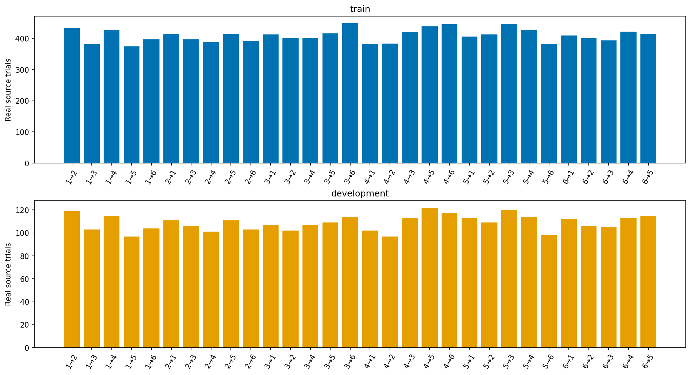
Eligible real sources by ordered endpoint pair; no decoder/uncertainty interval. These are not synthetic row counts. Endpoint cohort:195 units/58 sessions;12,288 train and3,265 historically exposed development real sources. Label-conditioned cross-session pseudopopulations,480 train/240 development rows per seed. Source: run-reviewed-20261007 saved artifacts (hashes in provenance.json). Not trial-specific or path/H1 evidence.

### source session support
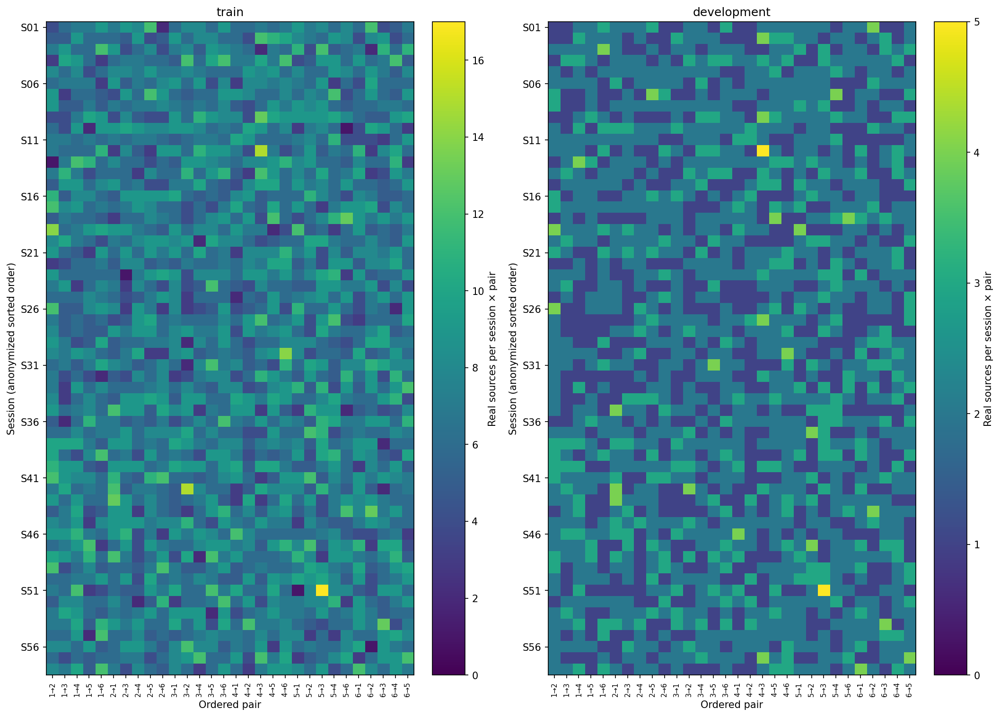
Session-by-class support for the fixed inner split. No decoder, inference or confidence interval;58 session blocks are not58 outer-test folds. Endpoint cohort:195 units/58 sessions;12,288 train and3,265 historically exposed development real sources. Label-conditioned cross-session pseudopopulations,480 train/240 development rows per seed. Source: run-reviewed-20261007 saved artifacts (hashes in provenance.json). Not trial-specific or path/H1 evidence.

### time balanced accuracy

All ten predeclared100-ms cue windows, development balanced accuracy. Lines are three-seed means; shading is min–max computational-seed variation, NOT biological confidence intervals. No inspected peak is a validated chosen window. Endpoint cohort:195 units/58 sessions;12,288 train and3,265 historically exposed development real sources. Label-conditioned cross-session pseudopopulations,480 train/240 development rows per seed. Cue-only evaluation; frozen1,000-update encoders; train-only scaling/PCA/readouts. Logistic C=0.01 for raw/PCA/CEBRA; raw SVD-LDA is a supervised reference. Source: run-reviewed-20261007 saved artifacts (hashes in provenance.json). Not trial-specific or path/H1 evidence.

### wholecue balanced accuracy

Concatenated0–1s cue development balanced accuracy; bar=three-seed mean, black points=seeds0/1/2 from left to right. Uniform reference shown. Not an eleventh selectable bin; dots are not biological replicates. Endpoint cohort:195 units/58 sessions;12,288 train and3,265 historically exposed development real sources. Label-conditioned cross-session pseudopopulations,480 train/240 development rows per seed. Cue-only evaluation; frozen1,000-update encoders; train-only scaling/PCA/readouts. Logistic C=0.01 for raw/PCA/CEBRA; raw SVD-LDA is a supervised reference. Source: run-reviewed-20261007 saved artifacts (hashes in provenance.json). Not trial-specific or path/H1 evidence.

### time log loss
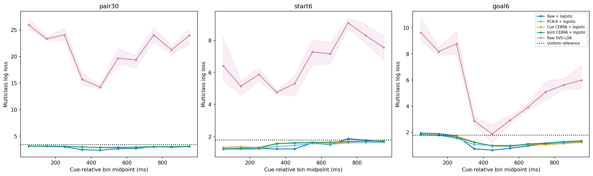
All ten predeclared100-ms cue windows, development multiclass log loss. Lines are three-seed means; shading is min–max computational-seed variation, NOT biological confidence intervals. No inspected peak is a validated chosen window. Endpoint cohort:195 units/58 sessions;12,288 train and3,265 historically exposed development real sources. Label-conditioned cross-session pseudopopulations,480 train/240 development rows per seed. Cue-only evaluation; frozen1,000-update encoders; train-only scaling/PCA/readouts. Logistic C=0.01 for raw/PCA/CEBRA; raw SVD-LDA is a supervised reference. Source: run-reviewed-20261007 saved artifacts (hashes in provenance.json). Not trial-specific or path/H1 evidence.

### wholecue log loss
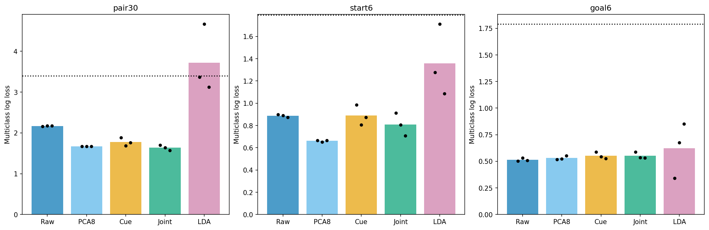
Concatenated0–1s cue development multiclass log loss; bar=three-seed mean, black points=seeds0/1/2 from left to right. Uniform reference shown. Not an eleventh selectable bin; dots are not biological replicates. Endpoint cohort:195 units/58 sessions;12,288 train and3,265 historically exposed development real sources. Label-conditioned cross-session pseudopopulations,480 train/240 development rows per seed. Cue-only evaluation; frozen1,000-update encoders; train-only scaling/PCA/readouts. Logistic C=0.01 for raw/PCA/CEBRA; raw SVD-LDA is a supervised reference. Source: run-reviewed-20261007 saved artifacts (hashes in provenance.json). Not trial-specific or path/H1 evidence.

### training development gap
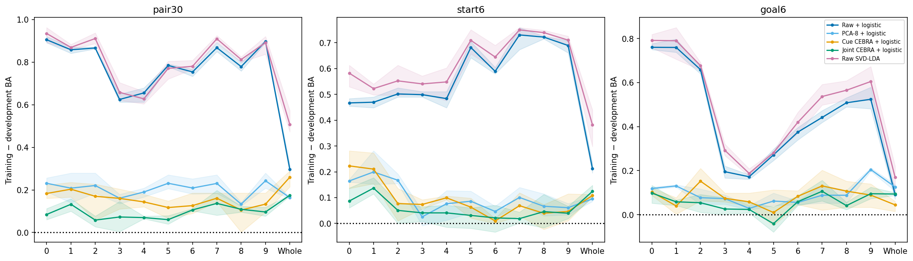
Train–development balanced-accuracy gaps for every cue bin(index0=0–100ms) and wholecue. Mean/min–max across three computational seeds; not confidence intervals. Same targets/representation readouts; large gaps indicate exposed-pool generalization limits. Endpoint cohort:195 units/58 sessions;12,288 train and3,265 historically exposed development real sources. Label-conditioned cross-session pseudopopulations,480 train/240 development rows per seed. Cue-only evaluation; frozen1,000-update encoders; train-only scaling/PCA/readouts. Logistic C=0.01 for raw/PCA/CEBRA; raw SVD-LDA is a supervised reference. Source: run-reviewed-20261007 saved artifacts (hashes in provenance.json). Not trial-specific or path/H1 evidence.

### null families
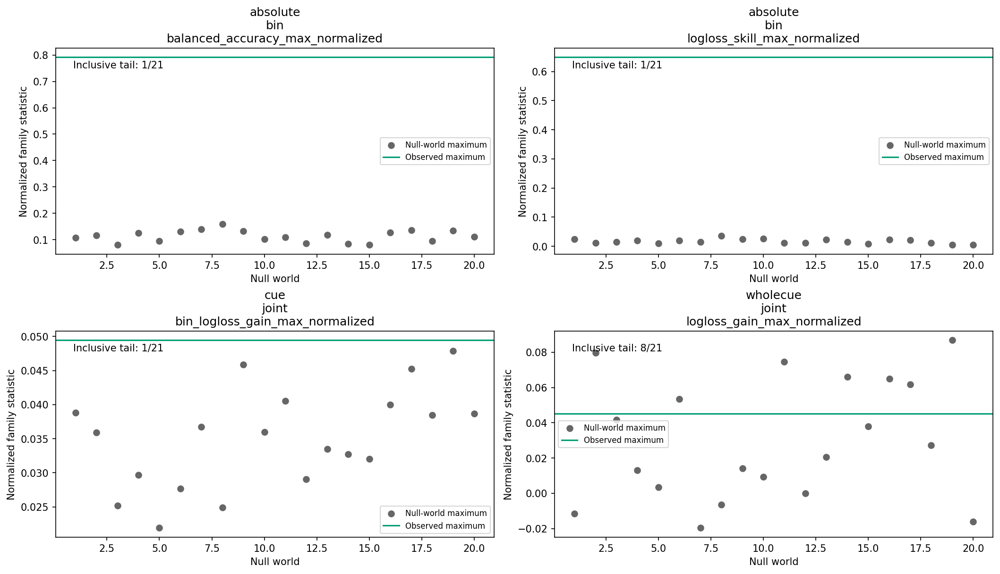
All20 joint-pair-label shuffles within session×inner split, with complete reassembly/refitting. Seed means precede family maxima. BA normalized by uniform reference; loss skill/gain normalized by log(K). Bin families span targets/windows (absolute families also representations); wholecue gain spans three targets. Inclusive plus-one tails have minimum1/21 and are diagnostic, not pristine confirmatory p-values or universal superiority tests. Endpoint cohort:195 units/58 sessions;12,288 train and3,265 historically exposed development real sources. Label-conditioned cross-session pseudopopulations,480 train/240 development rows per seed. Cue-only evaluation; frozen1,000-update encoders; train-only scaling/PCA/readouts. Logistic C=0.01 for raw/PCA/CEBRA; raw SVD-LDA is a supervised reference. Source: run-reviewed-20261007 saved artifacts (hashes in provenance.json). Not trial-specific or path/H1 evidence.

### source deletion
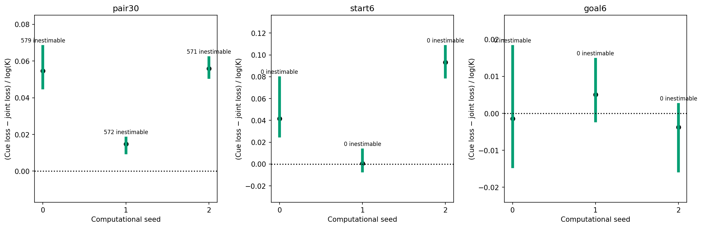
Wholecue paired joint advantage after deleting every pseudorow containing each used real development source, with predictions fixed. Line=min/max and dot=median of estimable deletions, NOT a confidence interval. Lost-class deletions are inestimable, not evidence of robustness; pair30 has571–579 per seed. No pseudorow bootstrap or refit. Endpoint cohort:195 units/58 sessions;12,288 train and3,265 historically exposed development real sources. Label-conditioned cross-session pseudopopulations,480 train/240 development rows per seed. Cue-only evaluation; frozen1,000-update encoders; train-only scaling/PCA/readouts. Logistic C=0.01 for raw/PCA/CEBRA; raw SVD-LDA is a supervised reference. Source: run-reviewed-20261007 saved artifacts (hashes in provenance.json). Not trial-specific or path/H1 evidence.

### confusions pair30 seed0
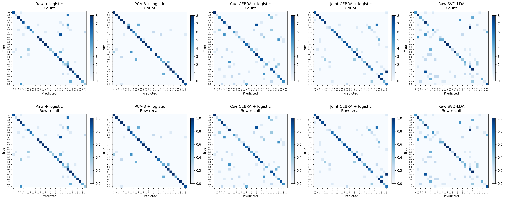
pair30, observed seed0, wholecue0–1s development predictions. Top=count, bottom=row-normalized recall, all five representation/readout families;240 synthetic rows, not240 independent biological trials. No seed aggregation or uncertainty interval. Pair labels are ordered(start,goal); endpoint IDs are provisional marker-derived categories. Endpoint cohort:195 units/58 sessions;12,288 train and3,265 historically exposed development real sources. Label-conditioned cross-session pseudopopulations,480 train/240 development rows per seed. Cue-only evaluation; frozen1,000-update encoders; train-only scaling/PCA/readouts. Logistic C=0.01 for raw/PCA/CEBRA; raw SVD-LDA is a supervised reference. Source: run-reviewed-20261007 saved artifacts (hashes in provenance.json). Not trial-specific or path/H1 evidence.

### confusions start6 seed0
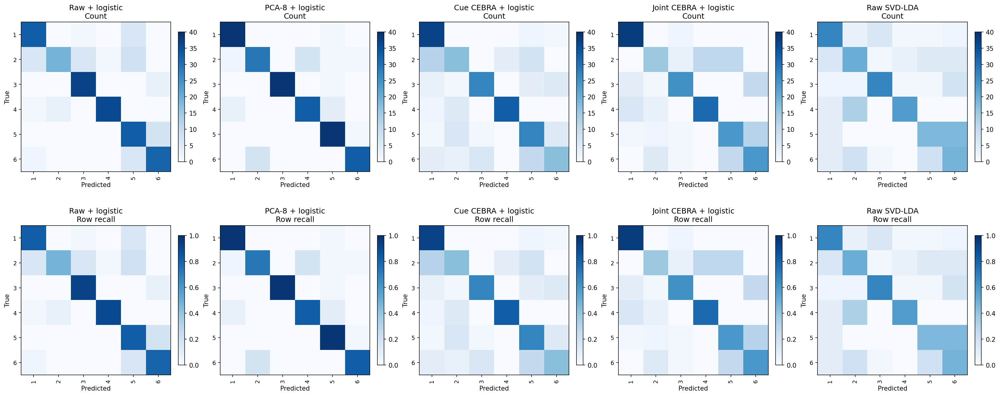
start6, observed seed0, wholecue0–1s development predictions. Top=count, bottom=row-normalized recall, all five representation/readout families;240 synthetic rows, not240 independent biological trials. No seed aggregation or uncertainty interval. Pair labels are ordered(start,goal); endpoint IDs are provisional marker-derived categories. Endpoint cohort:195 units/58 sessions;12,288 train and3,265 historically exposed development real sources. Label-conditioned cross-session pseudopopulations,480 train/240 development rows per seed. Cue-only evaluation; frozen1,000-update encoders; train-only scaling/PCA/readouts. Logistic C=0.01 for raw/PCA/CEBRA; raw SVD-LDA is a supervised reference. Source: run-reviewed-20261007 saved artifacts (hashes in provenance.json). Not trial-specific or path/H1 evidence.

### confusions goal6 seed0
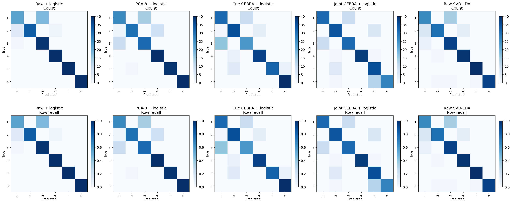
goal6, observed seed0, wholecue0–1s development predictions. Top=count, bottom=row-normalized recall, all five representation/readout families;240 synthetic rows, not240 independent biological trials. No seed aggregation or uncertainty interval. Pair labels are ordered(start,goal); endpoint IDs are provisional marker-derived categories. Endpoint cohort:195 units/58 sessions;12,288 train and3,265 historically exposed development real sources. Label-conditioned cross-session pseudopopulations,480 train/240 development rows per seed. Cue-only evaluation; frozen1,000-update encoders; train-only scaling/PCA/readouts. Logistic C=0.01 for raw/PCA/CEBRA; raw SVD-LDA is a supervised reference. Source: run-reviewed-20261007 saved artifacts (hashes in provenance.json). Not trial-specific or path/H1 evidence.

### confusions pair30 seed1
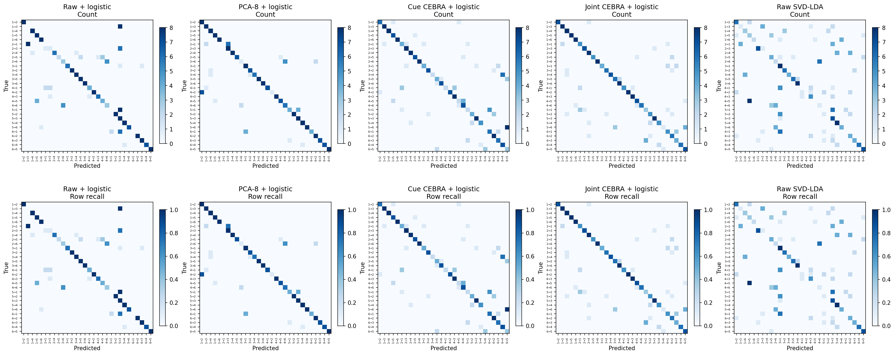
pair30, observed seed1, wholecue0–1s development predictions. Top=count, bottom=row-normalized recall, all five representation/readout families;240 synthetic rows, not240 independent biological trials. No seed aggregation or uncertainty interval. Pair labels are ordered(start,goal); endpoint IDs are provisional marker-derived categories. Endpoint cohort:195 units/58 sessions;12,288 train and3,265 historically exposed development real sources. Label-conditioned cross-session pseudopopulations,480 train/240 development rows per seed. Cue-only evaluation; frozen1,000-update encoders; train-only scaling/PCA/readouts. Logistic C=0.01 for raw/PCA/CEBRA; raw SVD-LDA is a supervised reference. Source: run-reviewed-20261007 saved artifacts (hashes in provenance.json). Not trial-specific or path/H1 evidence.

### confusions start6 seed1
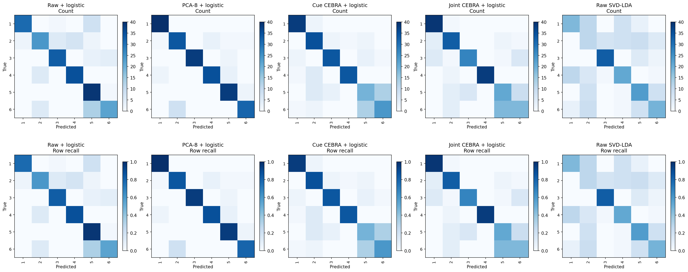
start6, observed seed1, wholecue0–1s development predictions. Top=count, bottom=row-normalized recall, all five representation/readout families;240 synthetic rows, not240 independent biological trials. No seed aggregation or uncertainty interval. Pair labels are ordered(start,goal); endpoint IDs are provisional marker-derived categories. Endpoint cohort:195 units/58 sessions;12,288 train and3,265 historically exposed development real sources. Label-conditioned cross-session pseudopopulations,480 train/240 development rows per seed. Cue-only evaluation; frozen1,000-update encoders; train-only scaling/PCA/readouts. Logistic C=0.01 for raw/PCA/CEBRA; raw SVD-LDA is a supervised reference. Source: run-reviewed-20261007 saved artifacts (hashes in provenance.json). Not trial-specific or path/H1 evidence.

### confusions goal6 seed1
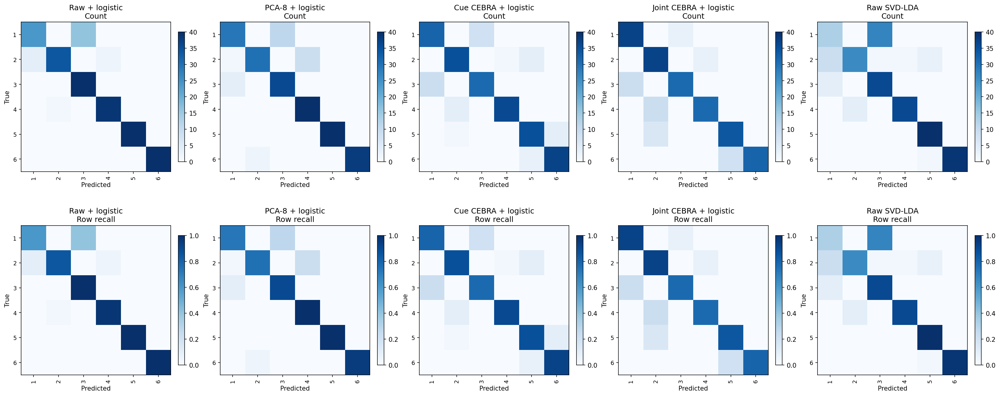
goal6, observed seed1, wholecue0–1s development predictions. Top=count, bottom=row-normalized recall, all five representation/readout families;240 synthetic rows, not240 independent biological trials. No seed aggregation or uncertainty interval. Pair labels are ordered(start,goal); endpoint IDs are provisional marker-derived categories. Endpoint cohort:195 units/58 sessions;12,288 train and3,265 historically exposed development real sources. Label-conditioned cross-session pseudopopulations,480 train/240 development rows per seed. Cue-only evaluation; frozen1,000-update encoders; train-only scaling/PCA/readouts. Logistic C=0.01 for raw/PCA/CEBRA; raw SVD-LDA is a supervised reference. Source: run-reviewed-20261007 saved artifacts (hashes in provenance.json). Not trial-specific or path/H1 evidence.

### confusions pair30 seed2
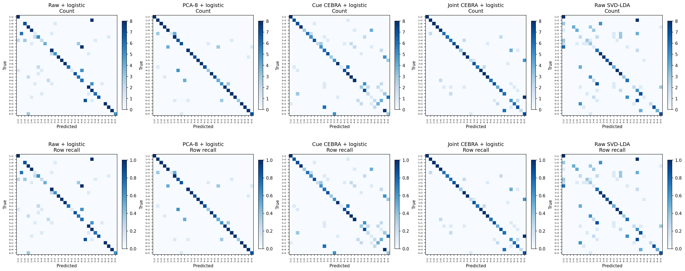
pair30, observed seed2, wholecue0–1s development predictions. Top=count, bottom=row-normalized recall, all five representation/readout families;240 synthetic rows, not240 independent biological trials. No seed aggregation or uncertainty interval. Pair labels are ordered(start,goal); endpoint IDs are provisional marker-derived categories. Endpoint cohort:195 units/58 sessions;12,288 train and3,265 historically exposed development real sources. Label-conditioned cross-session pseudopopulations,480 train/240 development rows per seed. Cue-only evaluation; frozen1,000-update encoders; train-only scaling/PCA/readouts. Logistic C=0.01 for raw/PCA/CEBRA; raw SVD-LDA is a supervised reference. Source: run-reviewed-20261007 saved artifacts (hashes in provenance.json). Not trial-specific or path/H1 evidence.

### confusions start6 seed2
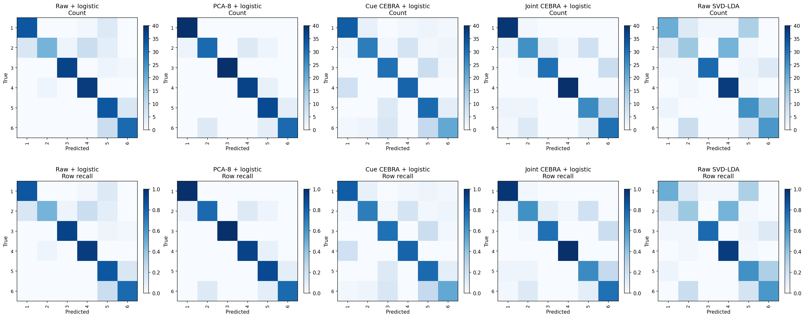
start6, observed seed2, wholecue0–1s development predictions. Top=count, bottom=row-normalized recall, all five representation/readout families;240 synthetic rows, not240 independent biological trials. No seed aggregation or uncertainty interval. Pair labels are ordered(start,goal); endpoint IDs are provisional marker-derived categories. Endpoint cohort:195 units/58 sessions;12,288 train and3,265 historically exposed development real sources. Label-conditioned cross-session pseudopopulations,480 train/240 development rows per seed. Cue-only evaluation; frozen1,000-update encoders; train-only scaling/PCA/readouts. Logistic C=0.01 for raw/PCA/CEBRA; raw SVD-LDA is a supervised reference. Source: run-reviewed-20261007 saved artifacts (hashes in provenance.json). Not trial-specific or path/H1 evidence.

### confusions goal6 seed2
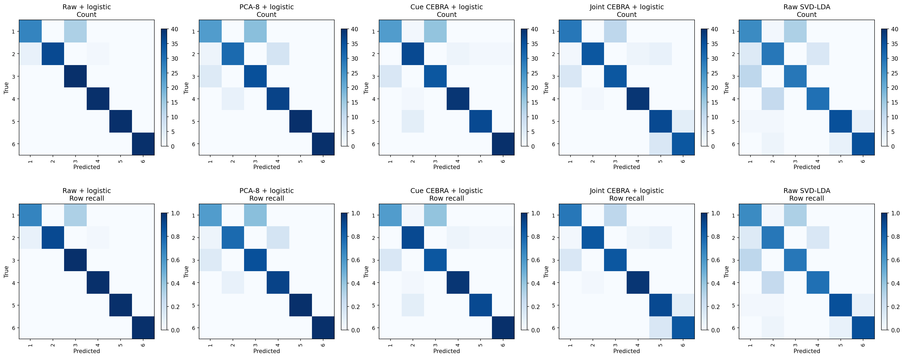
goal6, observed seed2, wholecue0–1s development predictions. Top=count, bottom=row-normalized recall, all five representation/readout families;240 synthetic rows, not240 independent biological trials. No seed aggregation or uncertainty interval. Pair labels are ordered(start,goal); endpoint IDs are provisional marker-derived categories. Endpoint cohort:195 units/58 sessions;12,288 train and3,265 historically exposed development real sources. Label-conditioned cross-session pseudopopulations,480 train/240 development rows per seed. Cue-only evaluation; frozen1,000-update encoders; train-only scaling/PCA/readouts. Logistic C=0.01 for raw/PCA/CEBRA; raw SVD-LDA is a supervised reference. Source: run-reviewed-20261007 saved artifacts (hashes in provenance.json). Not trial-specific or path/H1 evidence.

## Verification and limits

All126 encoder fits,63 PCA fits and10,395 readouts completed in32m10s, retaining all20null worlds and three seeds. Original replay false negatives were retained: float32 scaler accumulation, a PCA dtype/arithmetic-order mismatch, and CPU-vs-CUDA rounding. Separate reviewed verification uses original float64 scaler statistics, saved-float32 sklearn PCA.transform and the fitted CUDA backend; no model refits or tolerance relaxation. All63 scalers and378 PCA/encoder train/development feature arrays independently reproduced exactly. The complete amended replay checks hashes, lineage, all encoders/readouts, metrics, confusions, nulls, paired comparisons and source sensitivity; see the bound receipt and execution ledger.

Independent saved-prediction review recomputed all20,790 metric rows (max error0 except macro-F1≈3.3e−16). Probability row sums differ from1 by at most3.53e−7; optional renormalization would alter log loss by at most2.23e−8. Reported values retain the original saved-prediction computation. No metric was changed to select a favorable model.

The independent unit is the real source trial/session, not a bin or synthetic row. Source-deletion ranges are finite-pool sensitivity, not uncertainty intervals. Endpoint IDs are provisional. This study cannot establish prospective path information beyond start/goal, intention, simultaneous population dynamics, biological rotation, or encoder superiority on independent future recordings.

## Separate completed path assay

The October5 fixed4→3 component study remains separate:29units/7sessions,82training/22historical-validation sources. Its descriptive joint/logistic100–200ms peak was88.9%, but its primary family tail was9/21 and absolute family tail17/21. It is not rerun or pooled with these endpoint results. See `../cebra-cue-time-readout-20261005/README.md`. Full ordered-path prediction remains outside this study.

## Provenance and operation

Run: `outputs/cebra-endpoint-time-readout-20261006/run-reviewed-20261007`. Run-manifest SHA256: `e0f88a72b436b6fd86299c5e4575af2137904b4e21c57a7fbaa392661b802a36`. Verification-receipt SHA256: `998724e5c4722ecd4da280e003c916e76f08e2e3bca294f12c7409bec9aa0778`. Full artifact pointers and renderer hash: `provenance.json`. See `protocol.md`, `execution.md`, and `run-operations.md`. No raw data or model fits are created by this renderer. PR15 remains draft/unmerged.
