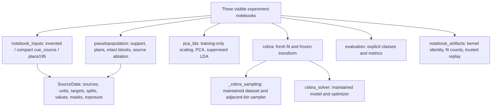
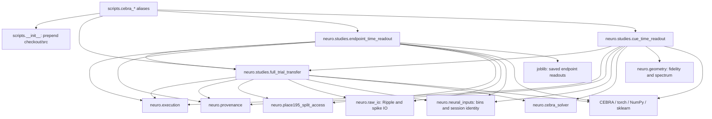
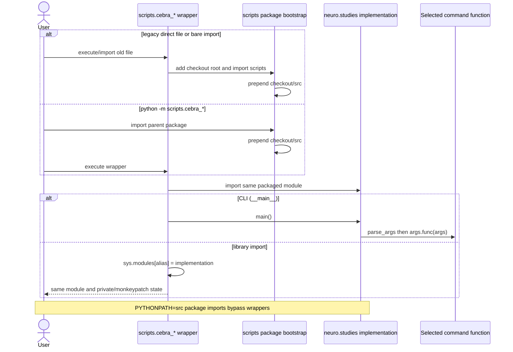
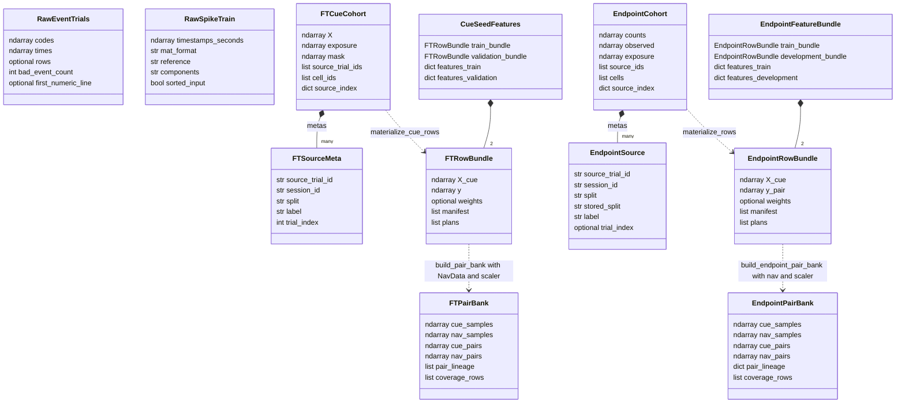
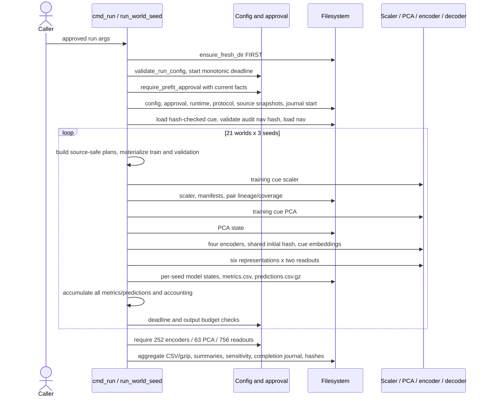
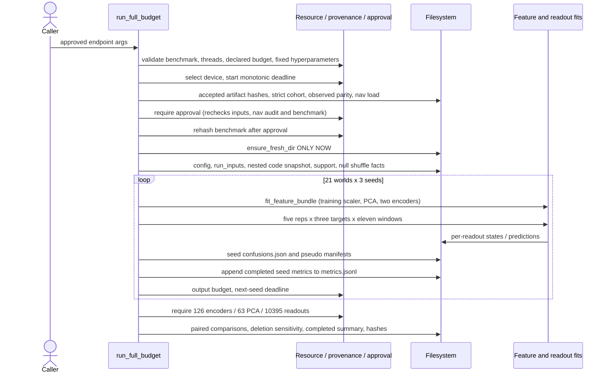
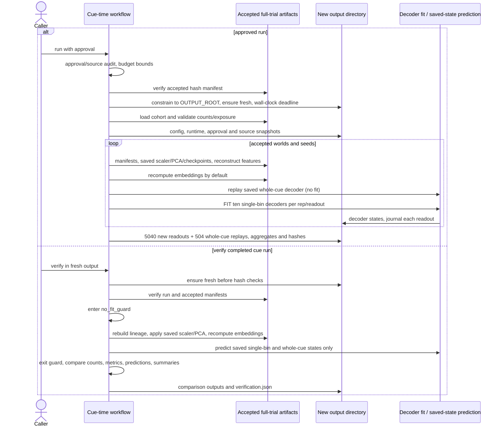

# Scientific package software design

Maintained as-built engineering reference, updated for the **October23 independent
public APIs and fresh-input notebooks** (local implementation on `3f84018`).
[Execution ledger](shareable-notebooks-execution-20261023.md) owns validation/run identities.
Historical package checkpoint `8c98b52` and October15 helper cleanup were delivered
through [PR20](https://github.com/Hong-yiii/neuro_science/pull/20); that publication does
not imply publication of the current local changes.
This document is the canonical engineering source; the preserved
[HTML design preview](codebase-design.html) is historical and may lag it.
GitHub renders the Mermaid blocks; no server, renderer dependency or new HTML is required.

## Scope and reading contract

`src/neuro/` contains **whole concrete exploratory experiment workflows and reusable
helpers**, not a pure helper library. The supported family is full-trial transfer,
endpoint-time readout and frozen cue-time readout, end to end: input validation,
assembly, training/readout algorithms, controls, provenance and verification. There is
no common `Runner`, experiment service or general-purpose pipeline framework. The owner
has additionally approved the independently usable source/assembly/PCA-LDA/CEBRA APIs
and three actual notebooks described below. Historical reproducibility or hypothetical
future consumers still do not justify compatibility layers.

Packaging preserves scientific definitions while changing imports, equivalent
bookkeeping and current-source provenance. It does not authorize execution, approve
current hashes, certify deployment or strengthen a biological claim. Frozen historical
approvals do not approve today's source. Historical-only experiment bodies remain
outside package support; no architectural/code migration is requested by this scope note.

**Document roles:** the [root README](../README.md) is the evidence/reader landing page;
[package reference](../src/neuro/README.md) owns checkout usage and module contracts;
this document owns as-built dependencies, objects, lifecycle ordering and gaps.
[Migration ledger](reorganization.md) owns implementation status/history; the preserved
[HTML design preview](codebase-design.html) may lag source and is not a competing current
architecture. Scientific claims belong to the [report](../report/README.md) and
[analysis contract](analysis-contract.md).

### Workflow/library boundary: current coupling, not a finished split

The three study modules are **not three reusable helper APIs**. They each contain
concrete orchestration and substantial scientific algorithms/data objects. Endpoint
imports full-trial's CEBRA dataset/training/embedding machinery; cue-time imports
full-trial cohorts, binary assembly, decoder states and comparison machinery. Full-trial
therefore acts both as one experiment and as the current owner of common algorithms.
The diagram's endpoint/cue → full-trial arrows are real coupling, not merely references
to an independent helper layer. Imports bring in its scientific runtime too.

Purpose-specific `raw_io`, `neural_inputs`, `cebra_solver`, `geometry`, split access,
execution and provenance remain helper seams. Shared CEBRA dataset/samplers now live
in `_cebra_sampling`, with full-trial re-exports preserving callers and exact extracted
AST checks. Study-specific training/cohort/readout coupling remains; distinct binary/
endpoint labels and lineage objects have not been merged. The new public APIs are
independent of these study modules.

Diagrams below describe implemented source, not a proposed target architecture.
Dependency arrows mean “imports/uses,” not data movement. In the UML, composition denotes
stored objects; dashed arrows denote functional construction/use, not inheritance.
Sequence diagrams show successful paths; any failed gate raises and stops that path.
“FS” means local filesystem, including protected private artifacts only when explicitly
called with authorization. Counts are protocol expectations, not fresh execution evidence.

## Fresh supplied-input layer — implemented October23



`SourceData` validates explicit timing/units/provenance and source×unit×bin arrays.
Unavailable measurements remain masked/NaN, not zeros. Masks currently represent
complete observed bins per source/unit; unsupported dropout fails. Plans bind source
content, split and effective condition identities; materialization validates lineage.
Training-source ablations preserve the evaluation plan and refit all learned stages.

The place195 adapter authenticates six named inputs, derives provisional endpoints,
regenerates frozen assignments and selects a directly contributor-disjoint panel
before interpreting neural numbers. Reconstruction independently recomputes canonical
metadata before numeric traversal; mutable/forged selections cannot replace the gate.
The compact `cue_source` route derives trial metadata and fresh native-precision bins
from the committed unbinned view, reusing that historical selection policy and frozen
assignments. Both routes bind the inspection-time configuration fingerprint and
reinspect canonical metadata before consumption. Compact NPZ headers and payloads
are bounded before allocation; selected units' whole timestamp vectors are scanned
to find cue windows. No historical neural tables or fitted results are required.
This dataset policy is not hidden in the general model/assembly APIs.

Raw normalization is training-only with unit-major flattening. PCA uses full SVD and
explicit numerical-rank refusal, not historical padding. Latent layouts are time-major.
LDA remains a supervised classifier. CEBRA reuses the maintained sampler/solver,
reports native pairs/exposure and enforces cooperative update deadlines; external
containment supplies the hard process/memory limit. Notebook cells expose all fit loops,
targets, seeds and budget comparisons—no hidden whole-study invocation.

The bounded executor runs fresh sequential kernels, identifies their actual installed
code before inputs/fitting, rejects identity drift and counts actual fits/updates.
Authenticated new states are transformed/predicted again with fitting/updates blocked.
Manifest authentication is not safe loading of arbitrary external pickles: only trusted
fresh artifacts with a separately retained expected manifest hash are supported.
Private output and final disk/deadline checks complement, not replace, independent
privacy/scientific review. Current source-notebook outputs are cleared, not stale
invented outputs. The [October26 ledger](compact-cue-source-20261026.md) records the
non-fitting compact-source A execution; B/C were not executed for this update.

One setuptools distribution supplies optional `cebra` and `notebooks` extras. Public
construction/PCA use does not import CEBRA/torch/studies or require Git/private roots.
Installed-wheel runs were validated outside the checkout; retained dependencies were
borrowed read-only rather than freshly resolved. No stable API or licensing grant is
implied. [Notebook usage](../notebooks/README.md) and [API reference](../src/neuro/README.md#independent-public-workflow).

## Concrete study ownership and component dependencies



Legend: selected direct dependencies, not an exhaustive third-party import graph.
Endpoint uses full-trial solver/training objects. Cue-time imports geometry directly;
full-trial/endpoint do not load it. No package module imports `scripts` or changes
`sys.path`. External CLI bootstraps point into the package only. Provenance enumerates
source identities, rather than importing all enumerated files.

| Owner / source | Public-use entry or shared seam | Internal implementation responsibilities |
| --- | --- | --- |
| [Full-trial](../src/neuro/studies/full_trial_transfer.py) | `main`, `parse_args`; existing consumers reuse `CueCohort`, `RowBundle`, `CebraVectorDataset`, loaders, `train_encoder`, `embed_cue`, decoder/state helpers | Binary path-component cohort, plans, pair bank, four encoder arms, baselines, paired summaries and source sensitivity |
| [Endpoint](../src/neuro/studies/endpoint_time_readout.py) | `main`, `parse_args`; `run_full_budget`, `replay_run` are concrete workflow entry functions | Endpoint artifact parity, independent cohort/lineage, navigation audit, benchmark/approval gates, target/window readouts and streamed confusion output |
| [Cue-time](../src/neuro/studies/cue_time_readout.py) | `main`, `parse_args`; `load_seed_features`, `extract_window_features`, `replay_run` support this frozen study | Reconstruct accepted full-trial features, fit single-bin readouts, replay whole-cue states, verify and report |
| [Split gate](../src/neuro/place195_split_access.py) | `SplitFilteredAccess`, `SplitAccessError`, `SplitFilteredAudit.as_dict` | CSV/gzip source validation before yield, allowed-source gate and seen/skipped/yielded counters |
| [Execution](../src/neuro/execution.py) | `sha256_file`, `ensure_fresh_dir`, `check_deadline`, `snapshot_sources` | Equivalent byte hashing, endpoint/cue fresh paths, full-trial/endpoint monotonic deadlines, bounded nested snapshot paths |
| [Provenance](../src/neuro/provenance.py) | `REPOSITORY_ROOT`, `study_sources` | Explicit current source closure; reject unknown study, missing source or implementation outside checkout |
| [Raw IO](../src/neuro/raw_io.py) | `read_ripple_trials`, `read_spiketrain`, `spikes_in_window`, marker/time and CSV precision helpers | `EventTrials`/`SpikeTrain`, HDF5 group/orientation checks, MATLAB decoding, ms-to-seconds and accepted serialization |
| [Neural inputs](../src/neuro/neural_inputs.py) | `bin_events`, `session_from_cell` | Count/exposure/omission rules and session identity |
| [Solver](../src/neuro/cebra_solver.py) | `make_solver` | Fixed offset1 model, cosine criterion and Adam optimizer construction |
| [Geometry](../src/neuro/geometry.py) | `fidelity`, `spectrum` | Cross-row distances/neighbors, rank correlation and descriptive spectrum |

“Public-use” is a navigation guide, **not** a promise of versioned stable APIs.
Private functions, module constants and state formats remain study-specific. Legacy aliases
expose private attributes for compatibility; that does not make them preferred new APIs.
There is no shared result schema or inheritance hierarchy for the three workflows.

## Configuration, imports and command entry

Defaults still name `/home/hongyi-home-lab/neuro_science` and dated private study roots.
Protocols/current-source closure resolve from the actual checkout via `REPOSITORY_ROOT`;
private input defaults do not relocate automatically with a clone. CLI options override
only the paths/settings offered by each parser. Full-trial locks encoder settings against
`locked_config`; endpoint locks model constants and benchmark/config facts; cue limits
runtime/output budgets against frozen maxima. Constants are not a generic configuration file.

Importing `neuro`, `neuro.studies`, `execution` and `provenance` is stdlib-only. Study
imports require the retained scientific runtime but do not open lab inputs or fit models.
Some parser defaults probe CUDA availability, so help can emit driver warnings.
Use `PYTHONPATH=src` (absolute checkout `src` when elsewhere). Package imports do not
bootstrap the checkout root or load historical scripts. External aliases alone own
path bootstrapping. `pyproject.toml` supplies a
Pyright source path and general dependencies, not a complete historical replay environment.
The new independent public APIs have installed-wheel validation. The concrete study
commands below remain checkout/private-input workflows; their full historical runtime
and arbitrary old artifact portability are not thereby certified.



Old `scripts.cebra_*`, bare `cebra_*` and package imports resolve to the same module.
Historical `scripts.cebra_*` pickle lookup remains resolvable; newly serialized classes
name the package. Arbitrary historical `__main__` pickle paths are not certified.
Audit/prepare/geometry/report/verify are **not** interchangeable with data-free checks:
no-fit commands can read protected inputs and write new artifacts.

## UML: distinct source and assembly objects



Legend: `RawEventTrials`/`RawSpikeTrain` qualify the `neuro.raw_io` types and have
no inheritance or identity relationship to study source/lineage classes.
`FT*` and `EndpointRowBundle` are diagram-qualified names; real full-trial types
are `SourceMeta`, `CueCohort`, `RowBundle`, `PairBank`; endpoint also defines its own
`RowBundle`. Cue's actual container is `SeedFeatures`. Selected fields are shown, not
complete API declarations. Each pair bank also stores labels and per-row sample/pair
indices. `NavData` and `EndpointNavData` independently hold flattened ragged counts,
exposure, masks, source identity, offsets and native bin counts. They are not subclasses.

### Shapes, labels and time references

| Object / contract | Implemented shape, dtype or meaning |
| --- | --- |
| Full-trial source cohort | `X`: `(104,29,10)` float32; exposure `(104,10)` float32 seconds; mask `(104,29)` bool. Fixed source hash and bin width 0.1 s; 82 train + 22 historical validation sources |
| Endpoint source cohort | Strict `(15553,195,10)` float32 counts, bool observed `(15553,195)`, float32 exposure `(15553,10)`; 12288 train + 3265 development sources, 58 sessions |
| Source labels | Full-trial absent/present of `D_N_R_T__N_R_M` at fixed endpoint `4→3`; endpoint 30 directed non-self start/goal pairs. Endpoint preserves historical `stored_split` while mapping validation → development; all endpoint sources originated in outer train |
| Assembled rows | `(rows,cells,10)` float32 counts, labels int64; full-trial `y` binary, endpoint `y_pair` 0–29. Full-trial 128 training rows (64/class), endpoint 480 train/240 development (16/8 per pair); synthetic rows are not independent recorded trials |
| Feature layout | Raw cell-major flatten: full-trial 290, endpoint 1950 whole-cue features. PCA/CEBRA bin-major `(row,10,8)` flattened to 80; single bins use 29/195 raw or 8 latent coordinates |
| Navigation | Native 100 ms bins referenced to cue end, ragged flattened `(total_bins,cells)` counts/masks; offsets int64, exposure seconds. Endpoint retains complete bins with a numerical tolerance/clamp, not a partial terminal bin |
| Pair banks | Float32 neural vectors; int64 labels/pair indices. Cue pairs only adjacent bins in each row. Nav pairs select native adjacent bins per session at normalized progress `q=(j+0.5)/L`; not synchronized cross-session biological time |
| Endpoint compact lineage | `session_ids`, per-row `source_trial_ids`, int64 `row_pair_offsets`, uint16 `native_anchor_bins`; explicit capacity guard. Full-trial instead stores per-pair dictionaries with row, label, phase_q and session/source/native-bin blocks |

Raw reader UML boundary: `raw_io.EventTrials` owns marker `codes` and `times` arrays
plus optional row/audit metadata; `raw_io.SpikeTrain` owns sorted timestamp seconds
and format/reference/component metadata. They are not the study-specific source or
lineage classes above. Readers construct these objects, not historical importer classes.

Cue and navigation boundaries are verified against Ripple trial timestamps and imported
windows by the owning extraction functions; numerical bin index is not independent trial
identity. `extract_window_features` encodes different raw/latent reshape order explicitly.
Do not infer timing, simultaneity or label semantics from tensor shape alone.

### Invariants and lineage boundaries

- Split gate accepts only subsets of `{train, validation}` and validates all table source
  mappings before first yield. Counters record skipped rows; filtering does not mean files
  containing other splits are never scanned. Cached table validation is not a filesystem lock.
- Both assembly functions check session/split membership and observed-cell masks and reject
  unavailable assembled cells rather than silently imputing. Endpoint source loader explicitly
  requires absent-session cells to remain non-finite, not zero-filled.
- Scalers and PCA fit on assembled training cue only. Validation/development are transformed;
  encoder training does not consume their navigation. Readout fits use training features/labels.
- Source-label null worlds shuffle within session/split restrictions, then reassemble; they are
  not arbitrary row permutations. Source manifests connect each synthetic session block back
  to its actual source. Source deletion/resampling uncertainty is not independent pseudo-row CI.
- Native navigation pair coverage is checked, pairs do not cross rows or cue/navigation phase
  boundaries. Full-trial paired encoders check equal initialization hashes.
- Pseudopopulations support condition-level associations, not same-trial covariance, dynamics,
  intention or mechanistic/observability claims. Endpoint labels and binary path labels cannot
  be unified because their array containers look similar.

## Full-trial run lifecycle

Helper extraction changes import/source ownership, not the three lifecycle orderings
below. Snapshots now capture internal helpers rather than obsolete script bodies.

Source: `cmd_run` → `run_world_seed` in [full_trial_transfer.py](../src/neuro/studies/full_trial_transfer.py).



The output directory exists even if config/approval fails. The loop's exception handler
journals `run_failed`, but earlier preflight/cohort failures are outside that `try`.
Models and per-seed results are incremental; root aggregates stay in memory until all
seeds complete. Thus full-trial is **not** an all-or-nothing transaction.

## Endpoint run lifecycle

Source: `run_full_budget`, `approval_facts`, `validate_resource_benchmark` in
[endpoint_time_readout.py](../src/neuro/studies/endpoint_time_readout.py).



Endpoint preflight reads private artifacts **before** fresh output creation, unlike
full-trial. Metrics remain accumulated for summaries, but confusions are written per
seed rather than retaining all 6.7 million rows. There is no enclosing full-trial-style
failure journal; stdout reports completed seeds. A partial seed may contain fit states
without completed metrics/confusions. Summary/hash completion is a separate final step.

## Frozen cue-time run and no-fit verification

Source: `cmd_run`, `load_seed_features`, `fit_one_readout`, `replay_wholecue_readout`,
`cmd_verify`, `no_fit_guard` in [cue_time_readout.py](../src/neuro/studies/cue_time_readout.py).



Run does **not** train encoders or PCA but **does fit readouts**. `--use-saved-embeddings`
skips recomputation in run, not the manifest/checkpoint/label checks. Verify always
recomputes embeddings. Geometry uses saved checkpoints at 250/500/750/1000 updates;
it is a descriptive no-fit branch, not another predictive factorial or permission to run.

Cue guards patch scaler/PCA/logistic/SVC fits and Adam steps temporarily and restore them
in `finally`. Endpoint replay uses `FITS_BLOCKED` plus temporary logistic/LDA/PCA patches;
training helpers inspect the flag. Full-trial verify installs process-wide fit/step
monkeypatches without restoration: prefer a separate process, not a persistent notebook.
These are bounded workflow guards, **not security sandboxes** or universal fit interception.

## Filesystem, provenance and failure contract

| Workflow | Artifact layout and replay obligations |
| --- | --- |
| Full-trial | Root config/approval/runtime/input facts and `helper_snapshots/`; `worlds/NN_name/seedN` owns cue scaler, assembly CSVs, gzip pair lineage, PCA, `encoders/arm`, `readouts/rep/decoder`, seed results. Root `hash_manifest.json`; verify requires exact grid, locked config and forward accounting, compares saved aggregates/sensitivity |
| Endpoint | Root `run_config.json`, `run_inputs.json`, `code_snapshot/`, support, `metrics.jsonl`, final `summary.json`; `observed/seedN` and `null_NNN/seedN` own features, compact pair lineage, readouts, confusion JSON and pseudo manifests. `artifact_hashes.json`; replay requires completed summary, exact grid, input/approval/benchmark hashes, **current code equality with frozen hashes** and snapshot hashes |
| Cue-time | Root approval/config/runtime/protocol/helper snapshots and journal; `worlds/NN_name/seedN/readouts/rep/window/decoder` contains new states. Aggregate metrics, gzip predictions, confusion/sensitivity/summary plus full-trial-style hash manifest; verify writes separate `verification.json` and comparisons |

`study_sources` enumerates the active implementation/helper closure, package initializers
and external CLI aliases plus their initializer. The alias files remain solely to preserve
the current launch/snapshot contract; no obsolete experiment body is included. Geometry
is included only for cue-time. Historical helper scripts and the adapter are excluded. Endpoint includes its protocol in helper
paths along with `pyproject.toml` and `uv.lock`; other workflows bind documents through their own facts. Snapshot copying creates
nested repository-relative paths and rejects escapes. Flat `code_snapshot_cebra_*.py`
files now contain implementation, not merely wrapper code. Snapshots are source evidence,
not portable executable environments. Run metadata differs: full-trial/cue record Git
state and command; endpoint `run_inputs` records resolved input paths, hashes and versions.

Fresh-directory checks refuse any existing destination. **No resume protocol is
implemented**: journals and saved states are diagnostic/replay evidence, not restart
checkpoints for skipping completed fits. Preserve failed output and approval facts;
review the cause and obtain scope before a retry in a distinct fresh directory. No
automatic cleanup, rollback, atomic multi-file commit or overwrite recovery is supplied.
Readers/JSON/CSV writes can fail mid-run, and budget failures preserve partial artifacts.
Completion counts and verified manifests, not process exit alone, establish completeness.

## Approval, security and resource boundaries

Approval JSON binds current protocol/code/helper/input facts; relocation deliberately
stales old approval/benchmark hashes. Do not replace historical hashes to bless changed
source. Endpoint's exact-current-source replay rule prevents using current package code
as an automatically accepted replay of old snapshots. Use the retained executed source,
original runtime/approval and separately authorized private artifacts for historical work.

Approvals are local hash-bound declarations, **not signed identities or OS permissions**.
Loading checkpoint/joblib/pickle-compatible state trusts its origin; hash equality proves
identity relative to a manifest, not safety of an untrusted payload. Source snapshot/path
containment checks do not authorize raw access. Full-trial/endpoint run output paths are
not universally constrained to canonical roots; cue run explicitly is. No network service,
credential system, daemon, process lock or host-wide resource scheduler is added here.

Full-trial/endpoint use cooperative monotonic 90-minute deadlines; cue uses wall time
(up to 90 minutes). Ten-GiB output checks occur at discrete boundaries, so they are not
hard disk quotas. Long operations can overshoot a cooperative deadline. Full-trial locked
config declares two threads but `cmd_run` does not implement endpoint's thread setter.
Endpoint uses environment `setdefault` plus torch thread limit; existing BLAS environment
values are not overwritten. It validates a source-bound **CUDA** invented-data benchmark,
preflight inputs, workload, projected runtime with 25% margin and output projection.
Explicit CUDA selection requires availability and at least 80% free GPU memory.
Although endpoint parser defaults to CPU, approval config must match the CUDA benchmark:
the biological full-budget path is not thereby certified for CPU execution.

## Validation layers and documentation assessment

Proportionate **non-fitting** checks from checkout (no installation):

```sh
PYTHONDONTWRITEBYTECODE=1 /usr/bin/python3 -m unittest scripts.test_place195_split_filtered_access -v
PYTHONDONTWRITEBYTECODE=1 PYTHONNOUSERSITE=1 scratch/v6-v9-runtime/bin/python -B \
  -m unittest scripts.test_neuro_study_package -v
PYTHONDONTWRITEBYTECODE=1 /usr/bin/python3 report/test_layout.py
PYTHONDONTWRITEBYTECODE=1 /usr/bin/python3 report/test_path_summary.py
```

The package suite covers pinned `cc0527e` study AST equivalence and exact AST of all
21 extracted helpers against `ce31248`, shared bookkeeping/nested snapshots, cold imports
rejecting private paths and fit/step APIs, aliases/class/pickle identity, active source
closure and nine help invocations. Package-only cold imports and copied snapshot imports
from another cwd load no scripts; a static check forbids package script imports/path shims. It needs that Git object and the retained runtime.
The split suite uses invented CSVs and source/identity checks. Report layout/arithmetic
cover presentation, not model science. These commands are maintenance guidance, not a
claim they were all rerun when writing this reference. The
[recorded validation ledger](reorganization.md#package-consolidation-validation--october13)
reports 42 guarded checks in the earlier local state; package commit publication is later.

Do **not** run broad `check_research_software.py` by name alone: private embedding QA is
included. Synthetic-smoke/benchmark tests can fit, even on invented arrays; fits remain
outside documentation scope. Forward replay is no-fit but private-data access and runtime
certification are separate authorization/validation layers. Preserved frozen-HTML integrity
failure is not a green test. CUDA probes previously emitted error804 warnings; there is
no new GPU or historical-private-replay certification from those historical checks.
October23 adds the scoped CPU installed-wheel/notebook checks recorded in the execution
ledger; it does not certify every dependency/platform combination.

Engineering assessment: source ownership, real object boundaries, import compatibility,
entry/config behavior, lineage, preflight ordering and failure artifacts now have a
maintained reference and diagrams. Remaining gaps are explicit: no complete per-function
API catalog, formal machine-readable schema/version policy for every artifact, supported
cross-host portability matrix, stable public artifact schemas, restart/resume implementation
or deployment certification. Current source closure is manually audited, not automatic
arbitrary dynamic dependency discovery. Those gaps are not reasons to invent a Runner.

Active-helper extraction is implemented without migrating old experiment families.
The [script inventory](../scripts/README.md) and
[package scope and historical boundary](../src/neuro/README.md#active-helper-ownership-and-historical-boundary)
distinguish supported current helpers from unchanged historical script implementations.
No historical snapshot, hash or approval is rewritten. Current approval/source hashes
intentionally change. No old scientific body is declared safely deletable.

**Notebook integration is implemented:** the three fresh-input notebooks use independent
public operations rather than study runners; source/target/assembly/model choices remain
visible. Temporary replay monkeypatches are restored. The October19 historical saved-model
notebook remains separate and unchanged. Restart-and-run-all evidence and the separately
authorized real execution are recorded in the [execution ledger](shareable-notebooks-execution-20261023.md).
No permanent server, new public data/license grant or PR merge is implied.
