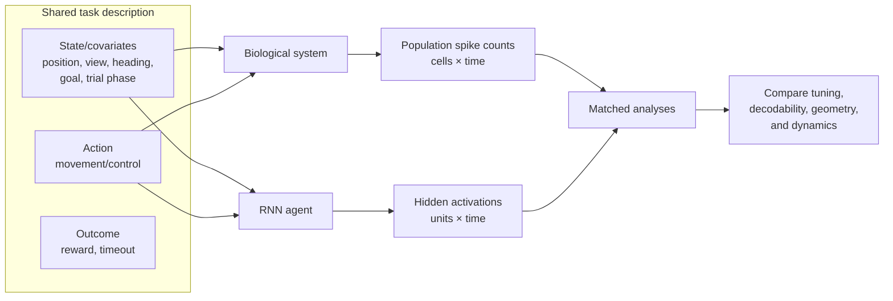
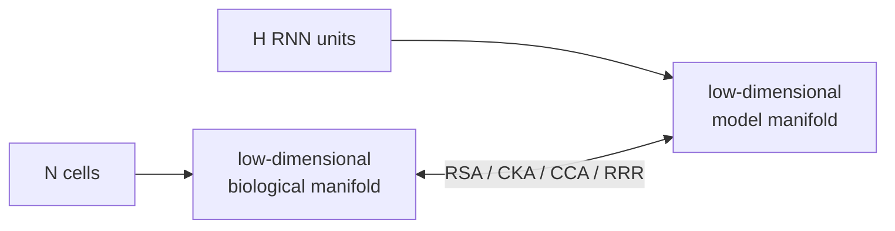
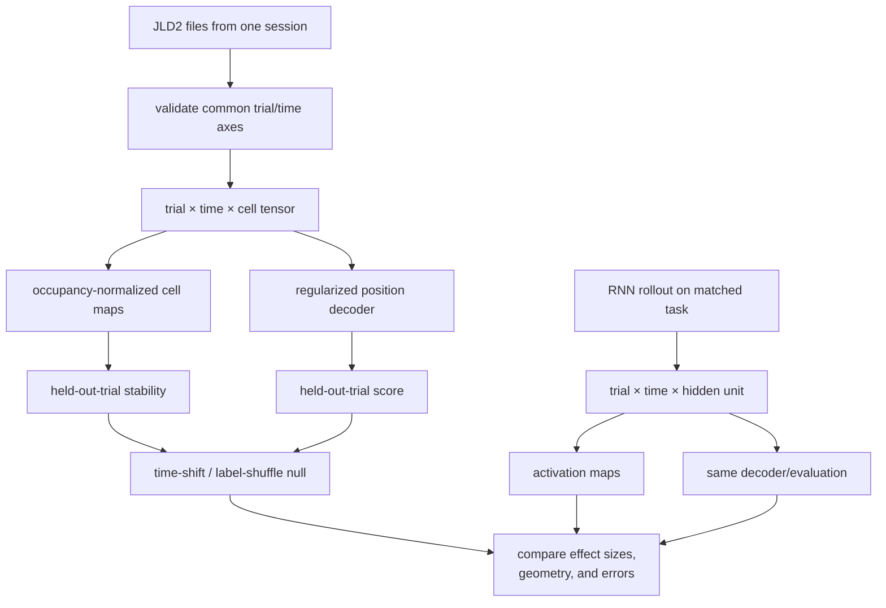

# Supervisor Meeting: Neural–Agent Comparison

> **Historical — superseded by the 2026-08-17 research pivot.** This pre-pivot
> scratchpad retains useful dataset and place-analysis background, but its
> RNN/place-first milestones are no longer the active plan. Use
> [`research-questions.md`](research-questions.md) for current H1/H2 framing,
> [`analysis-contract.md`](analysis-contract.md) for required data, and
> [`getting-started-tasks.md`](getting-started-tasks.md) for current priorities.

Status: archived pre-pivot discussion scratchpad
Prepared from the currently received place-spatial-bin export

## 30-second update

We now have a small, readable biological-data example: one file represents one
sorted cell across variable-length navigation trials, with spike counts and a
spatial-bin label every 20 ms. I have created a reproducible Python/`uv` loader
and an initial visualization that checks trial duration, spike sparsity,
occupancy, and occupancy-normalized firing rate. The immediate goal is to first
verify that multiple cell files share the same trials and 20 ms windows, then
assemble them into a population object and run a leakage-safe place-decoding
baseline. In parallel, we should make the virtual
agent emit the same trial/time behavioral labels alongside its hidden state.
The first comparison should be representational and predictive—not a claim that
an RNN unit is a neuron or that either system implements the same mechanism.

## The project in one diagram



The shared object is the **task trajectory**, not a neuron-to-unit pairing. At
each time point, both systems should be indexed by comparable task variables.
Their internal responses may have completely different dimensions.

## What we actually received

### Verified shape

A JLD2 file represents one sorted cell:

```text
cell file
└── trial t                       # trials have unequal lengths
    ├── trialidx[t]
    ├── spikecounts[t][k]         # detected spikes in 20 ms window k
    └── bins[t][k]                # spatial-bin label for the same window
```

For the inspected `f1526be5` example:

| Property | Observed value |
| --- | ---: |
| Cell files inspected in detail | 1 exact-hash example |
| Trials | 395 |
| Total 20 ms samples | 65,576 |
| Median trial duration | 3.26 s |
| Total spikes | 1,441 |
| Median spikes per trial | 3 |
| Visited spatial-bin labels | 453 |
| Spatial-bin label range | 0–1342 |

There is also a curated list of 195 place-selective cell paths and a second
example file with a different hash. These are not yet a synchronized
195-cell population dataset.

### ML translation

```text
Current single-cell example
X/context:  trial × ragged_time → spatial_bin_id
Y/response: trial × ragged_time → spike_count_for_one_cell

Desired biological population
X/context:  trial × time → state, action, outcome
Y/response: trial × time × recorded_cell → spike_count

Desired virtual-agent population
X/context:  trial × time → state, action, outcome
Y/response: trial × time × hidden_unit → activation
```

A 20 ms bin is one correlated time sample, not one independent training example.
The effective sample size is much closer to the number/diversity of trials than
to 65,576.

### Directly observed versus inferred

| Item | Status |
| --- | --- |
| Sorted spike count in each exported 20 ms bin | Provided, but already derived from electrical recordings and spike sorting |
| Spatial-bin ID | Provided behavioral label |
| Cell firing-rate map | Derived: spikes divided by occupancy time |
| Place selectivity | Inferred; requires stability and null controls |
| Memory, intention, or internal “state” | Not directly observed |
| RNN hidden activation | Directly accessible model variable |
| Equivalent biological/model mechanism | Not established by representational similarity |

## Current gaps to resolve

The present export is enough for a **place-rate analysis**, but not yet for the
full state–action comparison.

| Needed field or property | Current status | Why it matters |
| --- | --- | --- |
| Spatial bin → physical coordinate lookup, such as `(x,y)` or Unity `(x,z)` | Missing | Required for a real maze heatmap and geometric distance |
| Meaning of spatial bin `0` | Unknown; anomalously high occupancy | Could be a valid location or an invalid/outside label |
| Same trial IDs across cell files | Unconfirmed | Required to form `trial × time × cell` |
| All simultaneously recorded cells | Not received | Population geometry requires a population, not independently pooled cells |
| Non-place-selected cells | Not received | The selected list cannot estimate prevalence or serve as an unbiased population |
| Heading, speed, view/gaze, goal, trial phase | Not in current export | Position can be confounded with these variables |
| Biological action/control signal | Not in current export | Movement can be derived from position, but intended action may require joystick/input logs |
| Reward/timeout | Not in current export | Needed to align task outcome and policy phases |
| Spike-sorting/curation status | Unconfirmed | Defines whether cell identity and quality control are upstream/final |
| RNN rollout/checkpoint schema | Not received | Needed for the matched half of the analysis |

“State” should not silently mean only `spatial_bin_id`. For this task it may
include position, heading, speed, view, goal, and trial phase. Likewise,
biological “action” may be joystick input, observed displacement, or an inferred
movement category; these are different variables and should be named precisely.

## Proposed parity contract

Use one behavioral table and attach each system's response matrix:

```text
trial_id
step_id
start_time_ms
end_time_ms
position_x, position_y
spatial_bin_id
heading, speed
view_bin / gaze variables
observed_action
control_input                 # if available
agent_action                  # model only
goal, reward, done, trial_phase
biological_response[cell_id]  # spike counts
model_response[unit_id]       # hidden activations
```

The model does not have to run at 20 ms internally. Preserve its native steps,
then create an explicit resampling/alignment layer. Never pretend two time bases
match merely because their arrays have equal lengths.

## Analysis ladder

Stop at the lowest rung that answers the question.

### 1. Single-unit descriptive tuning

For each biological cell and RNN unit:

```text
occupancy(position) = number of samples at position × 0.020 s
biological rate     = summed spikes / occupancy time in seconds
model activation    = mean activation at position
```

Measure train/test map stability and compare against shuffled spatial labels or
time-shifted responses. This tells us whether a unit is reproducibly associated
with position; it does not establish a mechanism.

### 2. Population decoding

Fit the same simple decoder family separately to:

- biological population activity → position/action/task variable;
- RNN hidden population → position/action/task variable.

Compare held-out performance, error topology, and confusion patterns. This asks
whether information is linearly accessible in each representation. It does not
require equal numbers of cells and units.

For the first baseline, use regularized linear/logistic models before deep
networks. Split complete trials—not random 20 ms rows.

### 3. Representational geometry

Construct matched conditions, for example spatial bins or
`position × heading` bins, and compare population geometry:

- **RSA:** correlate representational dissimilarity matrices. It naturally
  avoids neuron-to-unit correspondence because each system contributes a
  condition-by-condition matrix.
- **Linear CKA:** compare centered population representations while tolerating
  different feature counts; report its invariances and do not interpret it as
  unit matching.

These are good first answers to “do the systems organize task conditions in a
similar way?”

### 4. Shared predictive subspaces

Use CCA, PLS, or reduced-rank regression to test whether low-dimensional linear
subspaces predict one representation from the other under matched conditions.
The held-out score matters; an in-sample alignment is easy to manufacture when
feature counts are large.

These methods can accommodate different numbers of cells and units. However,
they require paired observations or carefully matched condition averages, such
as occupancy-balanced position/heading bins or matched trajectories. Compare
against condition-label and behavior-only baselines. All cells in a biological
population matrix must correspond to aligned task samples; unrelated cells from
unrelated sessions cannot simply be concatenated.

### 5. Learned nonlinear alignment

CEBRA or another contrastive latent model is a reasonable later experiment for
joint neural/behavioral embeddings. It should only be added after linear/RSA
baselines, with held-out trials or sessions, shuffle controls, and sensitivity
to random seed and embedding dimension.

### 6. Mechanistic tests

“Mechanistic interpretability” is appropriate only when we move beyond
correlation and similarity. For the RNN we can:

- identify candidate units/subspaces or fixed points;
- ablate or perturb them;
- predict a specific change in behavior or internal dynamics;
- test the prediction on held-out task variants;
- compare whether the resulting deficit resembles a biological hypothesis.

The current biological data is observational. Without stimulation or lesions,
it can constrain and validate hypotheses but cannot provide equivalent causal
evidence. A careful meeting phrase is:

> We first aim for representational alignment. The trained RNN may later become
> a mechanistically inspectable model whose perturbation predictions can be
> compared with biological observations.

## Should we train an LLM to translate neurons into RNN units?

### Useful intuition in the idea

The idea correctly notices that dimensions need not match and that both systems
may express a lower-dimensional task-related manifold. Learning a mapping can
test whether one population predicts another.

### Why an LLM is not the first model

An LLM's language objective is unrelated to these sparse numerical time series.
A transformer could be adapted as a generic sequence model, but calling it an
LLM would not add a useful inductive bias. More importantly, a flexible mapper
could learn position, trial timing, session identity, or preprocessing artifacts
and appear to translate biology into the RNN without discovering shared neural
organization.

The dimensional mismatch itself does not require a large model:



### When a learned sequence model becomes defensible

Try one only if:

1. multiple aligned sessions/trajectories provide enough independent trials;
2. it beats regularized linear, low-rank, and behavior-only baselines on a
   completely held-out session or task variant;
3. the mapping is compared with shuffled alignment controls;
4. the result yields a testable prediction, not merely low reconstruction loss;
5. model capacity is constrained and uncertainty is reported.

A small temporal model or set encoder would be a more direct prototype than an
LLM. Different cell sets across sessions may eventually motivate set-based
encoders, but only after we understand session identity and simultaneous
recording structure.

## Sample efficiency and leakage

### Do not use a random row split

Adjacent 20 ms samples share location, trial context, and neural history. A
random split would place near-duplicates in train and test.

Preferred evaluation ladder:

1. hold out complete trials;
2. hold out trajectories or goals;
3. hold out sessions/days;
4. for the model, hold out random seeds/checkpoints or environment variants.

Hyperparameter selection must occur inside the training data. If we select cells,
spatial bins, smoothing, or model settings using all data and then report test
performance on those same data, that is circular analysis (“double dipping”).

### Required controls

- occupancy-normalized maps;
- minimum occupancy per spatial bin;
- within-trial time shifts preserving autocorrelation;
- trial or label shuffles appropriate to the hypothesis;
- behavior-only baseline for any cross-system translator;
- repeated RNN seeds/checkpoints;
- uncertainty across trials/sessions, not only across time bins;
- sensitivity to bin size, smoothing, and fixation filtering.

## Recommended first milestone

**Question:** Can position be recovered consistently from the biological
population and the RNN hidden population under the same trial-level evaluation?



### Concrete outputs

1. A validated manifest of cell files from one recording session.
2. One long table, or padded tensor plus valid-time mask, preserving ragged
   trials on shared axes across cells.
3. Occupancy-normalized place maps with minimum-occupancy filtering and
   train/test stability.
4. A regularized position decoder with trial-held-out evaluation. Treat a
   decoder built only from preselected place cells as a positive control, not an
   unbiased population estimate.
5. One autocorrelation-preserving null distribution.
6. The same schema and analysis contract for one RNN rollout.
7. RSA or linear CKA only after both sides pass basic quality checks.

This is intentionally narrower than the full place/view/conjunctive project. It
creates the infrastructure and controls the later analyses require.

## Suggested short verbal update

> I can now read and visualize the professor-provided format. Each current file
> is one sorted cell over ragged trials, with a spike count and spatial-bin label
> every 20 milliseconds. My next step is not to directly match cells to RNN
> units; it is to verify shared trial/time axes, assemble simultaneously
> recorded cells as a ragged table or masked tensor, validate
> occupancy-normalized place responses, and test held-out position decoding. I want the RNN rollout to expose the same behavioral variables so we
> can compare decodability and representational geometry despite different
> population dimensions. RSA or CKA would be our first cross-system comparison;
> learned nonlinear alignment comes later. I would reserve “mechanistic” claims
> for RNN perturbations that make testable behavioral predictions.

## Questions for the supervisor

### About the biological export

1. What does spatial-bin ID `0` mean?
2. Where is the mapping from spatial-bin ID to physical maze coordinates?
3. Are cell files within a session aligned to exactly the same `trialidx` and
   20 ms windows?
4. Which cells were recorded simultaneously, and can we obtain a complete
   session population rather than only selected place cells?
5. Can we obtain non-place-selected cells to avoid selection bias?
6. Are the spike sorting and manual curation final and out of scope for us?
7. Which preprocessing choices produced hash `f1526be5`? Does it encode binning,
   fixation filtering, trial selection, or another configuration?
8. Can the export include heading, speed, view/raycast bin, gaze/fixation, goal,
   reward/timeout, and trial phase?
9. Is joystick/control input available, or should “action” be inferred from
   movement between positions?

### About the virtual-agent comparison

 1. Which Unity task/version should the RNN reproduce first?
 2. Is there already an RNN checkpoint or rollout format?
 3. Which level of parity is the priority: matched task variables, predictive
    decoding, representational geometry, or causal/mechanistic hypotheses?
 4. What result would count as a successful first milestone?
 5. Should the first deliverable focus only on place coding before adding view
    and conjunctive coding?

## Scratchpad: established versus speculative

### Established from local files

- The exact example has 395 ragged trials and 20 ms bins.
- Spike counts and spatial labels are aligned within each trial.
- The current cell is sparse and spatial occupancy is uneven.
- The list contains 195 paths selected as place cells.
- The current export does not itself contain the full state/action contract.

### Working hypotheses to test

- Biological and RNN populations may support similar position decoding despite
  different unit counts.
- Their representational geometry may align even without individual unit
  correspondence.
- Shared structure may be low dimensional.
- Apparent alignment may disappear after controlling for position, time, heading,
  view, and goal.
- RNN perturbations may produce testable predictions about which task variables
  its internal subspaces support.

### Ideas deliberately deferred

- A transformer/LLM cross-system translator.
- End-to-end nonlinear alignment before linear baselines.
- Claims that an RNN unit is analogous to a particular biological neuron.
- Mechanistic claims based only on RSA, CKA, decoding, or visualization.

## Selected references

1. Kriegeskorte, Mur & Bandettini (2008), “Representational similarity
   analysis—connecting the branches of systems neuroscience.” Introduces RSA as
   a common representational-geometry interface across brains, behavior, and
   models. <https://doi.org/10.3389/neuro.06.004.2008>
2. Kornblith et al. (2019), “Similarity of Neural Network Representations
   Revisited.” Develops CKA and analyzes the invariances required of
   representation-similarity measures.
   <https://proceedings.mlr.press/v97/kornblith19a.html>
3. Raghu et al. (2017), “SVCCA: Singular Vector Canonical Correlation Analysis
   for Deep Learning Dynamics and Interpretability.” Compares representation
   subspaces rather than individual units.
   <https://papers.nips.cc/paper/7188-svcca-singular-vector-canonical-correlation-analysis-for-deep-learning-dynamics-and-interpretability>
4. Semedo et al. (2019), “Cortical Areas Interact through a Communication
   Subspace.” Uses reduced-rank regression to identify low-dimensional
   predictive population subspaces. <https://doi.org/10.1016/j.neuron.2019.01.026>
5. Schneider, Lee & Mathis (2023), “Learnable latent embeddings for joint
   behavioural and neural analysis.” Introduces CEBRA, a contrastive approach
   for behavioral and neural embeddings.
   <https://doi.org/10.1038/s41586-023-06031-6>
6. Kriegeskorte et al. (2009), “Circular analysis in systems neuroscience: the
   dangers of double dipping.” Explains why selection and evaluation must use
   independent data. <https://doi.org/10.1038/nn.2303>
7. Varoquaux (2018), “Cross-validation failure: Small sample sizes lead to large
   error bars.” Discusses uncertainty in predictive neuroimaging with limited
   independent samples. <https://doi.org/10.1016/j.neuroimage.2017.06.061>
8. Sussillo & Barak (2013), “Opening the Black Box: Low-Dimensional Dynamics in
   High-Dimensional Recurrent Neural Networks.” Demonstrates fixed-point and
   dynamical analysis of trained RNNs. <https://doi.org/10.1162/NECO_a_00409>
9. Barak (2017), “Recurrent neural networks as versatile tools of neuroscience
   research.” Reviews task-trained RNNs as models for neural computation.
   <https://doi.org/10.1016/j.conb.2017.06.003>

## Local artifacts for the meeting

- Initial figure: `outputs/cell_overview.png`
- Data-shape note: `notes/data_inspection/place_spatial_bins_f1526be5.md`
- Shared schema: `docs/analysis-contract.md`
- Reproducible entry point: `scripts/data.py`
- Local data policy: `data/README.md`
