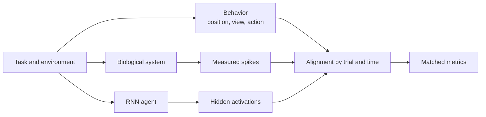
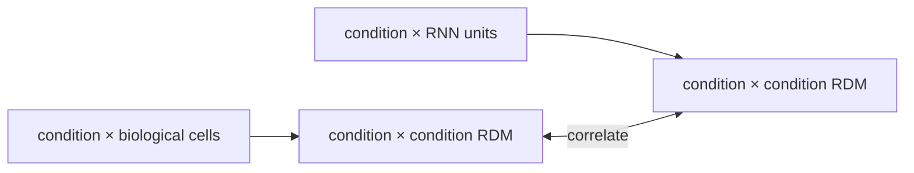

# Neural–Agent Learning and Action Plan

> **Pre-pivot curriculum retained as supporting material.** Measurement,
> validation, place/view controls, and population-analysis lessons remain useful,
> but the staged RNN-comparison plan and eight-week sequence are deprecated.
> Follow [`docs/getting-started-tasks.md`](../docs/getting-started-tasks.md) for
> current execution, [`docs/research-questions.md`](../docs/research-questions.md)
> for H1/H2, and [`docs/analysis-contract.md`](../docs/analysis-contract.md) for
> required cue-period population and subsequent-path data.

This was a just-in-time curriculum for the pre-pivot neural–agent comparison.
The goal was to become able to build, criticize, and explain one careful
comparison between hippocampal recordings and an RNN agent.

## The mental model



We do **not** directly compare “a neuron” with “an artificial neuron.” We compare
what information each population expresses about matched task variables, how
that information is geometrically organized, and eventually how perturbations
change behavior.

## What to learn, in order

### Stage 1 — Understand the measurement

**Question:** What is actually in a neural-data file?

Learn:

- an extracellular electrode measures voltage, not thoughts or place fields;
- spike detection and spike sorting turn voltage events into putative cells;
- a spike train is a sequence of event times;
- binning converts events into sparse counts;
- trial markers align neural time to behavioral time;
- in this repo, `ViewAndPlaceRepresentationNew` in
  `Hippocampus.jl/src/replay.jl` aligns `Spiketrain` timestamps to Ripple trial
  markers and the Unity/raytrace 1 ms behavioral samples;
- its current default begins at trial marker `2`, ends at marker `3`, and can
  retain only fixation samples;
- the received 20 ms files are downstream, heavily processed outputs rather
  than that raw 1 ms alignment.

ML analogy:

```text
raw voltage → detection/sorting → spike timestamps → 20 ms counts
raw text    → tokenizer          → token IDs        → model batches
```

The analogy is useful for pipeline structure, but spike sorting is an uncertain
measurement process rather than a deterministic tokenizer.

Actionables:

- [ ] Ask whether spike sorting and manual curation are final.
- [ ] Ask which cells were recorded simultaneously.
- [ ] Explain `spikecounts[t][k]` and `bins[t][k]` without looking at notes.
- [ ] Write down which values are measured, preprocessed, and inferred.
- [ ] Confirm what preprocessing configuration hash `f1526be5` means.
- [ ] Re-read `context/code-map.md` and trace how Ripple markers, Unity samples,
  fixation filtering, and spike timestamps lead to the received 20 ms export.

Done when:

> I can trace one plotted firing rate back to counted spikes, occupancy samples,
> trial alignment, and upstream assumptions.

### Stage 2 — Understand spatial tuning

**Question:** Does a cell respond reproducibly at particular locations?

Learn:

- occupancy: time spent in each spatial bin;
- rate map: spike count divided by occupancy time;
- place field: a spatial region with elevated, reproducible firing;
- why low-occupancy bins produce unstable high rates;
- smoothing as an analysis choice, not a source of new evidence;
- train/test map stability and spatial-information scores;
- why heading, view, speed, goal, and trial time can confound position.

Core calculation:

```text
occupancy_s[b] = number_of_20ms_samples[b] × 0.020
rate_hz[b]     = total_spikes[b] / occupancy_s[b]
```

Actionables:

- [x] Visualize occupancy and occupancy-normalized rate for one cell.
- [ ] Determine whether bin `0` is valid, outside-maze, or missing data.
- [ ] Obtain the bin-to-physical-coordinate lookup.
- [ ] Set and justify a minimum-occupancy threshold.
- [ ] Split by complete trials and calculate train/test rate-map correlation.
- [ ] Add a within-trial time-shift null that preserves temporal structure.

Done when:

> I can distinguish “this plot has a bright bin” from “this cell has stable
> place-related activity beyond an appropriate null.”

### Stage 3 — Build a population dataset

**Question:** Can cells be treated as one simultaneous population?

Learn:

- a population vector is all simultaneously observed cells at one time;
- ragged trials need a long table or padding plus a valid-time mask;
- cells from unrelated sessions are not simultaneous features;
- selected place cells are a positive-control subset, not an unbiased sample;
- adjacent 20 ms bins are correlated and not independent samples.

Target shapes:

```text
Long table:
trial_id, time_bin, cell_id, spike_count, spatial_bin_id, ...covariates

Masked array:
responses[trial, padded_time, cell]
valid_time[trial, padded_time]
```

Actionables:

- [ ] During the supervisor meeting, identify one session and which listed cell
  paths belong to its simultaneously recorded population.
- [ ] After access is confirmed, extend `scripts/data.py` with a manifest command
  that checks only those explicit expected paths on the mounted AFP (Apple
  Filing Protocol) share—no recursive server-wide search.
- [ ] Copy that bounded subset into `data/raw/`, then run
  `uv run python scripts/data.py manifest` to record local checksums.
- [ ] Verify identical `trialidx` and time-bin lengths across its cell files.
- [ ] Decide how missing cells/trials are represented; never silently fill them.
- [ ] Create the long table first; optimize to arrays only when needed.
- [ ] Obtain non-place-selected cells if population claims are intended.
- [ ] Produce per-cell and per-trial quality-control summaries.

Done when:

> I can identify one row/sample precisely and prove that population columns were
> observed on the same trial/time axis.

### Stage 4 — Decode task variables

**Question:** What task information is linearly accessible from each population?

Learn:

- encoding model: task variables predict neural/model activity;
- decoding model: neural/model activity predicts task variables;
- decoding demonstrates accessible information, not how the brain uses it;
- regularization controls high-dimensional small-sample fitting;
- evaluation splits define the scientific generalization claim;
- circular feature selection creates “double dipping.”

Actionables:

- [ ] Define whether position is a class, coordinates, or spatial distance error.
- [ ] Hold out complete trials; do not randomly split 20 ms rows.
- [ ] Fit a regularized linear/logistic baseline.
- [ ] Compare with occupancy/prior-only and shuffled-response baselines.
- [ ] Report uncertainty across trials, not only one aggregate score.
- [ ] Repeat the identical protocol on RNN hidden activations.

Done when:

> I can say exactly what was held out and what a decoder score does—and does
> not—show about a representation.

### Stage 5 — Compare representations without matching dimensions

**Question:** Are task conditions organized similarly in brain and model space?

Learn:

- population geometry: distances among task-condition representations;
- RSA: compare condition-by-condition dissimilarity matrices;
- linear CKA: compare centered representation similarity;
- CCA/PLS: find correlated linear subspaces;
- reduced-rank regression: test low-dimensional cross-prediction;
- matched samples or condition averages are required for cross-system alignment.



Quality gate before starting this stage:

- both biological and RNN loaders preserve trial/time identity;
- occupancy, missing-data, and bin-`0` rules are documented;
- each side has passed held-out decoding and null-control checks;
- RNN results are not based on a single favorable seed/checkpoint.

Actionables:

- [ ] Define matched conditions, initially spatial bins with enough occupancy.
- [ ] Build condition averages using training trials only.
- [ ] Compute held-out RSA as the first dimension-agnostic comparison.
- [ ] Add linear CKA only after confirming matched rows and centering choices.
- [ ] Compare against shuffled condition labels and behavior-only structure.
- [ ] Try CCA/RRR only with enough independent trials and nested validation.

Done when:

> I can explain whether a score reflects shared task geometry, direct
> cross-prediction, or merely shared dependence on position.

### Stage 6 — Move from similarity toward mechanism

**Question:** What computation does the RNN rely on, and does intervention
support that explanation?

Learn:

- RNN trajectories, dynamical systems, fixed points, and attractor-like dynamics;
- unit ablation versus subspace perturbation;
- causal intervention versus observational association;
- why biological observations can constrain a model without proving shared
  biological mechanism.

Actionables:

- [ ] Train or obtain multiple RNN seeds/checkpoints on the matched task.
- [ ] Identify a unit/subspace associated with a specific task variable.
- [ ] Predict a behavioral deficit before perturbing it.
- [ ] Ablate/patch the representation and test held-out task variants.
- [ ] Compare against random matched-size ablations.
- [ ] Use “mechanistic” only when intervention evidence supports the claim.

Done when:

> I can name the proposed internal computation, intervention, predicted effect,
> observed effect, and alternative explanations.

### Stage 7 — Extend from place to view and conjunctions

**Question:** Is activity explained by position, view/gaze, or their interaction?

Learn:

- allocentric place versus allocentric view and gaze-centered variables;
- fixation and raycast/view-bin preprocessing;
- additive models (`place + view`) versus interaction models
  (`place + view + place×view`);
- why correlated position and view can create false conjunctive selectivity.

Actionables:

- [ ] Obtain gaze/fixation, heading, and view/raycast labels on the shared axis.
- [ ] Fit held-out place-only, view-only, additive, and interaction models.
- [ ] Compare model improvements against time-shift and label-shuffle nulls.
- [ ] Run the same model family on RNN hidden activations.

This stage is deferred until the place-only pipeline and covariate alignment are
trustworthy; it remains a primary scientific target rather than a discarded
feature.

## Eight-week working sequence

This is ordered by dependency, not by calendar pressure.

| Week | Build | Learn/read | Concrete artifact |
| ---: | --- | --- | --- |
| 1 | Resolve schema questions | Measurement, spike counts, occupancy | Data dictionary and supervisor answers |
| 2 | Validate one-session files | Ragged alignment and quality control | Session manifest and long table |
| 3 | Place maps and null | Place fields, occupancy, time shifts | Held-out single-cell maps |
| 4 | Population decoder | Decoding, regularization, leakage | Trial-held-out biological baseline |
| 5 | RNN export parity | Hidden-state/time alignment | Matching model table and decoder |
| 6 | RSA | Representational geometry | Brain/model RDM comparison |
| 7 | CKA/RRR if justified | Similarity invariance and subspaces | Controlled alignment results |
| 8 | Perturbation design | RNN dynamics and causal claims | Mechanistic experiment proposal |

Do not advance because a week passed. Advance when the previous stage's “done
when” statement is true.

## Immediate next five actions

1. Bring the questions in `docs/supervisor-meeting-prep.md` to the meeting.
2. Confirm synchronized cell files, physical spatial coordinates, and bin `0`.
3. Read the first three items in `papers/reading-roadmap.md`.
4. Implement held-out-trial rate-map stability plus a time-shift null for one
   cell.
5. Only then pull/build one complete session population and attempt decoding.
