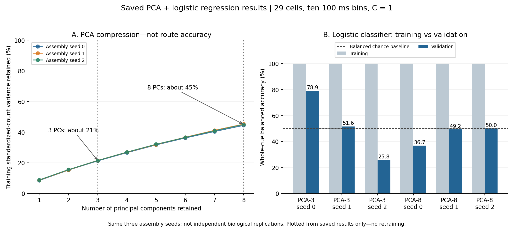

# PCA, the linear readout, and why below chance is not just class bias

**Status: current teaching companion for the historical V6–V9 benchmark.** Collated from the September 7 discussion and checked against saved results. No new biological fitting. The original holdout is not pristine. These are development-validation pseudopopulation results, not confirmatory H1 evidence or the later 30-class endpoint benchmark.

## 1. What was our model?

**PCA followed by L2-regularized logistic regression.** PCA reduced the cell vector in **each time bin** to 3 or 8 dimensions. Ten bins then gave the classifier **30 or 80 inputs**, not 3 or 8 whole-trial features.

The scientific question was whether cue activity distinguished subsequent observed paths within provisional endpoints **4→3**. The binary target was occurrence of directed component `D_N_R_T__N_R_M` among **all interior corridor traversals, after removing the first and last corridor runs**.

> **Terminology correction:** earlier conversational shorthand “absent from the route” is too broad and is superseded here. Absent means absent from the defined **interior**; it can still occur at the beginning/end of the path. The graph component exists in the fixed maze graph either way. We are not predicting whether an edge exists in the graph, reconstructing the whole route, or decoding intention.

## 2. PCA from first principles

One 100 ms bin is a vector of 29 cell spike counts. Across observations, some cells may vary together, so there may be redundant variation. PCA rotates the coordinates to find:

1. the direction of greatest training-data variance;
2. the greatest remaining variance direction perpendicular to the first;
3. further mutually perpendicular directions in descending variance order.

Each principal component is a **weighted combination of cells**, not a selected cell. For example, a hypothetical PC might increase when cells 1 and 2 fire more and cell 3 fires less. Keeping three PCs replaces 29 coordinates with three component scores.

PCA asks **which directions preserve variation**, not **which directions predict the target**. Cue timing, nuisance variation, and the label-conditioned pseudopopulation distribution can all shape its axes. A low-variance direction may contain useful path information that is discarded.

We first fitted a per-cell `StandardScaler` on training bins. This prevents firing scale alone from dominating PCA, but is itself a modeling choice: equalizing variance need not equalize signal quality. A standard matrix decomposition finds the principal directions. If `x` is the standardized cell vector and `W_d` contains the retained directions, the projected vector is `z = W_d.T @ x`.

PCA has no route-class prediction or cross-entropy objective. It was not trained for the 1,000 CEBRA updates. All means, scales and PCA directions were fitted on training data and then frozen for validation.

## 3. Exact tensor flow

```text
Primary input per split:
128 synthetic pseudotrials × 29 cells × 10 cue bins

PCA fitting, training only:
128 × 10 × 29 → 1,280 bin-level observations × 29 features

PCA-3:
128 × 29 × 10 → 128 × 10 × 3 → 128 × 30 classifier inputs

PCA-8:
128 × 29 × 10 → 128 × 10 × 8 → 128 × 80 classifier inputs
```

We fitted **one shared cell-space projection across all bins**, not ten unrelated PCAs. PCA-3 represents one cue as a ten-point sequence in 3D, not a single 3D point. The linear classifier can give different weights to different time bins.

The 1,280 bins are dependent observations. The primary panel contains **29 selected cells / 7 sessions / 104 real sources**, split into **82 training and 22 validation** sources. Each split's 128 pseudorows contains 64 rows per class and reuses those source pools. Same-session blocks stay together, but verified biological simultaneity is not established.

## 4. How prediction works

```text
Already-constructed validation pseudotrial
  → training-fitted per-cell normalization
  → frozen PCA applied to every bin
  → concatenate ten projected bins
  → training-fitted classifier-feature normalization
  → logistic regression
  → probability of interior-component presence
```

For flattened, standardized features `q`:

```text
score = intercept + weights @ q
p_present = 1 / (1 + exp(-score))
```

A 0.5 probability threshold gives the class decision. The sigmoid maps the linear score to a probability; it does not make the feature extractor nonlinear. Scaling and PCA are affine/linear, so the combined decision score is still linear in the original counts, with coefficients restricted by the retained PCA subspace.

The primary readout used `C=1`, `class_weight="balanced"`, `solver="liblinear"`, and `max_iter=1000`. V8b also examined stronger L2 via `C=.1` and `.01` without selecting a validation winner. The primary C=1 PCA readouts each recorded **seven solver iterations**; 1,000 was a ceiling, not the actual iteration count.

PCA itself does not receive path labels. **Assembly does:** even validation pseudorows require their true future condition to choose source blocks. This is not an operational unknown-label real-trial decoder or a wholly label-free pipeline.

## 5. What happened in training and validation?



The left panel shows retained **standardized training-count variance**, not route accuracy or percentage of brain activity explained. Three PCs retained **21.2–21.5%**; eight retained **44.4–45.2%**. The dimensions were fixed comparison settings, not selected for 90% explained variance or a validation win.

The right panel shows the primary C=1 classifier results:

| Model | Training BA, each seed | Validation seed 0 | Seed 1 | Seed 2 | Validation mean |
| --- | ---: | ---: | ---: | ---: | ---: |
| PCA-3 + logistic | 100% | 78.9% | 51.6% | 25.8% | 52.1% |
| PCA-8 + logistic | 100% | 36.7% | 49.2% | 50.0% | 45.3% |

Balanced chance is 50%. Seeds change assembly/refitting using the same underlying source pools; they are **not epochs, new splits, animals, or biological replications**. Eight PCs preserve more variation but do not predict better. PCA's variance objective and the classifier's prediction objective are different.

PCA-3 training log loss was about .011–.013; validation was **.373, 1.017, 2.596**. Lower is better; a constant probability .5 gives about .693. The training fit is excellent, but generalization is unstable. No epoch-by-epoch PCA loss trace was saved: this was a decomposition, not neural-network optimization.

## 6. Does below chance mean “mostly predicts absent”?

**No. Most model averages in the original comparison are below the 50% validation baseline, but class preference alone is not the explanation.**

```text
Balanced accuracy = (recall_present + recall_absent) / 2
```

| Strategy | Present recall | Absent recall | BA |
| --- | ---: | ---: | ---: |
| Always absent | 0% | 100% | 50% |
| Always present | 100% | 0% | 50% |
| Every label reversed | 0% | 0% | 0% |

The validation pseudopopulation is balanced (64 present, 64 absent), so ordinary accuracy equals BA here. Below-chance BA means the hard predictions are associated with the labels in the wrong direction on these evaluated rows. A finite random guess need not score exactly 50%; 50% is its expectation and the constant classifier's BA.

The saved **CEBRA-Time-3** predictions illustrate three different failure patterns behind one roughly 31% mean bar:

| Assembly seed | TP | FN | TN | FP | Predicted absent | BA |
| --- | ---: | ---: | ---: | ---: | ---: | ---: |
| 0 | 55 | 9 | 0 | 64 | 9/128 (7.0%) | 43.0% |
| 1 | 0 | 64 | 64 | 0 | 128/128 (100%) | 50.0% |
| 2 | 0 | 64 | 0 | 64 | 64/128 (50%) | 0.0% |

“Positive” means interior-component present. Seed 0 mostly predicts **present**. Seed 1 always predicts **absent**. Seed 2 predicts both classes equally but reverses every label. There is no single consistent absent bias across these fits.

Seed 1 also had AUROC **.946289**, despite every probability being below .5: good ranking on that constructed validation distribution, poor thresholded decisions. This is not reproducible ranking evidence across seeds; Time-3 seed 0/2 AUROC was **.022217/0**. Do not describe all these failure modes as equivalent or conclude that BA=.5 always means no ranking information.

## 7. Interpretation and what not to “fix” after seeing results

The training relationship did not transfer reliably to the source-disjoint validation pools. Sparse support, distribution differences and overfitting are possible contributors; these scores do not prove one cause or absence of prospective biology.

- The original plot's whiskers show the **three-seed range, not confidence intervals**. Pseudorows reuse 22 validation sources; a simple independent-128-row significance calculation is not justified.
- Reversing the 0%-accuracy run would give 100% on the same rows. Choosing that reversal after seeing their labels is post-hoc fitting, not validated improvement.
- Picking a threshold, seed, bin or metric after validation inspection has the same selection problem. Learn such choices within a declared training/development procedure and evaluate them on observations not used for choosing them; original holdout exposure still prevents a pristine confirmation claim here.
- Later path-generalization work tests source-pool transfer more directly. Do not silently substitute these original three-seed results for that later study or mix them with the easier 30-class endpoint task.

## 8. Evidence, preservation and scope

Implementation: [V7/V8 PCA and readout](../scripts/place195_v7_v8_neural_experiments.py), functions `run_decoders` and `fit_predict`; [V8b diagnostics](../scripts/place195_v8b_v9_cebra.py), functions `feature`, `fit_logreg`, and `v8b_regularization`. Main chronology: [V6–V9 report](../docs/reports/place195-v6-v9-autoresearch-20260906.md).

Accepted local root: `outputs/prospective_path_first_run/place195-v6-v9-autoresearch-20260906/`.

- Variance: `v7-v8-neural-experiments/primary29_min3train_min1val/bin100ms/train_only_pca_seed{0,1,2}.npz`.
- PCA scores: `v8b-v9-cebra-final-20260905T224554Z/v8b/v8b_regularization_metrics.csv`, selecting `C=1`, `pca_cellspace_3`/`pca_cellspace_8`.
- Confusions/ranking: that final directory's `v9/v9_cebra_predictions.csv` and `v9_cebra_metrics.csv`, selecting validation, `cebra_time`, dimension 3.

The curated figure is tracked so this lesson does not depend on a temporary HTTP server. The original [plot-builder source](archive/pca-explainer-build-20260907.py) is retained **byte-for-byte as archival code**, not a new supported entry point. It uses historical absolute input paths and writes `/tmp/pi-teach` views; those temporary links are superseded by this document. Review destinations before executing; it plots saved results, does not fit models, and requires the recorded NumPy/Matplotlib research runtime. Its built-in assertions check saved score/variance agreement. No raw data, checkpoint, or environment is embedded in this lesson.
