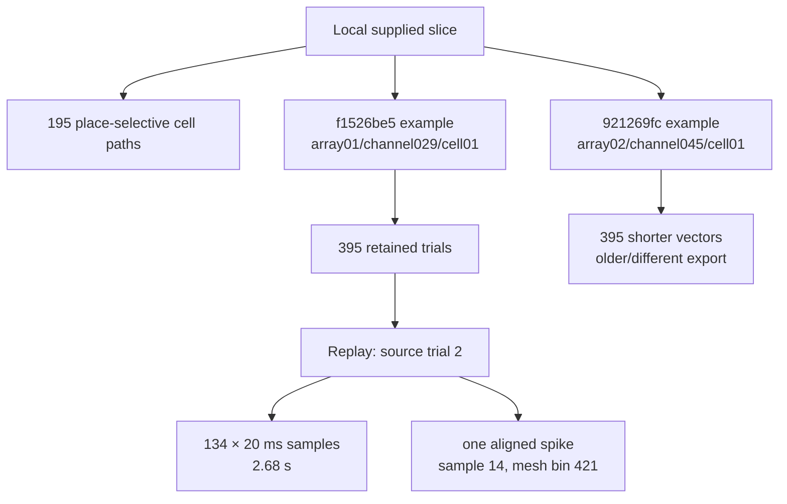
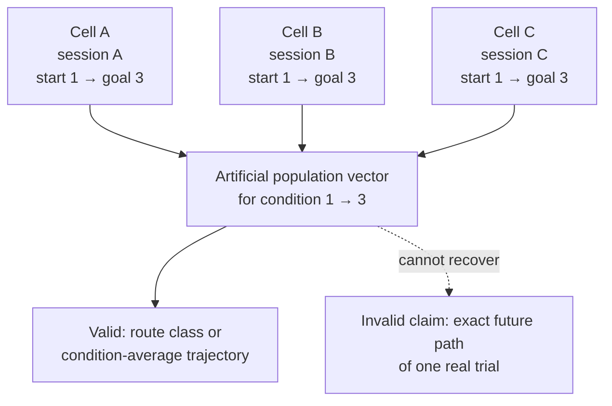
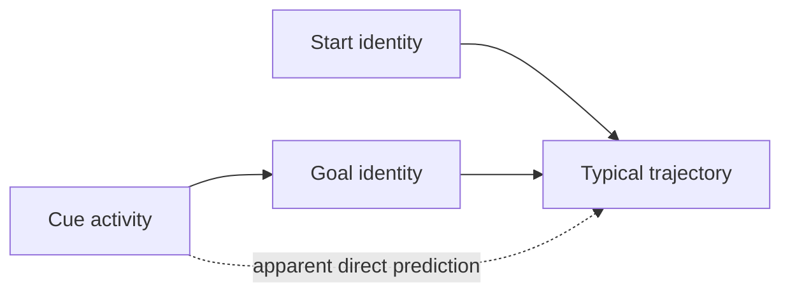
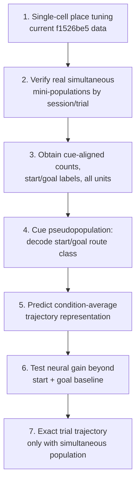

# Session: Spatial Mesh, Replay, and Pseudopopulations

> **Historical pre-pivot session.** Its verified mesh and pseudopopulation
> constraints remain valid, but its priorities and physical-path use of
> “trajectory” were superseded by the
> [2026-08-17 alignment](2026-08-17-prospective-path-hypothesis-alignment.md).
> Current terminology, H1/H2, and data requirements live in
> [`docs/research-questions.md`](../../docs/research-questions.md) and
> [`docs/analysis-contract.md`](../../docs/analysis-contract.md).

**Date:** 2026-08-10
**Project at the time:** hippocampal navigation × Unity/RNN representational analysis

## Session goal

Understand the supplied place-bin files well enough to visualize a real trial,
verify the Julia spatial indexing, and decide what population-level analyses the
data can support.

## Source-status key

- **Verified data:** directly inspected in the local JLD2 files.
- **Verified code:** traced or executed from the Julia implementation.
- **Historical:** reported by the previous student's write-up/code.
- **Inference:** scientifically plausible but not directly established.
- **Unknown:** requires confirmation or additional data.

## What the local data contains

The best-verified file is one selected neuron observed across many trials—not a
simultaneously recorded neural population.



### Main `f1526be5` example — verified data

| Property | Value |
| --- | ---: |
| Cells represented | 1 |
| Retained trials | 395 |
| Total 20 ms samples | 65,576 |
| Median samples/trial | 163 |
| Total spikes | 1,441 |
| Median / mean spikes per trial | 3 / 3.65 |
| Spike range per trial | 0–19 |
| Observed IDs | 452 valid mesh IDs plus `0` |

Per trial, the two vectors are aligned:

```text
bins[t][k]        = spatial mesh ID at 20 ms sample k
spikecounts[t][k] = spikes from this cell during the same sample
```

Ordered `bins[t]` therefore forms a coarse trajectory. Repeated IDs mean that
the subject remained in the same spatial patch for multiple samples.

### Why the replay looked almost spikeless

The replay displays one trial from one neuron. The source data contains exactly
one spike:

```text
sample index: 14
time:         approximately 0.28 s
mesh ID:      421
count:        1
```

The replay originally exposed this mainly through a brief numeric readout and a
pink marker, so it was easy to miss. Sparse activity here is expected: a single
place-responsive neuron usually fires only near its preferred region. This
should not be confused with the activity of a many-neuron population.

### Second `921269fc` example

This file contains 395 vectors and 2,308 spikes but only 7,909 vector entries
(median 19 per vector). It does not record the same generation hash, fields, or
verified 20 ms semantics as `f1526be5`.

**Decision:** do not stack the two examples. Treat `921269fc` as an older or
possibly compressed representation until its export semantics are confirmed.

## Spatial-mesh ordering verification

The Julia export does not store literal row-major 40 × 40 IDs. It stores
1-based indices into the refined navigable-floor mesh.


The geometry still lies on 40 × 40 lattice centers:

```text
40 × 40 nominal cells             1,600
four pillar footprints: 4 × 8 × 8  -256
navigable mesh elements            1,344
```

`QuadRefinement` emits child patches grouped by parent element rather than by
row and column. Therefore this is invalid for the current JLD2:

```python
row, column = divmod(mesh_id - 1, 40)  # wrong
```

Correct route:

```text
mesh ID → centroid(mesh[ID]) → (x, y)
```

The first replay trajectory independently validated this result:

| Interpretation | Median transition | Maximum transition |
| --- | ---: | ---: |
| Reconstructed mesh centroids | 0.625 | 1.398 |
| Incorrect row-major `divmod` | 1.875 | 23.758 |

The row-major interpretation creates implausible jumps across almost the whole
25-unit maze. See
[`notes/data_inspection/spatial_bin_ordering.md`](../data_inspection/spatial_bin_ordering.md)
for the detailed reconstruction and package-version caveat.

## Pseudopopulation discussion

### What a pseudopopulation does

A pseudopopulation concatenates neural features recorded in different sessions
by matching a shared condition. It can estimate condition-level information,
but it is not an observed simultaneous population state.



ML analogy: concatenating feature dimensions from different examples with the
same label may recover a class prototype. It does not create the hidden state of
one actual example.

### Cue phase versus navigation phase

Cue phase is easier to align across sessions because it is a fixed-duration,
event-locked interval. Navigation varies in duration, speed, and trajectory, so
matching cells by elapsed time would combine different physical states.

However, the current `f1526be5` export begins at marker `2`, cue offset. It does
not contain the one-second cue phase or cue/goal labels. A separate cue-aligned
export is required.

The previous student historically assembled 233 cells into 314 cue/inter-trial
pseudotrials by matching ordered start–goal conditions. Those cells and
pseudotrials are not identical to the current 195-cell place-selected list.

## Proposed question: cue activity → future trajectory

This is possible at two different claim levels.

### Supported with a cue pseudopopulation

```text
cue activity → start/goal or route condition
cue activity → condition-average trajectory template
```

Possible trajectory targets include:

- one of the 30 ordered start–goal conditions;
- coarse future occupancy map;
- maze-sector or waypoint sequence;
- turn sequence;
- low-dimensional trajectory embedding learned from training data only.

### Requires a real simultaneous population

```text
same real trial
├── cue activity from simultaneously recorded cells
└── that trial's exact subsequent trajectory
```

A cross-session pseudopopulation cannot predict trial-specific pauses, errors,
or deviations because its component cells belong to different actual trials.

## Central scientific confound

Start and goal may largely determine the route, while cue activity is already
known to contain goal information. Therefore:



Successful prediction alone would not establish a prospective trajectory code.
The critical comparison is:

```text
baseline: future trajectory ~ start + goal
neural:   future trajectory ~ start + goal + cue activity
```

A within-start–goal permutation test should ask whether cue activity predicts
trajectory variation beyond condition identity. With a pseudopopulation, this
can support only condition-level conclusions; genuine within-condition,
trial-specific prediction needs simultaneous cells.

## Recommended analysis ladder



Validation requirements:

- split complete source trials, never random 20 ms rows;
- keep bootstrapped copies of a source trial in one fold;
- fit trajectory embeddings and preprocessing inside training folds;
- balance start–goal conditions;
- shuffle neural features within start–goal condition;
- do not interpret pseudopopulation correlations as biological noise
  correlations or circuit connectivity;
- clearly label the current 195-cell list as place-selected.

## Decisions from this session

1. Treat current `spatial_bin_id` as a categorical mesh index, not an ordinal or
   row-major scalar.
2. Use reconstructed centroids for XY visualization and Euclidean errors.
3. Treat the replay as one sparse cell, not representative population activity.
4. Do not combine the two local example hashes without format reconciliation.
5. Prefer cue phase for the first pseudopopulation because it is event-aligned.
6. Limit cue-pseudopopulation trajectory claims to route class or
   condition-average trajectory.
7. Require simultaneous cells for exact trial-specific future-trajectory
   prediction.

## Artifacts produced or updated

- [`docs/dataset-card.md`](../../docs/dataset-card.md): canonical dataset facts
  and limitations.
- [`docs/dataset-explainer.html`](../../docs/dataset-explainer.html): interactive
  data-shape and real-trajectory visualization.
- [`notes/data_inspection/spatial_bin_ordering.md`](../data_inspection/spatial_bin_ordering.md):
  executed mesh-order verification.
- Commit `69a3997`: `Document and visualize spatial mesh ordering`.

## Data to request next

A cue-to-trajectory analysis needs:

```text
cell_id
session_id
simultaneous_recording_group
source_trial_id
cue_onset and cue_offset
cue-aligned spike counts
start_id and goal_id
future XY or spatial-bin trajectory
success/timeout and reward
all recorded units, not only selected place cells
```

Also request the authoritative mesh lookup or generation manifest and explicit
confirmation of the meaning of spatial bin `0`.

## Suggested next session

1. Draft the exact cue-aligned export schema for the professor.
2. Define one primary trajectory target and one baseline.
3. Decide whether the first result is route classification or trajectory-template
   regression.
4. Write a leakage-safe pseudopopulation construction protocol before modeling.
5. Design the matched RNN analysis using the same cue window, targets, and
   validation splits.
