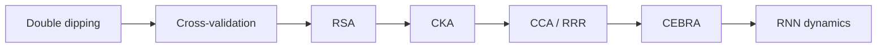

# Reading Roadmap: Hippocampal Data to RNN Comparison

> **Pre-pivot roadmap retained as supporting reading.** The active thesis core is
> prospective cue-period path information (H1); brain–RNN comparison is now H2,
> a stretch aim after H1 feasibility. Start with
> [`docs/research-questions.md`](../docs/research-questions.md),
> [`docs/analysis-contract.md`](../docs/analysis-contract.md), and
> [`docs/getting-started-tasks.md`](../docs/getting-started-tasks.md). Treat the
> RSA/CKA/RNN sections below as H2-stage reading, not immediate priorities.

Read for decisions, not completion. For each paper, answer:

1. What question does the method answer?
2. What array/table does it require?
3. What null or held-out evaluation makes the claim credible?
4. What can it **not** establish?
5. What will we borrow for this project?

Do not store publisher PDFs here by default. Links and original notes are enough.

## Place-cell primer — Read first

### O'Keefe & Dostrovsky: the original observation

**Paper:** O'Keefe & Dostrovsky (1971), “The hippocampus as a spatial map.”
**Link:** <https://doi.org/10.1016/0006-8993(71)90358-1>
**Read:** Abstract and reported relationship between unit firing and location.
Use a modern review or lab explanation for current terminology and methods.

Knowledge to extract:

- place-cell evidence began as location-associated firing during behavior;
- a place field is an empirical tuning pattern, not a directly observed map in
  the animal's mind;
- modern claims require occupancy correction, stability, and controls that were
  developed beyond this historical paper.

## Priority A — Read before the first population analysis

The sections below are grouped by method, but the beginner reading order is
**2 → 3 → 1**: first learn leakage, then cross-validation, then RSA. This matches
the dependency diagram at the end.

### 1. Representational Similarity Analysis

**Paper:** Kriegeskorte, Mur & Bandettini (2008), “Representational similarity
analysis—connecting the branches of systems neuroscience.”
**Link:** <https://doi.org/10.3389/neuro.06.004.2008>
**Read:** Abstract, Figure 1, the representational dissimilarity matrix (RDM)
sections, and discussion.

Why now:

- It gives us the cleanest answer to unequal numbers of biological cells and RNN
  units.
- Both systems are converted into distances among the same task conditions.
- It prevents premature one-neuron-to-one-unit matching.

Knowledge to extract:

```text
biological condition × cells → condition × condition RDM
RNN condition × units        → condition × condition RDM
compare the two RDMs
```

Method to borrow:

- define matched conditions, initially adequately sampled spatial bins;
- estimate condition representations on training trials;
- compare RDMs on held-out data;
- shuffle condition labels for a null distribution.

Caveat:

A shared RDM can arise because both systems encode the same obvious behavioral
variable. It is representational similarity, not proof of a shared algorithm.

### 2. Circular analysis / double dipping

**Paper:** Kriegeskorte et al. (2009), “Circular analysis in systems
neuroscience: the dangers of double dipping.”
**Link:** <https://doi.org/10.1038/nn.2303>
**Read:** Abstract, introductory examples, and recommendations.

Why now:

Our 195-cell list is already selected for place responsiveness. If we use the
same data to select cells, tune analysis settings, and report performance, the
result will be optimistic.

Knowledge to extract:

- selection and evaluation must use independent data;
- preprocessing choices can leak test information;
- a place-selected population is valid as a positive control but not for
  estimating the prevalence of place coding.

Method to borrow:

- split complete trials before fitting thresholds, maps, or models;
- fit smoothing, occupancy cutoffs, and model hyperparameters using training
  data only;
- request a complete/non-selected cell population.

### 3. Cross-validation with small samples

**Paper:** Varoquaux (2018), “Cross-validation failure: Small sample sizes lead
to large error bars.”
**Link:** <https://doi.org/10.1016/j.neuroimage.2017.06.061>
**Read:** Abstract, simulations/results on error bars, recommendations.

Why now:

Although one file has 65,576 time bins, adjacent bins are correlated. We have
395 trials, and likely fewer independent trajectories/conditions.

Knowledge to extract:

- many rows do not imply many independent samples;
- model rankings can be unstable at small effective sample size;
- uncertainty across resampled trials/sessions matters.

Method to borrow:

- hold out complete trials or trajectories;
- report fold/trial uncertainty rather than only a mean score;
- use nested validation for hyperparameters;
- prefer regularized low-capacity baselines.

## Priority B — Read while building brain/RNN parity

### 4. CKA and representation similarity

**Paper:** Kornblith et al. (2019), “Similarity of Neural Network
Representations Revisited.”
**Link:** <https://proceedings.mlr.press/v97/kornblith19a.html>
**Read:** Introduction, desiderata/invariance section, CKA definition, and
limitations/discussion.

Why it matters:

Linear CKA compares representation matrices with different feature dimensions,
which suits `cells != hidden_units`.

Knowledge to extract:

- what transformations should leave a similarity score unchanged;
- why invariance to every invertible linear transformation can be undesirable;
- why rows must still refer to matched samples or conditions;
- how centering and sample count affect the estimate.

Method to borrow:

- use linear CKA after trial/time or condition alignment is verified;
- report exactly what constitutes a row;
- include shuffled-condition and behavior-only controls.

Caveat:

High CKA does not identify corresponding units and is not a causal result.

### 5. SVCCA and shared subspaces

**Paper:** Raghu et al. (2017), “SVCCA: Singular Vector Canonical Correlation
Analysis for Deep Learning Dynamics and Interpretability.”
**Link:** <https://papers.nips.cc/paper/7188-svcca-singular-vector-canonical-correlation-analysis-for-deep-learning-dynamics-and-interpretability>
**Read:** Method overview and the role of SVD before CCA.

Why it matters:

It demonstrates comparison through correlated subspaces rather than individual
units. That is conceptually close to the proposed biological/RNN bridge.

Knowledge to extract:

- SVD removes low-variance/noisy directions;
- CCA finds maximally correlated linear projections;
- flexible alignment can overfit when dimensions are large relative to samples;
- learned alignment must be evaluated out of sample.

Method to borrow later:

Use CCA/PLS only after RSA/CKA and only on paired condition averages or matched
trajectories with nested validation.

### 6. Reduced-rank predictive subspaces

**Paper:** Semedo et al. (2019), “Cortical Areas Interact through a
Communication Subspace.”
**Link:** <https://doi.org/10.1016/j.neuron.2019.01.026>
**Read:** Conceptual introduction, reduced-rank regression method, cross-validated
rank selection, and interpretation.

Why it matters:

Reduced-rank regression tests whether prediction occurs through a smaller shared
subspace. This is closer to a falsifiable cross-prediction question than merely
visualizing two embeddings.

Knowledge to extract:

- predictive dimensionality differs from total dimensionality;
- reduced rank is a regularizer and scientific hypothesis;
- rank and prediction must be cross-validated;
- the original paper studies communication between biological areas, so our
  cross-system use is an analogy, not the same causal claim.

## Priority C — Read after linear baselines work

### 7. CEBRA

**Paper:** Schneider, Lee & Mathis (2023), “Learnable latent embeddings for
joint behavioural and neural analysis.”
**Link:** <https://doi.org/10.1038/s41586-023-06031-6>
**Read:** Main method figure, contrastive objective, behavioral-label variants,
and consistency/decoding evaluation.

Why later:

CEBRA can learn nonlinear low-dimensional embeddings conditioned on behavior,
but that flexibility makes controls and held-out validation more important.

Knowledge to extract:

- how positive/negative pairs are constructed;
- how behavior labels shape the learned geometry;
- how consistency is evaluated across datasets/models;
- which conclusions depend on decoding versus visualization.

Gate before use:

- multiple aligned trials and preferably sessions;
- linear/RSA baselines already established;
- held-out behavior decoding and shuffle controls;
- seed and embedding-dimension sensitivity.

### 8. Task-trained RNNs as neuroscience models

**Paper:** Barak (2017), “Recurrent neural networks as versatile tools of
neuroscience research.”
**Link:** <https://doi.org/10.1016/j.conb.2017.06.003>
**Read:** Full review; it is short.

Knowledge to extract:

- an RNN is a hypothesis about computation under a task objective, not a literal
  brain replica;
- task, architecture, optimization, and constraints all affect the resulting
  representation;
- similarity to data is stronger when the model predicts new observations.

Question for our project:

Which parts of the Unity task and training objective are intended to model the
animal experiment, and which are engineering conveniences?

### 9. Dynamical analysis of trained RNNs

**Paper:** Sussillo & Barak (2013), “Opening the Black Box: Low-Dimensional
Dynamics in High-Dimensional Recurrent Neural Networks.”
**Link:** <https://doi.org/10.1162/NECO_a_00409>
**Read:** Fixed-point method, examples, and discussion.

Why last:

This becomes useful when we have a trained RNN and want to move from “the hidden
state contains position” toward “the network implements a particular dynamical
computation.”

Knowledge to extract:

- RNN activity is a trajectory governed by recurrent dynamics;
- fixed and slow points can organize computation;
- a mechanistic account should predict effects of perturbing states/subspaces;
- model interventions still do not prove identical biological circuitry.

## Optional neighboring papers

Read only when a concrete analysis needs them:

- Skaggs et al. (1993), “An information-theoretic approach to deciphering the
  hippocampal code.” Useful when implementing spatial information, but first
  verify the exact formula and null procedure used by the lab.
- Gallego et al. (2020), “Long-term stability of cortical population dynamics
  underlying consistent behavior.” Neighboring evidence for stable latent
  dynamics despite unit-level variability.
  <https://doi.org/10.1038/s41593-020-0633-x>
- Degenhart et al. (2020), “Stabilization of a brain–computer interface via the
  alignment of low-dimensional spaces of neural activity.” Relevant if aligning
  changing cell populations across sessions.
  <https://doi.org/10.1038/s41551-020-0542-9>

## Reading order and output



For each Priority A/B paper, add five bullets beneath its section or in a dated
note:

```text
question answered:
required data shape:
validation/null:
claim not supported:
project decision:
```

Do not read CEBRA or transformer papers as a substitute for building the first
occupancy-controlled, held-out linear baseline.
